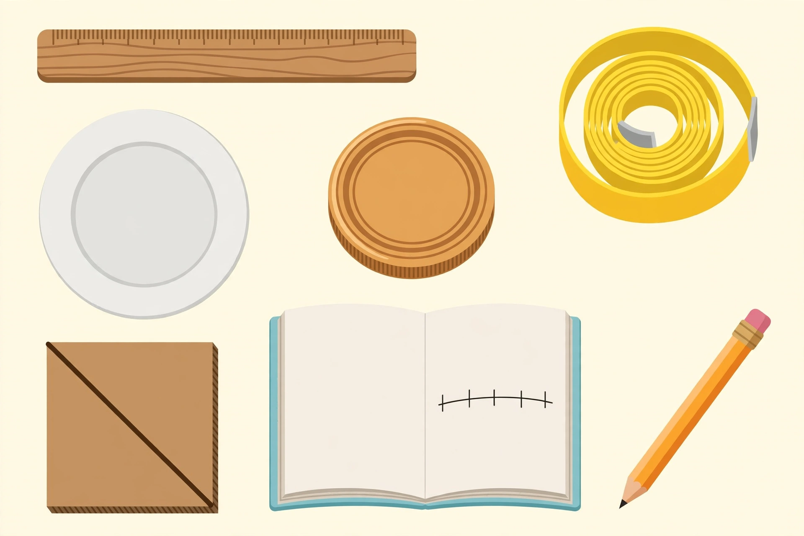

# Project — Irrational Measures

**Sessions 12 and 14** · Adult-supervised · Household materials ·
Deliverable: data table + one-page report with a labeled diagram

## The question

√2 and π are irrational — their decimals never end. But carpenters,
engineers, and bakers use them every day. How? In this investigation you
will *measure* your way to √2 and π, and find out exactly what a
measurement can and cannot tell you about an irrational number.

*Caption: An AI-generated illustration of the investigation station — a
ruler, a coiled tape measure, a dinner plate, a jar lid, a square tile with
a drawn diagonal, an open notebook with an unlabeled tick-mark line, and a
pencil. Which tool measures which quantity?*
*Alt text: "Top-down cartoon illustration of a desk with a wooden ruler, a
coiled yellow tape measure, a white dinner plate, a round jar lid, a square
cardboard tile with a diagonal line, an open notebook showing a horizontal
line with plain tick marks, and a pencil."*
*Text-only alternative: the station holds seven items — a wooden ruler, a
coiled tape measure, a dinner plate, a jar lid, a square cardboard tile
with a diagonal drawn corner-to-corner, an open notebook with an unlabeled
tick-mark line, and a pencil.*

## Materials

- Ruler and tape measure (or a piece of string + ruler for circumferences)
- 3 square objects (cardboard squares, tiles, book covers — measure the
  side first; sides of 5, 10, and 15 cm work well if you cut them yourself)
- 3 round objects (dinner plate, jar lid, can)
- Notebook, pencil, calculator
- The adult supervises measuring and checks the table before Part 2

## Part 1 — Measure and record (Session 12, ~45 min)

**Squares → √2.** For each square: measure the side s (cm, to the nearest
mm) and the diagonal d (cm, to the nearest mm). Compute d ÷ s.

| Square | Side s (cm) | Diagonal d (cm) | d ÷ s |
|---|---|---|---|
| 1 | | | |
| 2 | | | |
| 3 | | | |

*Why this works:* a square of side s has diagonal s√2 (Lesson 04's
geometry, formalized in U07 with the Pythagorean Theorem) — so d ÷ s
should be close to √2 ≈ 1.4142 no matter how big the square is.

**Circles → π.** For each round object: measure the diameter across the
middle (cm, to the nearest mm) and the circumference (wrap the string
around, mark it, measure the string). Compute C ÷ d.

| Object | Diameter d (cm) | Circumference C (cm) | C ÷ d |
|---|---|---|---|
| 1 | | | |
| 2 | | | |
| 3 | | | |

*Why this works:* circumference ÷ diameter is π for every circle —
π ≈ 3.1416 no matter the size.

**Record** both tables in the notebook. The adult checks measurements
before Session 14 (re-measure anything that looks off by more than a few
millimeters).

## Part 2 — Analyze and present (Session 14, ~45 min)

1. **Compare:** how close are your three d ÷ s values to each other? To
   1.4142? How close are your three C ÷ d values to each other? To 3.1416?
2. **Explain the gap:** your ratios are decimals with 2–3 digits, but √2
   and π have infinitely many. Where did the rest of the digits go? (Think
   about the nearest-millimeter measuring limit.)
3. **The key question:** could *perfect* measuring — down to atoms —
   reveal all the digits of π? Explain using what you know about
   irrational numbers. (No: a measurement is always a finite decimal, i.e.
   rational; no finite process can produce π's infinite non-repeating
   expansion. We can get *closer*, never *exact*.)
4. **Report:** one page with (a) both tables, (b) a labeled diagram of one
   square and one circle showing what was measured, (c) answers to 1–3 in
   complete sentences, (d) one sentence on why engineers use 3.14 or 1.414
   instead of the "exact" value.

## Rubric

| Criterion | 4 — Strong | 3 — Proficient | 2 — Developing | 1 — Starting |
|---|---|---|---|---|
| Measurement technique | All 12 measurements to nearest mm; method described (string for circumference) | 10–11 to nearest mm; method mostly described | Measurements present but coarse (nearest cm) or method unclear | Missing measurements or no method |
| Arithmetic | All 6 ratios computed correctly; compared with 1.4142 and 3.1416 | 4–5 correct; comparisons present | 2–3 correct; comparison attempted | Ratios missing or largely wrong |
| Reasoning about precision | Explains the digit gap via measuring limits AND the finite-decimal/rational argument for #3 | Explains the digit gap via measuring limits; #3 partially addressed | Says "measurements aren't exact" without connecting to irrationality | No explanation of the gap |
| Communication | Tables complete and labeled; diagram labeled; complete sentences; one engineering sentence | Tables/diagram present; minor labeling gaps | Tables or diagram missing; fragments | Report missing major parts |

**Scoring:** 14–16 = exceeds; 11–13 = meets (ready for Unit 02); 8–10 =
approaching (re-teach objectives 3–5); below 8 = re-teach before Unit 02.

## Safety and access notes

- Adult supervises all measuring; no climbing for high objects — choose
  tabletop items.
- Tactile alternative: measure with the string-and-knot method and compare
  lengths directly (which diagonal is longer?) before introducing numbers.
- If fine-motor measuring is a barrier, the adult measures while the
  learner directs ("measure across the middle") and records.
