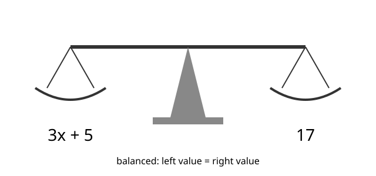

# Lesson 01 — An Equation Is a Question

**Goal (student-readable):** I can test whether a number is a solution
of an equation and explain why, using substitution.
**Time:** ~45 minutes · **Materials:** notebook, pencil, the
balance-scale diagram below.

## Readiness check

Evaluate `3x + 5` for `x = 4`. (Answer: `3(4) + 5 = 12 + 5 = 17`.)
If that feels shaky, warm up with two more evaluations before starting.

## Teaching

An equation says two expressions are equal. `3x + 5 = 17` is not a
fact — it is a **question**: *which number, put in place of `x`, makes
the left side actually equal 17?* A number that does is called a
**solution** of the equation. A number that does not is not a solution.
You never have to guess: put the number in, compute both sides, and
compare. That is called a **substitution check**.

Think of a balance scale. The equals sign is the pivot: whatever you do
to one side, you must do to the other, or the scale tips. Testing a
value is like putting a weight on the scale and seeing whether it
balances.

*Figure 1 — A balanced scale stands for a true equation. The left pan
holds the expression `3x + 5`; the right pan holds `17`. When `x = 4`,
both pans weigh 17 and the scale balances.*

**Text-only alternative:** The diagram shows a two-pan balance scale,
level. Left pan label: `3x + 5`. Right pan label: `17`. The caption
means: the equation is true exactly when the two pan values are equal.
For `x = 4`, the left pan computes to `3(4) + 5 = 17`, matching the
right pan, so the scale balances.

### Worked example 1

**Is `x = 4` a solution of `3x + 5 = 17`? Is `x = 5`?**

Put `x = 4` in: `3(4) + 5 = 12 + 5 = 17`. The left side equals the
right side, so `x = 4` **is** a solution.

Put `x = 5` in: `3(5) + 5 = 15 + 5 = 20`. 20 is not 17, so `x = 5`
**is not** a solution. One value can work while a nearby value fails;
that is why we test instead of guessing.

### Worked example 2

**Is `x = -2` a solution of `2(x − 3) = −10`? What about `x = 0`?**

For `x = -2`: `2(−2 − 3) = 2(−5) = −10`. That matches the right side,
so `x = -2` **is** a solution.

For `x = 0`: `2(0 − 3) = 2(−3) = −6`. −6 is not −10, so `x = 0`
**is not** a solution. Notice the parentheses: `x − 3` must be computed
before multiplying by 2. A common error is to compute `2x − 3` instead.

## Guided practice

Work these with the adult; say each substitution out loud.

1. Test `x = 7` in `5x − 8 = 27`.
2. Test `x = 3` in `4x + 9 = 21`. Then test `x = 4` in the same equation.
3. Test `x = -3` in `2x + 10 = 4`.
4. Test `m = 6` in `3(m + 2) = 24`.
5. Explain in one sentence why `x = 2` cannot be a solution of
   `x + 9 = 12` without computing anything else. (Hint: what does
   `2 + 9` equal?)

## Independent practice

1. Test `x = 5` in `7x − 9 = 26`.
2. Test `x = -4` in `3x + 20 = 8`.
3. Test `y = 8` in `2(y − 5) = 6`.
4. Test `y = 3` in `2(y − 5) = 6`. What does the pair of results in
   items 3–4 tell you?
5. Test `n = 10` in `n/2 + 7 = 12`.
6. Test `n = 12` in `n/2 + 7 = 12`.
7. A gym charges a $15 joining fee plus $20 per month. The total after
   `m` months is `20m + 15`. Test whether `m = 5` gives a total of $115.
8. **Explain your reasoning:** Maya says, "I tested `x = 1` in
   `4x + 3 = 7` and it worked, so the equation has exactly one
   solution." Is her conclusion justified from that one test alone?
   Why or why not?

## Application

Write one equation of your own in the form `ax + b = c` with whole
numbers, choose a value that IS a solution, and choose a value that is
NOT a solution. Show both substitution checks. Trade with the adult:
can they tell which value you designed as the solution before reading
your checks?

## Exit check

Is `x = 6` a solution of `2x + 7 = 19`? Show the substitution.

## Supports, alternate modes, extension

- **Language access:** "Solution" here means "the number that makes
  the equation true" — not "the answer to a problem" in general. Keep
  that sentence visible during the lesson.
- **Alternate response mode:** Answer checks orally or by pointing to
  the side that is larger; the adult scribes the arithmetic.
- **Extension:** Find, by testing, a solution of `3x − 4 = 2x + 5`.
  (Try `x = 9`.) Then explain why testing alone is slow for equations
  like this one — a preview of why Lessons 02–03 teach solving moves.

## Teacher note

Watch for two misconceptions: (1) treating any value that appears in
the equation as a solution, and (2) skipping the substitution check
once an answer "looks right." Insist on the check in every lesson of
this unit; it is the habit that makes the classification work in
Lesson 04 trustworthy. Answer-key reference:
[answer-key.md](../answer-key.md#lesson-01).
