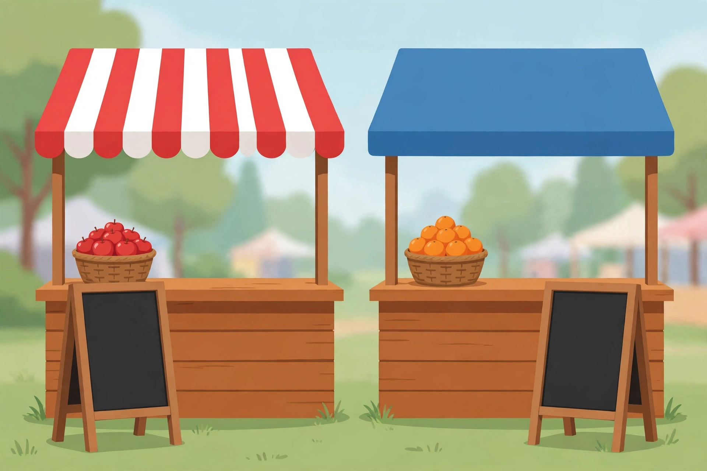

# Lesson 06 — Writing Equations from Real Situations

**Goal (student-readable):** I can turn a real situation into a
one-variable equation, solve it, and explain what the answer means —
including when there is no solution or infinitely many.
**Time:** ~45 minutes · **Materials:** notebook, pencil, the
illustration below.

## Readiness check

A stall charges a $4 entry fee plus $3 per basket. Write the cost
expression for `b` baskets. (Answer: `4 + 3b`.)

## Teaching

Modeling is translation: choose a letter for the unknown quantity,
write each side of the story as an expression, and put an equals sign
where the story says two amounts are the same. Four habits keep the
translation honest:

1. **Name the variable with its unit.** "Let `b` = number of baskets"
   beats "let `x` = stuff."
2. **Write expressions before the equation.** Cost of stall A, cost
   of stall B — then set them equal.
3. **Solve with the moves from Lessons 02–05.**
4. **Interpret, don't just answer.** A solution of `b = 2` means "2
   baskets." A classification of "no solution" means "never equal."
   An "infinitely many" result means "always equal — the plans are
   the same."

Study the picture. It shows two stalls at a fair — but it shows no
prices. Prices live in the words below the picture, not in the art.
Never read a number off an illustration unless the lesson text gives
it.

*Figure 1 — Two stalls at a fair (AI illustration). The striped stall
and the blue stall sell fruit by the basket. Their prices are given
in the text below, not in the picture.*

**Text-only alternative:** The picture shows two wooden market
stalls outdoors. The left stall has a red-and-white striped awning and
a basket of red apples on its counter; a blank dark signboard stands
in front of it. The right stall has a plain blue awning and a basket
of oranges on its counter; a blank dark signboard stands in front of
it. No prices, numbers, or words appear in the picture. All prices
used in this lesson are: striped stall — $4 entry + $3 per basket;
blue stall — no entry + $5 per basket.

### Worked example 1 — Break-even

**The striped stall charges a $4 entry fee plus $3 per basket. The
blue stall charges no entry fee and $5 per basket. After how many
baskets do the stalls cost the same? What is that cost?**

Let `b` = number of baskets.
Striped cost: `4 + 3b`. Blue cost: `5b`.
Set equal: `4 + 3b = 5b`.
Subtract `3b`: `4 = 2b`. Divide: `b = 2`.
Cost check: striped `4 + 3(2) = 10`; blue `5(2) = 10`. ✓
Interpretation: at 2 baskets both stalls cost $10. For 1 basket the
blue stall is cheaper ($5 vs. $7); for 3 baskets the striped stall is
cheaper ($13 vs. $15). The break-even point is where the answer
flips.

### Worked example 2 — No solution in context

**Stall C charges $10 entry plus $4 per basket. Stall D charges
$4 per basket plus a $15 entry fee. When do they cost the same?**

Let `b` = number of baskets: `10 + 4b = 4b + 15`.
Subtract `4b`: `10 = 15`. Different numbers → **no solution**.
Interpretation: the stalls never cost the same. Stall D costs $5
more than stall C for every number of baskets, because both charge
the same $4 per basket but D's entry fee is $5 higher. "No solution"
here is a real fact about the prices, not a failure to solve.

## Guided practice

1. A tutoring service charges $20 per session plus a $50 sign-up fee.
   Another charges $30 per session with no sign-up fee. After how
   many sessions do they cost the same? What is that cost?
2. A gym charges $60 per month with no joining fee. Another charges
   $40 per month plus a $100 joining fee. After how many months do
   they cost the same?
3. Two streaming plans: Plan P costs $8 per month plus $2 per movie.
   Plan Q costs $2 per movie plus $8 per month. Write the equation
   for equal cost, classify it, and explain what it means.
4. A caterer charges $150 plus $25 per guest. Another charges $40
   per guest with no fixed fee. At how many guests do they cost the
   same? What is that cost?
5. Explain why a "no solution" answer to a break-even question is
   useful information for a customer, not a dead end.

## Independent practice

1. A bike rental charges $12 plus $6 per hour. Another charges $9
   per hour with no base fee. After how many hours do they cost the
   same? What is that cost?
2. Two phone plans: Plan A costs $30 per month plus $5 per gigabyte
   over the allowance. Plan B costs $45 per month plus $5 per
   gigabyte over the allowance. When do they cost the same? Classify
   and interpret.
3. A plumber charges $80 for a visit plus $60 per hour. Another
   charges $100 for a visit plus $50 per hour. After how many hours
   do they cost the same? What is that cost?
4. A school fundraiser sells candles: one supplier charges $2 per
   candle plus $30 shipping; another charges $5 per candle with free
   shipping. How many candles make the costs equal? What is that
   cost?
5. **Explain your reasoning:** A learner models a break-even problem
   and gets `b = −3`. The learner reports "−3 baskets." What is wrong
   with that report, and what should the learner check first — the
   algebra or the model? Explain.

## Application

Invent your own two-plan comparison (streaming, snacks, rides,
lessons — your choice). Give both plans' prices, write the equation,
solve it, and write one sentence interpreting the answer for a
customer. If your plans produce no solution or infinitely many
solutions, say so and explain why — that is a valid result.

## Exit check

A parking garage charges $5 entry plus $2 per hour. Another charges
$3 per hour with no entry fee. After how many hours do they cost the
same? Show the equation and the check.

## Supports, alternate modes, extension

- **Language access:** "Break-even" means "the point where two costs
  are equal." Keep a two-column table (plan / cost expression)
  visible before writing any equation.
- **Alternate response mode:** Act out the stalls with play money
  and basket counters; record the table of costs for 0–5 baskets and
  point to the row where costs match.
- **Extension:** For the Worked example 1 stalls, find the cost
  difference at 0, 1, 2, 3, and 4 baskets and describe how the
  difference changes. When does the cheaper stall switch, and why?

## Teacher note

The most common modeling error is swapping which plan gets the fixed
fee. Require the two-column plan/expression table before the equation
is written. The negative-answer item (independent item 5) is the
unit's first "the algebra is right but the model is wrong" moment:
`b = −3` means the break-even point lies outside the situation's
domain (baskets can't be negative) — the learner should re-check the
story, not force a "−3 baskets" interpretation. Answer-key
reference: [answer-key.md](../answer-key.md#lesson-06).
