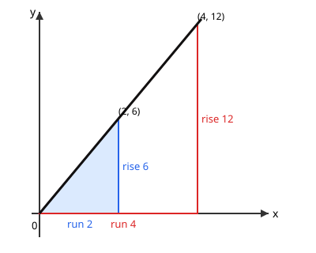

# Lesson 03 — Slope from Two Points; Why It Never Changes

**Goal (student-readable):** I can find the slope of a line from any
two of its points, and explain with similar triangles why the slope
is the same all along the line.
**Time:** ~45 minutes · **Materials:** notebook, pencil, ruler,
graph paper, the slope-triangles diagram below.

## Readiness check

From (1, 3) to (4, 9): how far across (change in `x`) and how far up
(change in `y`)? (Answer: across 4 − 1 = 3; up 9 − 3 = 6.) What is
6 ÷ 3? (Answer: 2.) If fraction division feels shaky, practise
"change = later minus earlier" on the numbers 3 and 9 first.

## Teaching

For any two points on a line, the **slope** is:

```
slope = (change in y) / (change in x) = rise / run
```

"Change" means later minus earlier, on either coordinate — but use
the same order for both: if you go from the first point to the
second for `x`, go from the first point to the second for `y` too.
Mixing the order flips the sign, which is the most common slope
error in this unit.

Why is the slope the same no matter which two points you pick? Draw
a right triangle under the line between two points: its horizontal
leg is the run, its vertical leg is the rise. Pick a different pair
of points and you draw a bigger or smaller triangle — but the two
triangles are **similar**: they have the same angles, because both
sit under the same straight line. Similar triangles have
corresponding sides in proportion, so rise/run is the same fraction
for the small triangle and the big one. Same line, same ratio,
same slope — that is the whole proof, and it is exactly what
standard 8.EE.B.6 asks for.



*Figure 1 — Two triangles under the same line. Small triangle:
run 2, rise 6, ratio 6/2 = 3. Large triangle: run 4, rise 12, ratio
12/4 = 3. The triangles are similar, so the slope is 3 between any
two points on this line.*

**Text-only alternative:** The diagram shows a straight line
through the origin rising to the right. Under it sit two right
triangles sharing the origin corner: the small one runs 2 units
across and rises 6 units; the large one runs 4 units across and
rises 12 units. Both give rise/run = 3, so the line's slope is 3.
Every question about this figure can be answered from this
paragraph alone.

Two edge cases to name now. A **horizontal** line has rise 0, so
its slope is 0/anything = 0. A **vertical** line has run 0, so its
slope would be rise/0 — division by zero, which has no value. We
say a vertical line's slope is **undefined**, and it is the one
case this unit excludes when it says "non-vertical line."

### Worked example 1

**Find the slope of the line through (1, 3) and (4, 12), and show
with triangles why a second pair of points on the same line gives
the same slope.**

Slope: rise = 12 − 3 = 9; run = 4 − 1 = 3; slope = 9/3 = 3.

Triangle check: take the smaller pair (1, 3) and (3, 9) — both lie
on this line, since the line's equation will turn out to be
`y = 3x` (check: 3 × 1 = 3, 3 × 3 = 9). Rise = 9 − 3 = 6, run =
3 − 1 = 2, ratio = 6/2 = 3. The triangle with legs 2 and 6 and the
triangle with legs 3 and 9 are similar (legs in the same ratio
2:6 = 3:9 = 1:3), so the slope must match — and it does: 3.

### Worked example 2

**Find the slope of the line through (2, 5) and (6, 17). Then check
it with a third point, (4, 11), on the same line.**

Slope: rise = 17 − 5 = 12; run = 6 − 2 = 4; slope = 12/4 = 3.

Check with (4, 11): from (2, 5) to (4, 11), rise = 11 − 5 = 6, run =
4 − 2 = 2, slope = 6/2 = 3. Same slope, as promised. If the third
point had given a different slope, the three points would not be on
one straight line at all — that is a useful test for straightness.

**A falling line, for contrast.** Through (0, 20) and (4, 8): rise =
8 − 20 = −12, run = 4 − 0 = 4, slope = −12/4 = −3. A negative slope
means the line falls as `x` grows: each step across drops 3. The
sign is part of the answer, never decoration.

## Guided practice

Work these with the adult; draw the triangle for at least two items.

1. Slope of the line through (0, 0) and (5, 20).
2. Slope of the line through (2, 3) and (5, 15). Then check with
   the point (4, 11) — is it on the same line? How do you know?
3. Slope of the line through (1, 10) and (4, 4). Is the line rising
   or falling? How does the sign tell you?
4. Two triangles under one line have legs (run 3, rise 12) and
   (run 5, rise 20). Are the triangles similar? What is the slope?
5. A learner computes the slope from (2, 5) to (5, 11) as
   (5 − 2)/(11 − 5) = 3/6 = 1/2. What went wrong, and what is the
   correct slope?
6. Explain in your own words why the slope of a straight line
   cannot change halfway along — use the word "similar" and the
   phrase "same ratio."

## Independent practice

1. Slope through (3, 9) and (6, 21).
2. Slope through (0, 7) and (3, 7). What kind of line is this?
3. Slope through (4, 1) and (4, 9). What happens when you try the
   formula, and what does that mean?
4. A line has slope 5 and passes through (2, 10). Find `y` when
   `x = 5` by climbing: each step across adds 5. Then check with
   the slope formula using (2, 10) and (5, `y`).
5. Triangles under a line have legs (run 2, rise 5) and (run 6, rise
   15). Show the triangles are similar and name the slope.
6. **Error analysis.** A learner says the slope from (1, 2) to
   (3, 8) is (8 − 2)/(1 − 3) = 6/(−2) = −3. The line actually rises.
   Find the ordering mistake and give the correct slope.

## Application

A wheelchair ramp rises 1 metre for every 12 metres of run (a
1:12 slope). A second ramp rises 2 metres over a 24-metre run.
Compute both slopes as fractions and explain, with similar
triangles, why the two ramps feel equally steep even though the
second is twice as long. Then decide: a ramp rising 3 metres over a
20-metre run — steeper or gentler than 1:12? Show the numbers.

## Exit check

Find the slope of the line through (2, 6) and (6, 18), and write
one sentence explaining why choosing a different pair of points on
the same line would give the same answer.

## Supports and extension

- **Language access:** "rise over run" is always said in that
  order — vertical change first, horizontal change second — and
  written as a fraction before any simplifying.
- **Alternate response mode:** count grid steps on graph paper
  (steps up, steps across) instead of subtracting coordinates; the
  counted fraction is the slope.
- **Extension:** prove that the points (0, 0), (2, 6), and (5, 15)
  lie on one line by showing two slopes are equal, then write the
  line's equation (preview of Lesson 04).

## Teacher note

Likely misconceptions: run-over-rise (see Guided practice item 5),
sign errors from mixed ordering (Independent practice item 6), and
treating a vertical line's slope as 0 instead of undefined
(Independent practice item 3). The triangle drawing is not
decoration: learners who draw it rarely flip rise and run.
Answer-key reference: [answer key, Lesson 03](../answer-key.md#lesson-03).
