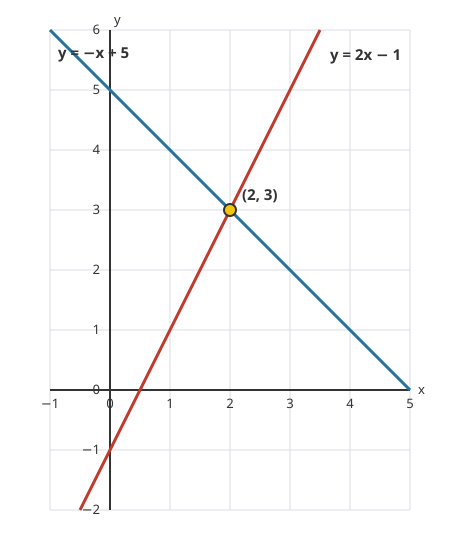

# Lesson 02 — Solve by Graphing

**Goal (student-readable):** I can graph two lines, read their
intersection as the solution of the system, and estimate a solution
from a graph.
**Time:** ~45 minutes · **Materials:** notebook, pencil, graph
paper, straightedge, the system-graph diagram below.

## Readiness check

Graph `y = 2x − 1` by plotting two points (for example `(0, −1)`
and `(2, 3)`) and drawing the line through them. If that feels
shaky, warm up by plotting the points first and checking each one
in the equation.

## Teaching

Every point on a line is a solution of that line's equation — the
line *is* the set of all its solutions. A system asks for a point
that lies on *both* lines at once. That point is the **intersection
point**: the one place where the two lines cross. Its coordinates
are the solution of the system.

So the graphing method is: graph both lines on the same axes, find
where they cross, and read the coordinates. Then — always — check
the pair in both equations by substitution, because a graph read by
eye can be off by a little, especially when the solution is not a
whole-number pair.

*Figure 1 — The lines `y = 2x − 1` (red) and `y = −x + 5` (blue)
cross at `(2, 3)`. That point lies on both lines, so `(2, 3)` is the
solution of the system.*

**Text-only alternative:** The diagram is a coordinate grid with
`x` from −1 to 5 and `y` from −2 to 6. The red line `y = 2x − 1`
rises from the lower left to the upper right, passing through
`(0, −1)` and `(2, 3)`. The blue line `y = −x + 5` falls from the
upper left to the lower right, passing through `(0, 5)` and
`(2, 3)`. The two lines cross at the point `(2, 3)`, which is
marked with a dot and labeled.

Three things can happen when you graph two lines — the same three
cases as Unit 03, now with a picture:

- **The lines cross once** → one solution: the crossing point.
- **The lines are parallel** (same slope, different intercepts) →
  no solution: they never meet.
- **The lines are the same line** (same slope and same intercept) →
  infinitely many solutions: every point on the line works.

### Worked example 1

**Solve by graphing: `y = 2x − 1` and `y = −x + 5`.**

Graph the first line: intercept `(0, −1)`, slope 2, so it rises two
units for each unit across; it passes through `(2, 3)`. Graph the
second line: intercept `(0, 5)`, slope −1, so it falls one unit for
each unit across; it also passes through `(2, 3)`. The lines cross
at `(2, 3)` — see Figure 1.

Check by substitution, in both equations: `2(2) − 1 = 3`, and
`−2 + 5 = 3`. Both give `y = 3`, so `(2, 3)` **is** the solution.
The check is what turns a graph reading into a proof.

### Worked example 2

**What does the graph tell you about `y = x + 2` and `y = x − 1`?
What about `y = 2x + 1` and `2y = 4x + 2`?**

The first pair both have slope 1 but different intercepts, `2` and
`−1`. Lines with the same slope and different intercepts are
parallel: they never cross. So the system has **no solution**. You
can see it without graphing — but if you do graph, the two lines
stay one apart forever.

The second pair looks different, but divide the second equation by
2: `y = 2x + 1`. It is the *same* line as the first. Every point on
the line satisfies both equations, so the system has **infinitely
many solutions**. Spotting that the second equation is a multiple of
the first saves you from graphing two lines on top of each other.

## Guided practice

Work these with the adult; graph on graph paper, then check every
answer by substitution.

1. Solve by graphing: `y = −x + 4` and `y = x − 2`.
2. Classify by slope and intercept, without graphing: `y = 3x − 2`
   and `y = 3x + 4`. How many solutions? Why?
3. Classify by rewriting: `y = x + 5` and `2x + 2y = 10`? Wait —
   rewrite the second equation first: divide by 2 to get
   `x + y = 5`, then `y = −x + 5`. How many solutions does the
   system have? Why?

## Independent practice

1. Solve by graphing: `y = x + 3` and `y = −2x + 3`.
2. Solve by graphing: `x + y = 4` and `x − y = 0`. (Hint: rewrite
   each in slope-intercept form first.)
3. Estimate from a graph, then verify: `y = (1/2)x + 1` and
   `y = −x + 4`. What point do the lines appear to cross at? Check
   it by substitution.
4. Classify without graphing: `2x + y = 6` and `4x + 2y = 12`.
   How many solutions? Explain with slopes and intercepts.
5. Solve by graphing: `y = 3x + 1` and `y = −x + 5`.
6. **Explain your reasoning:** Two lines cross at `(1, 4)` on a
   graph. What does that point mean for the system? What would you
   still need to do before calling `(1, 4)` the solution?

## Application

A learner graphs a system and the two lines cross at `(0, −1)`.
Write the solution as an ordered pair, and write one sentence
explaining what `(0, −1)` means for the two equations. Then explain
why a graph alone is not a proof, in your own words.

## Exit check

Graph `y = x + 1` and `y = −x + 3` on the same axes. What is the
solution? Check it by substitution in both equations.

## Supports, alternate modes, extension

- **Language access:** "Intersection" means "the place where two
  lines cross." "Parallel" means "lines that run side by side and
  never meet." Keep both sentences visible during the lesson.
- **Alternate response mode:** Describe the crossing point orally
  ("the lines meet at x equals 2, y equals 3") instead of writing
  it; the adult scribes. Desmos may be used to check a hand-drawn
  graph, not to replace it.
- **Extension:** Graph `y = (2/3)x + 1` and `y = (2/3)x − 2` and
  explain why the system has no solution. Then change one number
  in the second equation so the system has infinitely many
  solutions, and explain the change.

## Teacher note

Watch for two errors: (1) reading the intersection backwards, as
`(y, x)` instead of `(x, y)` — the dot in Figure 1 is at `x = 2`,
`y = 3`, and the check catches a swap immediately; (2) treating a
graph estimate as exact when the crossing falls between grid lines
— insist on the substitution check, and let a wrong estimate be
corrected by it rather than by re-drawing. Answer-key reference:
[answer-key.md](../answer-key.md#lesson-02).
