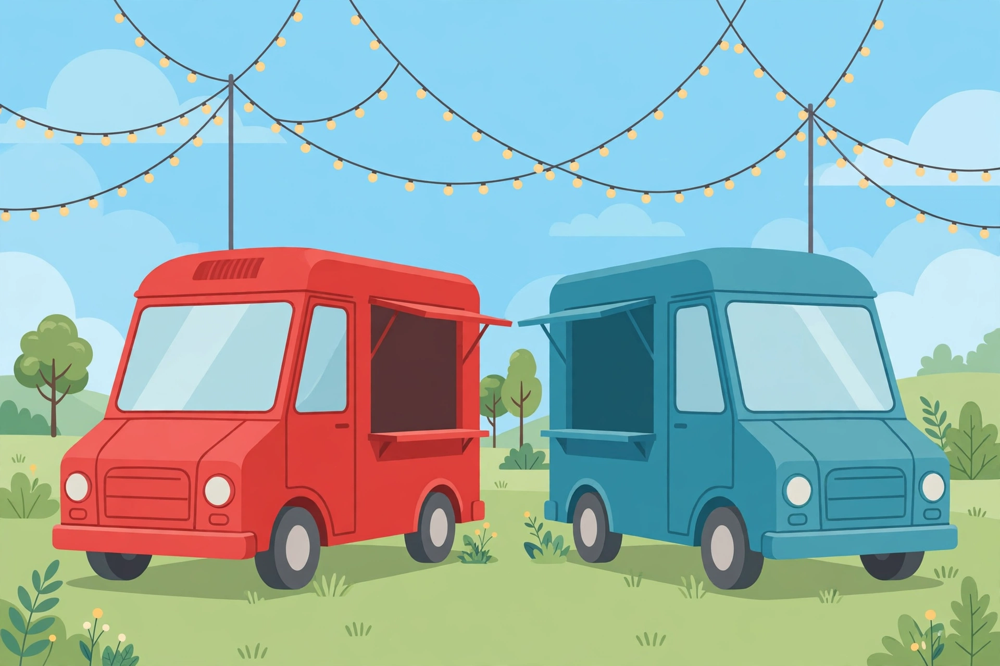

# Lesson 06 — Real-World Systems

**Goal (student-readable):** I can write a system of two equations
from a real situation, solve it, and explain what the answer means
in the situation.
**Time:** ~45 minutes · **Materials:** notebook, pencil, the
two-food-trucks illustration below.

## Readiness check

A plan costs $20 plus $5 per gigabyte. Write the cost expression
for `g` gigabytes. (Answer: `20 + 5g`.) If a second plan costs $35
plus $2 per gigabyte, when do the plans cost the same? (Answer:
solve `20 + 5g = 35 + 2g` to get `g = 5`, cost $45.) If that feels
shaky, warm up by writing one more cost expression before starting.

## Teaching

Real problems rarely arrive as equations. The work is in the
setup, and the setup has a fixed shape:

1. **Name the unknowns.** Say exactly what each variable stands
   for, with units. (`t` = price of one laser-tag game, in dollars.)
2. **Write two equations.** Each equation comes from one fact in
   the problem — a total, a count, a rate, a difference.
3. **Solve** by the most efficient method.
4. **Interpret.** Say the answer in a sentence about the situation,
   with units — and check that it makes sense. A negative number of
   tickets, or a break-even point before the business opens, means
   the setup is wrong, not the arithmetic.
5. **Check** the pair in both original equations.

The most common situation is a **break-even**: two plans, two
prices, one question — when do they tie? The tie is the solution of
the system, and on a graph it is the intersection of the two cost
lines.

*Figure 1 — Two food trucks at a fair: the red truck on the left
and the teal truck on the right. (AI illustration; all prices in
this lesson come from the text, not the picture.) Imagine each
truck is a business with its own pricing plan. The question of this
lesson is: when does each truck's plan win?*

**Text-only alternative:** The picture shows two food trucks, one
red and one teal, parked side by side at a fair. The lesson names
them "the red truck" and "the teal truck" and supplies every price
in words; nothing in the picture needs to be read to answer the
questions.

### Worked example 1

**Two phone plans.** Plan A charges $20 per month plus $5 per
gigabyte. Plan B charges $35 per month plus $2 per gigabyte. After
how many gigabytes do the plans cost the same, and what is that
cost?

Let `g` = gigabytes used in a month, and `C` = monthly cost in
dollars. Plan A: `C = 5g + 20`. Plan B: `C = 2g + 35`. Set the
costs equal (substitution — both are solved for `C`):

`5g + 20 = 2g + 35` → `3g = 15` → `g = 5`. Then
`C = 5(5) + 20 = 45`.

The plans cost the same after **5 gigabytes**, at **$45**. Below 5
gigabytes Plan A is cheaper (try `g = 0`: $20 vs. $35); above 5,
Plan B is cheaper (try `g = 10`: $70 vs. $55). The break-even point
`(5, 45)` is where the two cost lines cross.

### Worked example 2

**Two cyclists.** Diego rides at a constant 18 miles per hour, so
his distance in miles after `t` hours is `d = 18t`. Lin started
riding a quarter hour before Diego at a constant 12 miles per hour,
so her distance is `d = 12(t + 0.25) = 12t + 3`. When does Diego
catch up with Lin, and how far from the start are they?

Set the distances equal: `18t = 12t + 3` → `6t = 3` → `t = 0.5`
hours. Then `d = 18(0.5) = 9` miles. Diego catches Lin **half an
hour after Diego starts, 9 miles from the start**.

Check: Lin's distance is `12(0.5) + 3 = 6 + 3 = 9` miles, which
matches. This situation is adapted from the Open Up Resources
Grade 8, Unit 4 family materials (see the
[resource pack](../resource-pack.md)); the numbers are theirs, the
solving is ours.

## Guided practice

Work these with the adult; name the variables and write both
equations before solving.

1. An arcade charges $21 for 2 games of laser tag and 3 rounds of
   VR, and $24 for 2 games of laser tag and 4 rounds of VR. Let `t`
   be the price of one laser-tag game and `v` the price of one VR
   round. Write the system and find both prices.

## Independent practice

1. A school theater sold 200 tickets to a play, raising $1,450.
   Student tickets cost $5 each and adult tickets cost $10 each.
   How many of each ticket were sold?
2. A coffee roaster mixes beans costing $8 per pound with beans
   costing $14 per pound to create a 30-pound specialty blend
   selling for $10 per pound. How many pounds of each bean are
   needed?
3. A canoe travels 24 miles downstream in 2 hours with the current.
   It takes 4 hours to travel the same 24 miles upstream against
   the current. Find the speed of the canoe in still water (`c`)
   and the speed of the current (`w`), in miles per hour.
4. The sum of two numbers is 48. Their difference is 14. Find the
   two numbers.
5. **Explain your reasoning:** A system modeling two gym
   memberships has no solution. What does that mean for a person
   choosing between the gyms? What would the two cost lines look
   like on a graph?

## Application

Look at Figure 1. The red truck charges a $15 stall fee per day
plus $4 per meal; the teal truck charges $25 per day plus $2 per
meal. (These prices are from this text, not from the picture.) Let
`m` be meals sold in a day and `C` the daily cost in dollars.
Write the system, solve it, and say after how many meals the
trucks' daily costs are equal and what that cost is. Then say
which truck is cheaper on a 10-meal day, with the numbers.

## Exit check

Two streaming plans: Plan A charges $8 per month plus $3 per movie;
Plan B charges $14 per month plus $1 per movie. After how many
movies per month do the plans cost the same, and what is that cost?

## Supports, alternate modes, extension

- **Language access:** "Break-even" means "the point where two
  things cost exactly the same." "Let `g` be ..." means "I am
  deciding that the letter `g` stands for this quantity." Keep both
  sentences visible during the lesson.
- **Alternate response mode:** Dictate the setup (variables and
  equations) orally while the adult scribes; solve the system on
  paper.
- **Extension:** A taxi charges a $3 pickup fee plus $2 per mile; a
  rideshare charges $1 per mile with no pickup fee. Write the
  system, solve it, and explain why the answer means the rideshare
  is always cheaper once you are moving — and what happens at 0
  miles. (Answer: `C = 2m + 3` and `C = m`; set equal:
  `2m + 3 = m` gives `m = −3`, which is impossible for a distance.
  The lines cross at `m = −3`, outside the real situation, so for
  every real trip the rideshare costs less. At 0 miles the taxi
  costs $3 and the rideshare costs $0.)

## Teacher note

Watch for the two setup errors that cause most failures here: (1)
variables with no stated meaning ("let `x` be the thing") — insist
on the "let" sentence with units before any equation; (2) using one
equation twice — for example, writing the ticket count and then
writing the money equation with the same numbers in the wrong
places. The two-equation check (does each equation match one fact?)
catches both. Answer-key reference:
[answer-key.md](../answer-key.md#lesson-06).

*Four items in this lesson are adapted, with solutions re-derived,
from the track's legacy
`quizzes/systems-of-linear-equations-by-graphing-substitution-quiz.md`
(questions 9–10) and
`quizzes/systems-of-linear-equations-by-elimination-word-problems-quiz.md`
(questions 5, 6, 9, 12); the legacy files keep their inline keys
and remain untaught practice banks.*
