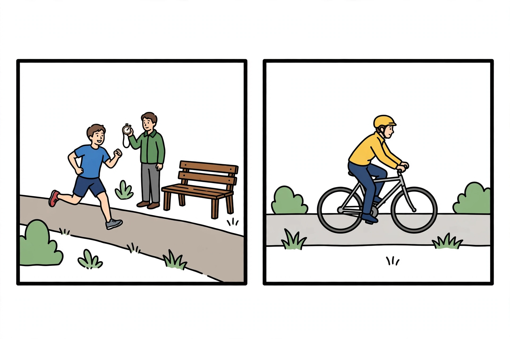

# Lesson 05 — What Slope Tells Us

**Goal (learner-facing):** I can read speed as the slope of a
distance–time graph, explain steep/flat/horizontal segments, and match a
motion story to its graph.

**Time:** 50 minutes · **Materials:** graph paper, printed or on-screen
[`two-movers-story.png`](../assets/two-movers-story.png), notebook ·
**Teacher key:** [answer key](../answer-key.md#lesson-05)

## Readiness check (5 min)

Look at the worked-example graph from Lesson 4 (the toy car that went
flat from 4 s to 8 s). "When was the car fastest — the first part, the
flat part, or the last part? How can you tell without calculating?"
(Accept "the steepest climb.")

## Explanation

On a distance–time graph, **slope** (steepness) is speed made visible:

$$\text{slope} = \frac{\text{rise}}{\text{run}} = \frac{\Delta d}{\Delta t}$$

That fraction is exactly the speed formula. So:

- **Steep line** → large rise per run → **fast**.
- **Gentle line** → small rise per run → **slow**.
- **Horizontal (flat) line** → zero rise → **stopped** (time passes,
  distance doesn't change).
- A line that **changes steepness** means the speed changed.

**Worked example 1.** A segment runs from (10 s, 20 m) to (20 s, 50 m).
Rise = 50 − 20 = 30 m. Run = 20 − 10 = 10 s.
Slope = 30 m ÷ 10 s = **3 m/s**. The mover traveled at 3 m/s on that
segment.

**Worked example 2.** Another segment runs from (20 s, 50 m) to
(30 s, 50 m). Rise = 0. Slope = 0 ÷ 10 = **0 m/s** — the mover was
stopped for those 10 seconds.

**Comparing two movers:** plot both on the same axes. The steeper line
belongs to the faster mover *on that segment*. If the lines cross, the
movers were at the same distance from the start at the same time — one
caught up with (or passed) the other.

**Vocabulary:** *slope* (rise over run), *steep*, *horizontal segment*,
*catch up* (lines crossing).

## Activity — match the movers (25 min)

Study the AI illustration, then match each panel to its graph. All
numbers below are **fictional practice data**, not measurements you made.

**Story J (jogger):** runs 60 m in 30 s, rests 20 s at the bench, runs
40 m in 20 s. Key points: (0,0), (30,60), (50,60), (70,100).
**Story C (cyclist):** rides steadily at 2 m/s for 70 s. Key points:
(0,0), (70,140).

The two graphs (exact, deterministic — drawn to scale):

<svg width="720" height="300" viewBox="0 0 720 300" role="img" aria-label="Two distance-time graphs. Graph A: line rises from origin to 60 meters at 30 seconds, goes flat until 50 seconds, then rises to 100 meters at 70 seconds. Graph B: straight line from origin to 140 meters at 70 seconds.">
  <text x="180" y="18" text-anchor="middle" font-size="15" font-weight="bold">Graph A</text>
  <text x="540" y="18" text-anchor="middle" font-size="15" font-weight="bold">Graph B</text>
  <!-- Graph A axes -->
  <line x1="60" y1="260" x2="340" y2="260" stroke="black" stroke-width="2"/>
  <line x1="60" y1="260" x2="60" y2="40" stroke="black" stroke-width="2"/>
  <text x="200" y="292" text-anchor="middle" font-size="13">Time (s): 0 – 80</text>
  <text x="18" y="150" text-anchor="middle" font-size="13" transform="rotate(-90 18 150)">Distance (m): 0 – 160</text>
  <polyline points="60,260 165,177.5 235,177.5 305,122.5" fill="none" stroke="#c0392b" stroke-width="3"/>
  <circle cx="165" cy="177.5" r="4" fill="#c0392b"/><circle cx="235" cy="177.5" r="4" fill="#c0392b"/><circle cx="305" cy="122.5" r="4" fill="#c0392b"/>
  <text x="165" y="270" font-size="11" text-anchor="middle">30</text>
  <text x="235" y="270" font-size="11" text-anchor="middle">50</text>
  <text x="305" y="270" font-size="11" text-anchor="middle">70</text>
  <text x="52" y="182" font-size="11" text-anchor="end">60</text>
  <text x="52" y="127" font-size="11" text-anchor="end">100</text>
  <!-- Graph B axes -->
  <line x1="420" y1="260" x2="700" y2="260" stroke="black" stroke-width="2"/>
  <line x1="420" y1="260" x2="420" y2="40" stroke="black" stroke-width="2"/>
  <text x="560" y="292" text-anchor="middle" font-size="13">Time (s): 0 – 80</text>
  <text x="378" y="150" text-anchor="middle" font-size="13" transform="rotate(-90 378 150)">Distance (m): 0 – 160</text>
  <polyline points="420,260 665,67.5" fill="none" stroke="#2471a3" stroke-width="3"/>
  <circle cx="665" cy="67.5" r="4" fill="#2471a3"/>
  <text x="665" y="270" font-size="11" text-anchor="middle">70</text>
  <text x="412" y="72" font-size="11" text-anchor="end">140</text>
</svg>

*Text equivalent of the graphs:* Graph A — the line starts at (0 s, 0 m),
climbs to (30 s, 60 m), runs flat to (50 s, 60 m), then climbs to
(70 s, 100 m). Graph B — a single straight line from (0 s, 0 m) to
(70 s, 140 m).

**Your task:**

1. Which graph matches the jogger's story (J), and which matches the
   cyclist's story (C)? Justify with the *shape* of each line.
2. Compute the jogger's speed on each of the three segments. Show rise,
   run, and slope for each.
3. Compute the cyclist's speed from Graph B's slope. Who was faster
   during the jogger's first 30 seconds — the jogger or the cyclist?
4. At what time and distance does Graph A's flat segment start? What was
   the jogger doing then? (Use the illustration as your story clue.)
5. **Explain your reasoning:** in 3–4 sentences, explain how the slope of
   a distance–time graph tells you both *how fast* and *whether the
   mover stopped*.

## Guided practice (with hints)

1. Segment from (5 s, 10 m) to (15 s, 40 m): slope? *(Hint: rise = 30,
   run = 10.)*
2. A line is flat from 12 s to 20 s. Speed on that segment? What was the
   mover doing?
3. Two movers start together. Mover P's line is steeper than mover Q's.
   Who is faster? If the lines cross at 25 s, what happened then?

## Independent practice

1. Plot both stories' key points from the activity on your own graph
   paper (time 0–80 s, distance 0–160 m) and check your plots against
   the SVG above.
2. The jogger's rest lasted 20 s. Suppose instead the jogger rested only
   10 s, then finished the same 100 m at the same running speed as the
   first segment (2 m/s). Sketch the new graph and give its key points.
3. **Error analysis:** "The flat part of Graph A means the jogger went
   back to the start." What's wrong, and what does the flat part really
   mean?
4. A delivery van's graph: steep climb, flat, gentle climb, steep climb.
   Write a 2–3 sentence story that fits — driving, parked, slow street,
   highway.

## Application

Look at your Lesson 4 sketch of the three walking trials. Which trial's
line was steepest — and does that match the fastest computed speed?
Write the slope of each trial's line (distance ÷ time) and confirm they
equal the speeds you calculated in Lesson 3.

## Exit check

On a distance–time graph: (a) what does a steeper line mean? (b) what
does a horizontal line mean? (c) compute the slope of the segment from
(0 s, 0 m) to (8 s, 24 m) with units.

## Supports

- **Reading/language:** sentence starters for justifications ("Graph A
  matches the jogger because…").
- **Alternate response mode:** the matching task may be answered orally
  with the adult pointing at segments; the text equivalent above carries
  every number the activity needs, so the activity works without seeing
  the graphs.
- **Extension:** compute the jogger's *overall* average speed for the
  whole 70 s (100 m ÷ 70 s ≈ 1.4 m/s) and explain why it is slower than
  any running segment — the rest "dilutes" the average.

## Teacher note

**Likely misconception:** reading the flat segment as "going downhill"
or "returning." Rehearse the mantra: *flat = stopped; up = moving away;
down (if it ever appears) = coming back toward the start.* Also: when
two lines cross, learners say "they collided" — correct to "same place,
same time; they may have just passed each other." Verify the slope
arithmetic (jogger: 60/30 = 2 m/s; 0 m/s rest; 40/20 = 2 m/s; cyclist:
140/70 = 2 m/s — the same 2 m/s is intentional: same pace, different
stories). Key: [answer key](../answer-key.md#lesson-05).
