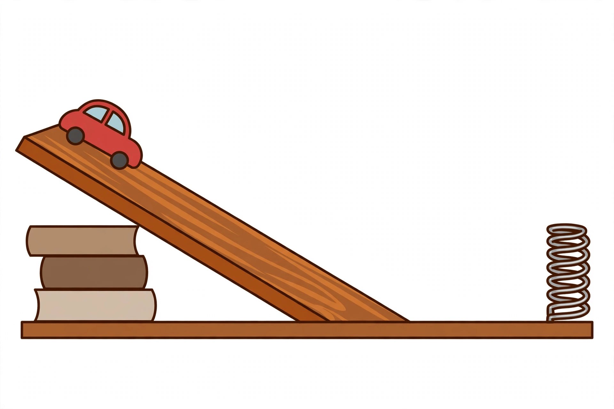

# Lesson 04 — Transfers, Transformations, and "Lost" Energy

**Goal (learner-facing):** I can track energy through a system as
transfers and transformations, and I can explain where energy goes
when something slows down.

**Time:** 50 minutes · **Materials:** notebook, the generated
illustration [`ramp-cart-spring-bumper.png`](../assets/ramp-cart-spring-bumper.png)
· **Teacher key:** [answer key](../answer-key.md#lesson-04)

## Readiness check (5 min)

Look at the illustration: a red toy car at the top of a wooden ramp,
a flat track, a coiled spring bumper at the end. "If the car rolls
down, what kinds of energy will it have at the top, halfway down,
and when it hits the spring?" The picture is a prediction prompt,
not data — the learner's own ramp trials (Sessions 8–9) supply the
evidence.

*Caption: AI-generated illustration of the ramp setup used in the
Sessions 8–9 investigation. It shows the apparatus, not a result:
nothing in the picture tells you how far any car traveled. Text-only
alternative: "Side view. A wooden ramp slopes down from left to
right; a small red toy car sits at the top of the ramp; a stack of
three books supports the ramp's high end; a flat track runs to the
right; a vertical coiled spring stands at the far right end of the
track."*

## Explanation

Energy moves in two ways, and the unit insists on naming which one:

- A **transfer** moves energy from one object (or place) to another
  without changing its form: the moving car transfers kinetic
  energy to the spring bumper when it hits it.
- A **transformation** changes energy from one form to another in
  the same system: the falling car's gravitational potential energy
  transforms into kinetic energy; a battery's chemical energy
  transforms into electrical energy, then into light and thermal
  energy in a bulb.

A **system** is whatever set of objects you choose to track, and
you must say what it is before you track it: "the car and the ramp"
is a system; "the car, the ramp, the floor, and the air" is a bigger
one. The bigger the system, the less energy seems to "disappear" —
because the energy that left the small system is still inside the
big one, usually as **thermal energy**: faster jiggling of particles
in the brakes, tires, track, and air, produced by friction.

Follow a falling ball to see the full account. A 2 kg ball held
5 m above the floor starts with $PE = 2 \times 9.8 \times 5 = 98$ J
and $KE = 0$. Halfway down (2.5 m up) it has $PE = 49$ J and $KE =
49$ J. Just before impact it has $PE = 0$ and $KE = 98$ J. At every
height the two add to 98 J — energy transformed, total unchanged.
In the real world the impact adds a third column: some of the 98 J
becomes thermal energy in the ball and floor and some becomes sound.
The ball bounces back lower because less mechanical energy remains
for the climb — not because energy vanished, but because some of it
moved into forms that do not lift the ball.

An **energy account** (energy bar diagram) is just that addition
written down: list every form, add them, and check the total
against the starting total. If the total grew or shrank, the account
is wrong or the system boundary leaked — Lesson 06 turns that check
into the conservation argument.

**Vocabulary:** *transfer* (energy moving between objects/places,
same form), *transformation* (energy changing form), *system* (the
objects you choose to track), *thermal energy* (energy of particle
motion, produced by friction), *energy account* (a list of energy
forms that must add to the starting total).

## Worked examples

**Example 1.** The falling ball above, in three rows: start — PE
98 J, KE 0 J, total 98 J. Halfway — PE 49 J, KE 49 J, total 98 J.
Just before impact — PE 0 J, KE 98 J, total 98 J. Same total, forms
swapped. That is transformation with conservation.

**Example 2.** A pendulum: at the top of its swing it is momentarily
still — PE maximum, KE zero. At the bottom it moves fastest — PE
minimum, KE maximum. Each swing peaks slightly lower than the last:
air resistance and the pivot's friction transfer a little mechanical
energy to thermal energy on every swing, so the peaks decay. The
pendulum does not "run out of energy"; its energy spreads into the
air and pivot as thermal energy.

**Example 3.** A flashlight: chemical energy in the battery
transforms to electrical energy in the wires, then to light energy
plus thermal energy in the bulb. A dim, warm flashlight is not
wasting energy into nothing — the warmth *is* part of the account.
Any account that lists only light is incomplete.

## Guided practice

1. A 2 kg ball is held 5 m up (PE 98 J, KE 0). Halfway down, what
   are its PE and KE (ignoring air)? What is the total?
2. A playground swing rises, stops for an instant, and falls back.
   At the highest point, which energy is maximum and which is zero?
   Why does each swing peak a little lower?
3. **Spot the misconception:** "The rolling car stopped, so its
   energy disappeared." What is wrong with this claim? Where did
   the energy go? *(Hint: brakes, tires, track, air.)*

## Independent practice

1. A skateboarder rolls down a ramp. Name one transfer and one
   transformation in that ride, and say what changes in each.
2. A battery torch is switched on. Write the energy chain from
   battery to light, naming each form in order, including the form
   most learners forget.
3. **Model numbers (not measurements):** A bouncing ball starts
   with 100 units of mechanical energy. After one bounce it has 80
   units of mechanical energy. (a) How many units went elsewhere?
   (b) Name two forms they could have become. (c) Why does the
   second bounce peak lower than the first?
4. In the Sessions 8–9 ramp lab, the car travels farther from a
   higher release but eventually stops on the flat track. List
   every place energy goes between release and rest.
5. Draw (or describe in words) energy bars for a pendulum at three
   moments: top of swing, bottom of swing, top of the next swing.
   What changes between the two tops, and why?

## Exit check

Give one example of an energy transfer and one of an energy
transformation, and in one sentence say where a rolling car's
energy goes when it stops.

## Supports and extension

- **Reading/language support:** sentence frames — "___ energy
  transforms into ___ energy when ___" and "energy transfers from
  ___ to ___."
- **Alternate response mode:** build the energy account with
  stacked paper strips (one strip per 10 J) instead of numbers, if
  arithmetic is the barrier.
- **Extension:** The PhET "Energy Skate Park: Basics" simulation
  (resource pack) shows live bar graphs with friction on and off.
  With friction off, what happens to the total bar? With friction
  on, which new bar grows as the skater slows? (Total stays
  constant with friction off; the thermal bar grows with friction
  on.)

## Teacher note

"Lost energy" language is the enemy of this lesson. Every time a
learner says "lost," ask "lost to where?" until the answer names a
form and a place (thermal energy in the brakes, sound in the air).
That habit is the entire prerequisite for Lesson 06's conservation
argument — without it, conservation sounds like a slogan.
