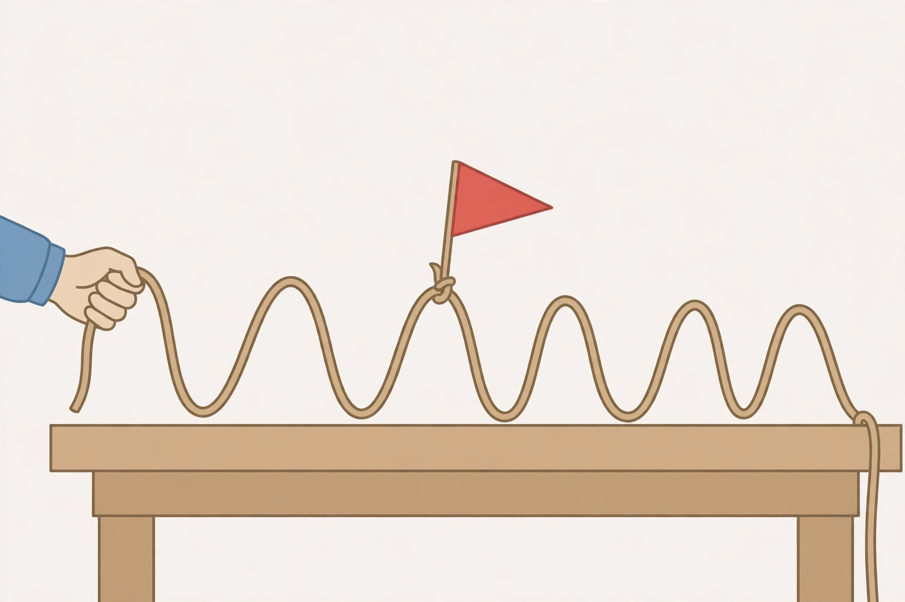

# Lesson 01 — What Is a Wave?

**Goal (learner-facing):** I can explain that a wave carries energy
without carrying the material itself, and I can tell a transverse
wave from a longitudinal wave.

**Time:** 50 minutes · **Materials:** a rope or long scarf, a
slinky or spring toy, notebook · **Teacher key:**
[answer key](../answer-key.md#lesson-01)

## Readiness check (5 min)

The adult shakes one end of a rope up and down once, so a single
hump travels to the other end. Ask: "Did the rope travel to the
other end, or did something else travel?" Accept all answers, then
ask: "Watch the middle of the rope. Where does it end up?" (Back
where it started.) Hold that thought — the rope returns, but the
hump moved.

## Explanation

A **wave** is a traveling disturbance: a pattern of motion that
moves through something, carrying energy with it. The "something"
it moves through is called the **medium**. For a rope wave the
medium is the rope. For a water wave it is the water. For sound it
is air, water, or a solid.

The key idea, and the one most learners get wrong at first, is
this: **the wave travels, but the medium does not travel with it.**
Each bit of the medium moves a little — up and down, or back and
forth — and then returns to about where it started. What moves
forward is the pattern, and the energy it carries. A cork floating
on water bobs up and down as waves pass, but it does not surf
along with the wave to the shore. If the medium itself traveled,
the cork would end up on the beach.

Look at the illustration for this lesson:

*Figure 1 — A generated illustration (not a photograph, not data).
A hand shakes one end of a rope so a repeating wave travels along
it. The red flag tied to the middle of the rope marks one bit of
the medium.*

**Text-only alternative:** A rope lies across a table. A hand
shakes the left end up and down. The rope forms a repeating
up-and-down pattern of humps and dips that travels to the right.
A red flag tied to the middle of the rope sits on top of one hump.
The flag itself does not move to the right; it will bob up and
down in place as humps and dips pass under it. Question: if the
hand keeps shaking, does the flag end up at the right end of the
table? Answer: no — the flag stays near the middle, bobbing up
and down, while the wave pattern travels past it.

There are two basic kinds, decided by one question: does the
medium move at right angles to the wave's travel, or along the
same line as the travel?

- A **transverse wave** moves its medium at right angles to the
  direction the wave travels. The rope wave is transverse: the
  wave travels sideways along the rope, but each bit of rope
  moves up and down. "Transverse" means "across."
- A **longitudinal wave** moves its medium back and forth along
  the same line the wave travels. Push one end of a stretched
  slinky toward the other end and a squeezed-up bunch (a
  **compression**) travels along it, followed by a stretched-out
  part (a **rarefaction**). Each coil moves back and forth along
  the slinky, then returns. Sound is a longitudinal wave: air
  bunches up and spreads out, and that pattern travels to your
  ear. "Longitudinal" means "along the length."

A wave needs a source of energy to start it — your hand shaking
the rope, a speaker cone pushing air, a stone dropped in water.
Once started, the wave keeps going until its energy spreads out
or is absorbed, which is why real waves fade: the rope wave gets
smaller as friction and air resistance take its energy. That
fading is called **damping**, and it is not the wave "getting
tired" — it is energy leaving the wave.

**Vocabulary:** *wave* (a traveling disturbance that carries
energy), *medium* (what a wave travels through), *transverse
wave* (medium moves at right angles to travel), *longitudinal
wave* (medium moves back and forth along the travel line),
*compression* (bunched-up part of a longitudinal wave),
*rarefaction* (spread-out part of a longitudinal wave).

## Worked examples

**Example 1.** A flag is tied to the middle of a rope. The adult
shakes the rope ten times. Does the flag travel to the far end?
No. The flag is part of the medium. It bobs up and down in place
as each hump and dip passes. What travels to the far end is the
wave pattern and its energy. If the flag ended up at the far end,
that would mean the rope itself traveled — and the rope did not.

**Example 2.** A learner pushes the end of a stretched slinky
sharply toward the other end, then pulls it back. A squeezed bunch
shoots down the slinky. Is this transverse or longitudinal?
Longitudinal: each coil moves back and forth along the same line
the bunch travels. Contrast it with shaking the slinky up and
down, which makes a transverse wave: the coils move up and down
while the wave travels sideways. Same slinky, different shake,
different kind of wave — the kind is decided by the direction of
the medium's motion, not by the object.

## Guided practice

1. A cork floats on a pond. Waves pass. The cork bobs up and down
   but stays in the same patch of water. What does this show
   about what a wave carries and what it does not carry?
2. Classify each: (a) shaking a rope up and down; (b) pushing a
   slinky end in and out; (c) sound traveling through air;
   (d) a crowd doing a stadium wave (people stand and sit while
   the "wave" travels around the stands).
3. A learner says, "The water in an ocean wave travels all the
   way from the middle of the ocean to the beach." What is right
   and what is wrong in that sentence?

## Independent practice

1. A speaker cone vibrates in and out 100 times a second. The
   air in front of it bunches and spreads. Is sound transverse
   or longitudinal? Give the direction test from this lesson.
2. You shake a rope faster but with the same up-and-down size.
   Does the rope itself start traveling? Explain.
3. A wave passes and a floating leaf ends up slightly closer to
   shore because of a current. Does that prove the wave carried
   the leaf? Explain the difference between the wave and the
   current.
4. Draw (or describe) a transverse wave and a longitudinal wave
   side by side, labeling the travel direction and the medium's
   motion direction in each.

## Applied task

Sort these into "wave carries energy, medium stays" or "matter
itself travels": (a) a rope wave, (b) a rolling bowling ball,
(c) sound crossing a room, (d) a thrown baseball, (e) a water
wave. Write one sentence of justification for each.

## Exit check

The hand stops shaking the rope. What happens to the wave already
on the rope, and what happens to the flag? One or two sentences.

## Support, extension, teacher note

- **Reading/language access:** act out both wave kinds before
  naming them; the words transverse and longitudinal land after
  the motion, not before.
- **Alternate response mode:** learners may answer the exit
  check by pointing at the illustration and describing the flag's
  motion in words.
- **Extension:** water surface waves are a combination — each
  water bit moves in a small circle, which has both a transverse
  and a longitudinal part. Learners who finish early can test
  whether a floating object on a slinky-style model shows this.
- **Teacher note:** the most common misconception is that the
  medium travels with the wave (the "surfing cork"). If it
  persists, redo the flag demonstration slowly and ask the
  learner to predict the flag's final position before shaking.
  Key: [answer key](../answer-key.md#lesson-01).
