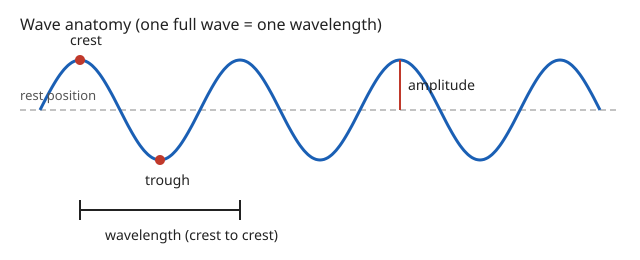

# Lesson 02 — Wave Anatomy and Wave Math

**Goal (learner-facing):** I can name the parts of a wave, use
$v = f\lambda$ to find speed, wavelength, or frequency, and explain
why a bigger wave carries more energy.

**Time:** 50 minutes · **Materials:** notebook, ruler, the
wave-anatomy diagram below · **Teacher key:**
[answer key](../answer-key.md#lesson-02)

## Readiness check (5 min)

The adult draws one wave hump on the board and asks: "What two
measurements would you need to describe this wave completely —
how tall it is, and how long one repeat is?" Learners suggest
height and length; the adult names them amplitude and wavelength
and says frequency joins them today.

## Explanation

A simple repeating wave has four numbers that describe it. Learn
them on the diagram, not as a word list:

*Figure 2 — Deterministic diagram (exact by construction, not a
measurement). One full wave: crest to crest is one wavelength;
the height from the rest line to a crest is the amplitude.*

**Text-only alternative:** A wave repeats like a row of identical
humps and dips. The highest point of a hump is the **crest**; the
lowest point of a dip is the **trough**. The flat middle line the
wave oscillates around is the **rest position**. **Amplitude** is
the height from the rest position up to a crest (or down to a
trough) — how far the medium is displaced. **Wavelength** (symbol
λ, pronounced "lambda") is the length of one full repeat: crest to
next crest, or trough to next trough. **Frequency** (symbol f) is
how many full waves pass a fixed point each second, measured in
**hertz (Hz)**: 1 Hz means one wave per second. **Period** (symbol
T) is the time for one full wave: $T = 1/f$. A 2 Hz wave has a
period of 0.5 s.

These numbers are tied together by one formula:

$$v = f \times \lambda$$

- $v$ = wave speed, in meters per second (m/s) — how fast the
  pattern travels
- $f$ = frequency, in hertz (Hz) — waves per second
- λ = wavelength, in meters (m) — length of one repeat

You can solve for any one of the three: $f = v / \lambda$ and
$\lambda = v / f$. Units must match: if λ is in centimeters,
convert to meters first (100 cm = 1 m), or the speed will come
out 100 times too big.

The last piece is energy. **A wave with a larger amplitude
carries more energy.** Shaking a rope gently makes small humps
that barely disturb anything; shaking it hard makes tall humps
that can knock over a light object placed on the rope. The link
is qualitative at this level: bigger amplitude means more energy,
smaller amplitude means less energy. (How much more, exactly, is
a higher-level question; this unit only asks "more or less" and
"which carries more.") Frequency and wavelength, by contrast, do
not by themselves tell you the energy: a fast, small ripple can
carry less energy than a slow, tall swell.

**Vocabulary:** *crest* (highest point), *trough* (lowest
point), *rest position* (undisturbed middle line), *amplitude*
(height from rest to crest), *wavelength* (length of one repeat),
*frequency* (waves per second, Hz), *period* (time for one wave),
*wave speed* ($v = f\lambda$).

## Worked examples

**Example 1.** A rope wave has frequency 2 Hz and wavelength
1.5 m. How fast does it travel?
$v = f\lambda = 2 \times 1.5 = 3$ m/s. Check: each second, 2 waves
pass, each 1.5 m long, so the pattern advances $2 \times 1.5 = 3$
m in that second. The units work: Hz means "per second," so
(per second) × meters = meters per second.

**Example 2.** A water ripple travels at 0.6 m/s with wavelength
0.3 m. What is its frequency, and its period?
$f = v / \lambda = 0.6 / 0.3 = 2$ Hz. Period $T = 1/f = 1/2 = 0.5$
s. So two waves pass a fixed point each second, one every half
second. A common error is dividing the wrong way ($0.3 / 0.6$);
the unit check catches it: wavelength ÷ speed gives seconds,
not waves per second.

## Guided practice

1. A wave has $f = 4$ Hz and λ = 0.25 m. Find its speed.
2. A wave travels at 12 m/s with frequency 3 Hz. Find its
   wavelength.
3. A wave has λ = 2 m and speed 8 m/s. Find its frequency and
   its period.
4. Two rope waves travel on identical ropes. Wave A has amplitude
   2 cm; wave B has amplitude 6 cm. Which carries more energy,
   and how do you know without any calculation?

## Independent practice

1. A wave has $f = 5$ Hz and λ = 0.4 m. Find its speed.
2. A wave travels at 20 m/s with wavelength 5 m. Find its
   frequency.
3. A wave travels at a fixed speed of 10 m/s. First its frequency
   is 2 Hz, then it is doubled to 4 Hz. What happens to its
   wavelength? Give both wavelengths.
4. **Error analysis.** A learner writes: "To find wave speed I
   add frequency and wavelength: $v = f + \lambda$." A wave has
   $f = 3$ Hz and λ = 2 m. Show what the learner's method gives,
   what the correct method gives, and why the units prove the
   learner's method wrong.

## Applied task

Design a wave that travels at 6 m/s with frequency 3 Hz. State
its wavelength, its period, and how you would make it on a rope
(fast or slow shaking, big or small shake) to carry a lot of
energy. Sketch it or describe the sketch in words.

## Exit check

A wave has frequency 10 Hz and wavelength 0.2 m. What is its
speed? What is its period?

## Support, extension, teacher note

- **Reading/language access:** keep the formula triangle
  ($v$ on top, $f$ and λ below) on the board all lesson; learners
  cover the unknown to read off the calculation.
- **Alternate response mode:** learners may answer with a
  labeled sketch instead of sentences for the applied task.
- **Extension:** if the speed is fixed, frequency and wavelength
  are inversely related — doubling one halves the other. Learners
  who finish early can build the table for $v = 12$ m/s at
  $f$ = 2, 3, 4, 6, 12 Hz (this table returns in Practice Set B).
- **Teacher note:** watch for two confusions: amplitude vs.
  wavelength (height vs. length — point at the diagram, never
  just say the words), and frequency vs. speed (a fast-shaking
  source does not automatically mean a fast-traveling wave; the
  medium sets the speed). Key: [answer key](../answer-key.md#lesson-02).
