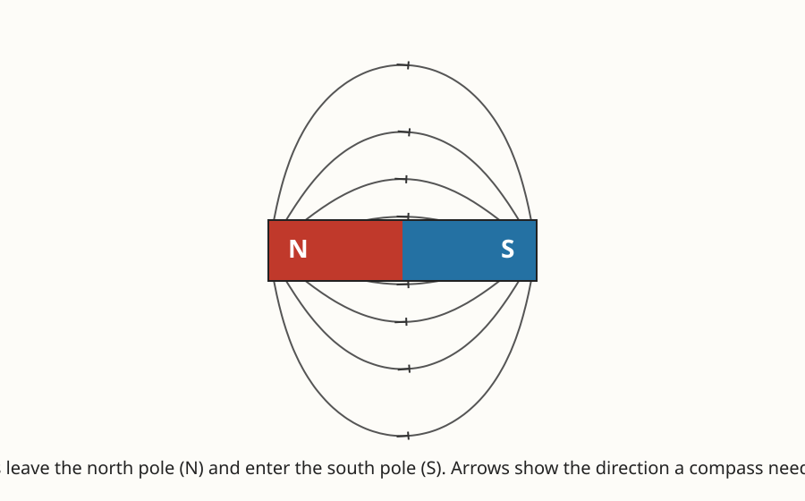

# Lesson 03 — Magnets and Fields Without Contact

**Goal (learner-facing):** I can show that a magnet's force
reaches across empty space, and I can map where that force points.

**Time:** 50 minutes · **Materials:** two bar magnets, a small
compass, paper clips, a ruler, a sheet of paper, notebook ·
**Teacher key:** [answer key](../answer-key.md#lesson-03)

## Readiness check (5 min)

The adult holds a bar magnet a few centimeters above a paper clip
and the clip jumps up to the magnet. Ask: "What touched the
clip?" (Nothing.) "So what pulled it?" Accept all answers, then
ask: "If the magnet's pull reaches across that gap, does it reach
farther in some directions than others — and how could we find
out without touching anything?" Hold that thought: the tool for
finding out is a compass, and the map it draws is the point of
this lesson.

## Explanation

A magnet is an object that pulls on iron, steel, and other
magnets without touching them. Every magnet has two ends called
**poles**: a **north pole** and a **south pole**. The rules sound
exactly like the charge rules from Lesson 01, and that is not a
coincidence — electric and magnetic forces are two faces of one
interaction:

- **Like poles repel:** north pushes north away; south pushes
  south away.
- **Opposite poles attract:** north pulls south toward it.

Try it: hold two bar magnets north-to-north and you feel them
push apart; flip one around and they snap together. But here is
the deeper question the readiness check raised: *how* does the
force cross the gap? The answer is a **magnetic field** — the
region around a magnet where another magnet (or a piece of iron)
feels a force. The field is not a thing you can see, but it is
real: it has a direction at every point, and it is stronger near
the poles and weaker farther away.

A compass lets you see the field's direction. A compass needle
is itself a tiny magnet, free to turn. Put it near a bar magnet
and it lines up with the field at that spot: the needle's
north-seeking end points in the direction of the field. Move the
compass around the magnet, mark the needle's direction at each
spot, and the marks join up into curved lines that leave the
north pole, sweep around the magnet, and enter the south pole.
Those lines are the field map.

Look at the field map for this lesson:

*Figure 1 — An exact diagram (computed from the two-pole field
model, not a measurement). The bar magnet's north pole is on the
left (N) and its south pole on the right (S). Field lines leave
N, curve around the magnet, and enter S. Arrows show the
direction a compass needle points at that spot.*

**Text-only alternative:** A horizontal bar magnet lies in the
middle of the picture. Its left half is red and labeled N (north
pole); its right half is blue and labeled S (south pole). Eight
curved lines leave the left (N) end, arc above and below the
magnet, and enter the right (S) end. The lines are closest
together near the poles and spread farther apart as they get
farther from the magnet. Small arrows on the lines point away
from N and toward S. Question: at a point directly above the
middle of the magnet, which way does a compass needle point?
Answer: along the field line there, which runs from the N side
toward the S side — the needle's north-seeking end points toward
the right (toward S), slightly downward as the line curves into
the pole.

Three facts from the map matter for the rest of the unit. First,
the field exists *in the space* — the compass turns even though
nothing touches the magnet. That is the evidence MS-PS2-5 asks
for: a force acting without contact, explained by a field.
Second, the lines are closer together near the poles, and a
compass needle swings harder there — the field is stronger near
the poles and weaker farther away. Hold a paper clip at 1 cm
from a pole and it jumps; hold it at 10 cm and it barely moves.
Third, the field has a direction everywhere: the needle does not
just turn, it turns to a *specific* direction that depends on
where it sits. That is what "mapped by its effect on a test
object" means — the compass is the test object.

One more fact, for the compass in your hand: Earth itself is a
giant magnet. That is why a compass needle points roughly north
— the needle's north-seeking end is pulled toward Earth's
magnetic pole near the geographic north. Your pocket compass and
the bar magnet on the table obey the same rules.

**Vocabulary:** *magnet* (an object that attracts iron and other
magnets without contact), *north pole* / *south pole* (the two
ends of a magnet, where the field is strongest), *magnetic
field* (the region around a magnet where a magnetic force acts),
*compass* (a small free-turning magnet used to show field
direction).

## Worked examples

**Example 1.** A compass is placed above the middle of a bar
magnet (north pole on the left). The needle's north-seeking end
points to the right. Explain. The compass needle lines up with
the field at its position. Above the magnet, the field lines run
from the north pole (left) over the top toward the south pole
(right), so the field direction there is toward the right. The
needle's north-seeking end points along the field — to the
right. If the needle had pointed left, that would mean the field
there ran toward the left, which would contradict the map.

**Example 2.** A paper clip hangs from a magnet's north pole.
The adult slowly moves a second magnet's north pole toward the
first magnet's north pole from the side. The clip falls off
before the magnets touch. Why? The two north poles repel. As the
second magnet comes closer, its field pushes against the first
magnet's hold on the clip — the repulsive force grows as the
distance shrinks, until it overcomes the attraction holding the
clip. The clip falls even though nothing touched it: the fields
did the pushing across the gap. Distance matters: the effect is
weak far away and strong close up.

## Guided practice

1. Two bar magnets are placed north-to-south, 5 cm apart. Do
   they attract or repel? What if they are placed
   south-to-south? Explain each with the pole rules.
2. A compass is placed to the left of a bar magnet's north pole
   (the pole is on the magnet's left end). Which way does the
   needle's north-seeking end point — toward the magnet or
   away from it? Use the field map to answer.
3. A paper clip is held 2 cm from a magnet's pole and jumps to
   it. The same clip is held 8 cm away and does not move. What
   does that tell you about how field strength changes with
   distance?

## Independent practice

1. A learner says, "The magnet's force only exists where the
   magnet is." Give two observations from this lesson that prove
   the force exists in the space around the magnet.
2. You place compasses at four points around a bar magnet: above
   the north pole, above the south pole, below the north pole,
   below the south pole. Sketch or describe the direction each
   needle points, using the rule that field lines leave N and
   enter S.
3. A compass needle points north when it is far from any magnet.
   You bring a bar magnet's south pole near the compass from the
   east. Predict which way the needle turns, and explain why the
   Earth's field stops being the boss.
4. **Error analysis.** A learner draws a field map with straight
   lines shooting out of both poles in all directions, like
   sunbeams. Correct the drawing: what shape should the lines
   have, where should they start and end, and what observation
   would prove the straight-line version wrong?

## Applied task

You have one bar magnet, one compass, and a ruler. Write a
3-step procedure to answer: "Is the field stronger 2 cm from the
north pole or 2 cm from the middle of the magnet?" Name what you
will observe at each spot and what result would count as
evidence. (You will run a version of this in Investigation
Part 2.)

## Exit check

A compass sits on a table. A magnet is slid under the table,
below the compass, without touching it. The needle swings. In
one or two sentences, explain what the swinging proves about
where the magnet's force exists.

## Support, extension, teacher note

- **Reading/language access:** move real magnets and a real
  compass before naming "field"; the word labels the pattern
  the learner already saw in the needle directions.
- **Alternate response mode:** learners may answer the exit
  check by moving the compass and magnet and describing the
  needle's turn in words.
- **Extension:** cutting a bar magnet in half does not give one
  north piece and one south piece — each half becomes a new
  magnet with its own north and south poles. Learners who finish
  early can explain why that fits the field picture (poles are
  not "stuff" stored at the ends; the field pattern comes from
  the whole magnet).
- **Teacher note:** the most common misconception is that the
  field is "only at the poles" or "only where iron is." Keep
  returning to the compass evidence: the needle turns in empty
  space, centimeters from the magnet, with nothing magnetic
  between. The second misconception is confusing the compass
  needle's painted end: the needle's north-seeking end points
  *toward* a south pole — it is attracted to the opposite pole,
  exactly like the pole rules say. Key:
  [answer key](../answer-key.md#lesson-03).
