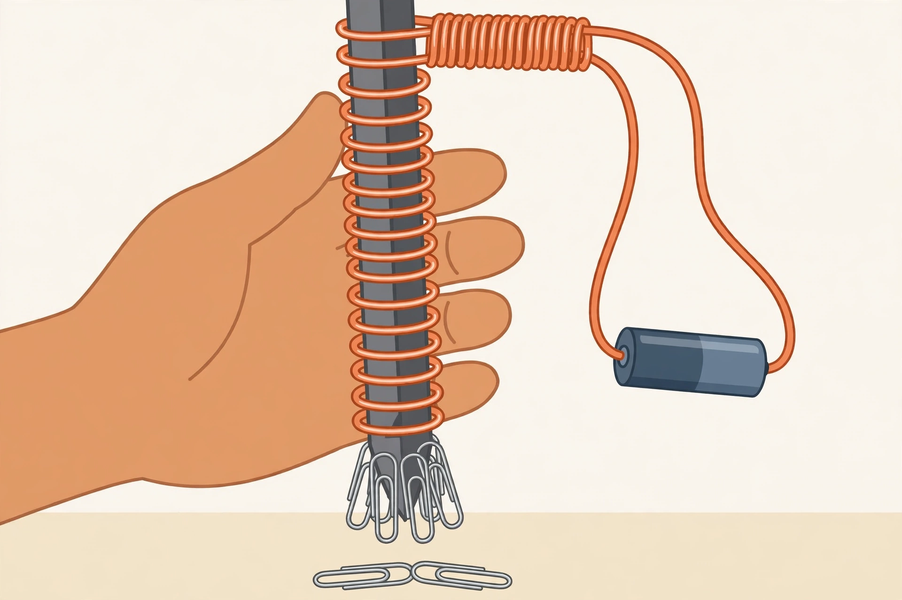

# Lesson 04 — Electromagnets: What Changes Strength

**Goal (learner-facing):** I can build a magnet I can switch on
and off, and I can say what makes it stronger — with data.

**Time:** 50 minutes · **Materials:** a large iron nail, about
1 m of insulated copper wire, one AA battery (in a holder), paper
clips (about 20), notebook · **Teacher key:**
[answer key](../answer-key.md#lesson-04)

## Readiness check (5 min)

The adult holds up a nail with wire wrapped around it, connected
to a battery, and lifts paper clips with it — then disconnects
one wire and the clips fall. Ask: "The nail is not a magnet by
itself. What made it magnetic — and what made the magnetism go
away?" Accept all answers. Hold the question: the answer is
moving charge, and this lesson is about controlling it.

## Explanation

A wire carrying an electric current makes a magnetic field
around itself. That is the link between this unit's two halves:
moving charge (current) creates magnetism. Wind that wire into
a **coil** around an iron nail, connect a battery, and the small
fields of every loop add up into one strong field — the nail
becomes a magnet. This is an **electromagnet**: a magnet made by
current in a coil, usually around an iron **core**. Disconnect
the battery, the current stops, the field collapses, and the nail
stops being a magnet (it may keep a tiny bit of magnetism — a
fact for the extension, not a problem for the build).

Look at the illustration for this lesson:

*Figure 1 — A generated illustration (not a photograph, not
data). A hand holds an iron nail wrapped with copper wire; the
wire ends connect to a battery, and paper clips hang from the
nail's tip, held up by the electromagnet.*

**Text-only alternative:** A hand holds a large iron nail
upright. Copper wire is wrapped in many neat loops around the
nail. The two wire ends run to a small cylindrical battery. Six
paper clips stick to the tip of the nail, hanging in the air,
and two more paper clips lie on the table below. Question: what
is holding the six clips up, and what would happen if one wire
were disconnected from the battery? Answer: the current in the
coil makes the nail magnetic, and the nail's field holds the
clips; disconnecting the wire stops the current, the field
collapses, and the clips fall.

Three things change how strong an electromagnet is, and the
project will test all three. First, **the number of turns**:
more loops of wire around the nail means a stronger magnet —
about twice the turns, about twice the clips lifted (the
proportional reasoning MS-PS2-3 allows). Second, **the current**:
more current means a stronger magnet. In this unit's builds,
current is changed by adding a second battery — two batteries
push about twice as hard as one, so about twice the current, so
about twice the clips. Third, **the core**: a coil around an iron
nail is much stronger than the same coil with no core (just air),
because iron concentrates the field. A coil around a wooden
pencil or a plastic pen is barely a magnet at all.

Notice what does *not* change the strength much in these builds:
the length of the nail (within reason) and the color of the wire.
A fair test changes one thing at a time — that is the
investigation design MS-PS2-5 asks learners to evaluate, and it
is the project in this unit: change the turns and keep the
batteries and core the same; change the batteries and keep the
turns and core the same; change the core and keep everything
else the same. Count the clips each time, repeat each test three
times, and the pattern in the data answers the question.

Two warnings from the safety rules. An electromagnet's coil is
almost a short circuit: the wire has very little resistance, so
a battery connected across it for a long time gets warm and runs
down fast. Connect the battery only while testing, then
disconnect it — never leave it connected. And if the wire or the
battery feels warm, disconnect it at once and tell the adult.

**Vocabulary:** *electromagnet* (a magnet made by current in a
coil, usually around an iron core), *coil* (wire wound in loops;
each loop is a *turn*), *core* (the material inside a coil — iron
makes the field much stronger), *current* (the flow of electric
charge; here, the flow through the coil).

## Worked examples

**Example 1.** An electromagnet with 10 turns lifts 4 paper
clips. The learner rewinds it with 20 turns, same battery, same
nail. About how many clips should it lift, and why? About 8.
Doubling the turns about doubles the field strength, and the
number of clips is a rough measure of strength — so doubling
the turns should about double the clips. This is proportional
reasoning, not a law of nature with an equals sign: real data
wobble (7, 8, or 9 would all be reasonable), and the project
repeats each test three times precisely because of that wobble.
If the 20-turn coil lifted only 4 clips, something else changed
— a loose connection, a tired battery — and the fair test failed.

**Example 2.** Two electromagnets are built the same way (20
turns, one battery), except one has an iron nail core and the
other has no core at all — just a coil of wire in the air. The
air-core coil lifts 1 clip; the iron-core coil lifts 6. Explain.
The current is the same in both, so the difference is the core.
Iron concentrates the magnetic field: the coil's field lines up
the iron's own tiny magnetic regions, and they add their field
to the coil's. Air does not do that. So the core is not a
decoration — for the same current and turns, it is the biggest
single change you can make. (This is also why motors and
generators — the MS-PS2-3 examples — are built around iron.)

## Guided practice

1. An electromagnet with 15 turns lifts 6 clips. Predict the
   lift for 30 turns with the same battery and core. What
   assumption are you making?
2. A learner tests "more batteries = stronger" by adding a
   second battery *and* rewinding the coil with more turns at
   the same time. The lift goes from 5 clips to 14. Can the
   learner say the extra battery caused the change? Explain
   the fair-test problem.
3. Two coils have the same turns and battery, but one is wound
   around a nail and the other around a wooden pencil. Which
   lifts more clips, and why?

## Independent practice

1. A learner's electromagnet lifts 3 clips with 10 turns, 6
   clips with 20 turns, and 9 clips with 30 turns (one battery,
   iron nail). Describe the pattern in one sentence and predict
   the lift for 40 turns. What would make you distrust the
   prediction?
2. A coil with 20 turns and two batteries lifts 12 clips. The
   same coil with one battery lifts 6 clips. A learner says,
   "Batteries don't matter — it's the turns." Use the data to
   correct them.
3. Why must you disconnect the battery between tests? Give two
   reasons (one about the battery, one about the fairness of
   the test).
4. **Error analysis.** A learner writes: "My electromagnet is
   stronger because I used a longer nail." The learner changed
   only the nail length (same turns, same battery, same wire).
   The lift went from 6 clips to 7. Is "longer nail" a good
   explanation? What else could explain one extra clip, and
   how would you check?

## Applied task

Design a fair test for the question: "Does the core material
matter?" List: the question, the variable you change (with at
least two values), the variables you keep the same, what you
measure and how many times, and what result would count as
"yes, the core matters." (You will run this test in the project.)

## Exit check

Your electromagnet lifts 4 clips. You want it to lift about 8.
Name two different changes you could make, and for each say
what you would keep the same while you test it.

## Support, extension, teacher note

- **Reading/language access:** build the electromagnet first,
  count clips, then name the three factors; the words "turns,"
  "current," and "core" label things the learner already held.
- **Alternate response mode:** learners may answer the exit
  check by pointing at the coil, the battery, and the nail in
  the illustration and describing the change in words.
- **Extension:** a nail that has been an electromagnet keeps a
  little magnetism after the battery is disconnected — it can
  still lift one clip. That leftover magnetism is called
  remanence, and it is why a compass can be magnetized by
  stroking it with a magnet. Also: swap the battery connections
  and the electromagnet's poles flip — north becomes south.
  Learners who finish early can test the pole flip with a
  compass.
- **Teacher note:** the most common misconception is that the
  battery "makes" the nail magnetic by itself, or that the nail
  stays magnetic forever. Disconnect the wire in front of the
  learner and watch the clips fall — the demo does the teaching.
  The second misconception is changing two things at once and
  blaming one of them; the project rubric scores the fair-test
  design explicitly, so name the problem every time it appears
  in practice. Key: [answer key](../answer-key.md#lesson-04).
