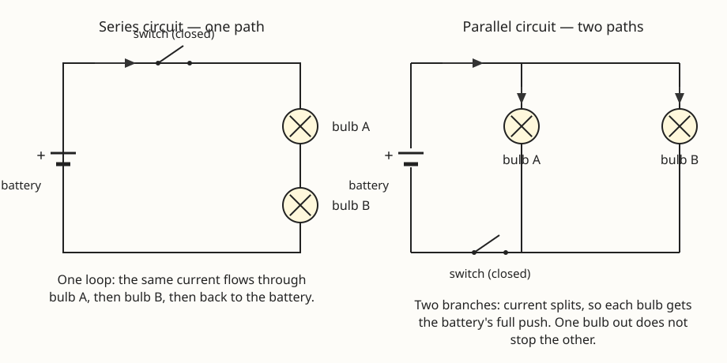

# Lesson 05 — Simple Circuits: Series and Parallel

**Goal (learner-facing):** I can build a circuit that lights a
bulb, and I can explain why two bulbs in a row go dim while two
bulbs side by side stay bright.

**Time:** 50 minutes · **Materials:** two AA batteries in a
holder, two small bulbs in holders, a switch, connecting wires
with alligator clips, notebook · **Teacher key:**
[answer key](../answer-key.md#lesson-05)

## Readiness check (5 min)

The adult shows a battery, a bulb, and a wire, and asks: "What
is the fewest connections needed to light the bulb?" Let the
learner try: one wire from the battery to the bulb is not enough
— the bulb needs a complete loop, a path out of the battery,
through the bulb, and back into the battery. Ask: "What happens
if you break the loop anywhere?" (The bulb goes out.) Hold that
thought: a circuit is a loop, and everything in this lesson is
about what the loop looks like.

## Explanation

A **circuit** is a closed loop that electric charge can flow
around. The **battery** pushes the charge: it is the source of
the push, measured in **volts** (a volt is the unit of that push;
one AA cell pushes with 1.5 volts). The moving charge is the
**electric current** — a flow of electrons around the loop. A
**switch** opens or closes the loop. A **bulb** lights when
current flows through its thin wire, the **filament**: the
filament gets hot and glows, turning electrical energy into
light energy and thermal energy (that is the Unit 03 energy story
again, now with a circuit doing the transferring).

A circuit that is not closed is an **open circuit**: the loop is
broken somewhere — a switch open, a wire loose, a bulb burned
out — and no current flows anywhere in the loop. A **closed
circuit** is a complete loop, and current flows all the way
around. One fact surprises most learners: in a single loop, the
current is the same everywhere in the loop. The charge does not
get "used up" by the bulb — the bulb takes energy from the
charge, not the charge itself, and the same charge keeps flowing
around.

Now the two ways to arrange two bulbs:

- A **series circuit** puts the bulbs one after the other on a
  single path: battery → bulb A → bulb B → battery. There is
  only one path, so the same current flows through both bulbs,
  and the two bulbs *share* the battery's push. Each bulb gets
  only part of the push, so each is dimmer than one bulb alone.
  And if one bulb burns out, the loop is broken and *both* bulbs
  go out — like old holiday lights where one dead bulb killed
  the whole string.
- A **parallel circuit** gives each bulb its own path: battery →
  bulb A → battery, and separately battery → bulb B → battery.
  The current splits at the junction: part goes through bulb A,
  part through bulb B. Each bulb gets the battery's *full* push,
  so each shines as brightly as one bulb alone. And if one bulb
  burns out, the other keeps shining — its path is still closed.
  That is why the lights in a house are wired in parallel: one
  bulb going out does not darken the room.

Look at the circuit diagrams for this lesson:

*Figure 1 — Exact diagrams (constructed, not measured). Left:
series circuit — one loop; the same current flows through bulb A,
then bulb B, then back to the battery. Right: parallel circuit —
two branches; the current splits, so each bulb gets the battery's
full push.*

**Text-only alternative:** Two diagrams side by side. Left,
"Series circuit — one path": a rectangular loop of wire. A
battery sits on the left side (marked + at the top). A switch
sits on the top wire. Two bulbs sit one after the other on the
right side, labeled bulb A (top) and bulb B (bottom). An arrow on
the top wire shows current flowing from the battery toward the
bulbs. Caption: "One loop: the same current flows through bulb A,
then bulb B, then back to the battery." Right, "Parallel circuit
— two paths": a battery on the left, a switch on the bottom wire,
and two vertical branches — one with bulb A, one with bulb B —
each connecting the top wire to the bottom wire. Arrows show
current leaving the battery, then splitting into the two
branches. Caption: "Two branches: current splits, so each bulb
gets the battery's full push. One bulb out does not stop the
other." Question: in which circuit would both bulbs go out if
bulb A burned out? Answer: series — the single loop is broken;
in parallel, bulb B has its own path and stays lit.

The battery's push is shared in series and not shared in
parallel — that single idea predicts everything in the practice
sets. A second battery in series adds its push to the first
(about twice the push, brighter bulbs); that is the same "more
batteries, more current" idea from the electromagnet lesson.

**Vocabulary:** *circuit* (a closed loop charge can flow
around), *battery* (the source of the push, measured in volts),
*electric current* (the flow of charge around a circuit),
*switch* (a gap you can open or close in a circuit), *filament*
(the thin wire inside a bulb that glows when current flows),
*volt* (the unit of the battery's push), *series circuit* (bulbs
on one shared path), *parallel circuit* (each bulb on its own
path), *closed circuit* (a complete loop — current flows),
*open circuit* (a broken loop — no current flows).

## Worked examples

**Example 1.** One bulb on one battery shines brightly. A second
identical bulb is added in series. Both bulbs glow dimly. Why?
In series there is one path, and the two bulbs share the
battery's push — each bulb gets about half the push it had
alone, so each is dimmer. The current is the same through both
bulbs (one loop, one current), but the push each bulb gets is
smaller. Contrast this with adding the second bulb in parallel:
each bulb would keep the full push and stay bright, because each
has its own path.

**Example 2.** Two bulbs are wired in parallel. Bulb A burns
out. Bulb B stays lit. A learner says, "The current must have
stopped, because a bulb died." Correct them. The current through
bulb A's branch stopped — that branch is now an open circuit.
But bulb B's branch is a separate closed loop with the battery,
so current still flows there and bulb B stays lit. In parallel,
each branch is its own loop with the battery; breaking one does
not break the other. In series, the same failure would have
darkened both bulbs, because there is only one loop to break.

## Guided practice

1. Draw or describe a circuit with one battery, one bulb, and
   one switch. Mark where the loop is, and say what happens
   when the switch is opened.
2. Two identical bulbs, one battery. In series, each bulb is dim.
   In parallel, each bulb is bright. Explain both results with
   the "shared push vs. full push" idea.
3. A series string of two bulbs goes completely dark. Give two
   different things that could have happened, and for each say
   how you would test which one it is.

## Independent practice

1. A learner builds a circuit and the bulb does not light. The
   battery is fresh, the switch is closed, and the bulb is good.
   Name the most likely problem, and the fix.
2. Three identical bulbs are wired in series on one battery.
   Predict: brighter, dimmer, or the same as one bulb alone?
   Explain with the shared-push idea. (No numbers needed —
   "dimmer" with the reason is the answer.)
3. A house's lights are wired in parallel. A learner asks, "Why
   not series? It uses less wire." Give two reasons parallel
   is the right choice for a house.
4. **Error analysis.** A learner writes: "The first bulb in a
   series circuit uses up the current, so the second bulb gets
   less current and is dimmer." Correct the sentence: what is
   the same through both bulbs, and what is actually shared?

## Applied task

You have one battery, two bulbs, a switch, and wires. Your
friend wants a two-bulb lamp where both bulbs are as bright as
possible and one bulb burning out does not kill the other. Draw
or describe the circuit you would build, name it (series or
parallel), and justify both choices with the push and path
rules. Then say what changes if your friend instead wants a
lamp where one switch controls both bulbs at once.

## Exit check

One bulb, one battery: bright. Add a second bulb in series:
both dim. Add the second bulb in parallel instead: both bright.
In one or two sentences, explain the difference using the words
"path" and "push."

## Support, extension, teacher note

- **Reading/language access:** build both circuits before
  naming them; the words series and parallel label the two
  shapes the learner already held in their hands.
- **Alternate response mode:** learners may answer the exit
  check by pointing at the two diagrams and tracing the paths
  with a finger while describing them in words.
- **Extension:** a short circuit is a loop with (almost) no
  bulb in it: the current is huge, the wire heats up, and the
  battery drains fast. That is why the safety rule forbids a
  bare wire across a battery. Learners who finish early can
  explain why a bulb in the loop makes the same battery safe:
  the filament resists the flow, so the current stays small.
  (Resistance itself is high-school work; the qualitative idea
  — the bulb limits the flow — is enough here.)
- **Teacher note:** the most common misconception is that the
  bulb "uses up" current. Keep returning to the loop: charge
  flows around and around; the bulb takes *energy* from the
  moving charge, and the charge keeps going. The second
  misconception is that series bulbs are dimmer because "the
  second bulb gets less current" — the current is the same
  through both; it is the *push* that is shared. Key:
  [answer key](../answer-key.md#lesson-05).
