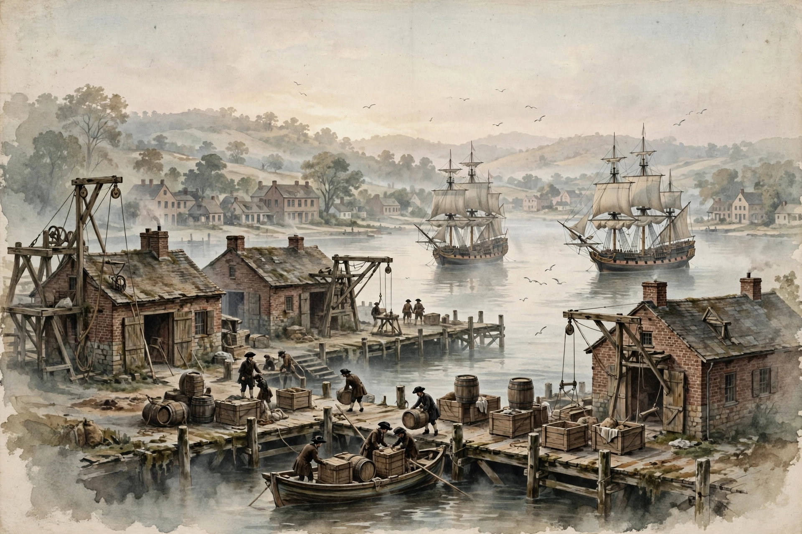

# Lesson 4 — Enslavement as a System: The Middle Passage and Plantation Labor

**Unit 01 · Week 5 S1 · ~45 minutes · Session type: concept launch**

> **Adult preview note:** This lesson covers the Middle Passage and plantation labor — mature, violent history. All excerpts are adult-selected, brief, and public domain. Read the [teacher guide](../teacher-guide.md) preview notes before teaching. Learners may take an observer/recorder role in any discussion.

## Goal

I can describe the four things the plantation system required — supply, demand, law, and violence — and explain what the Middle Passage was.

## Materials

- [Generated port illustration](../assets/colonial-port-illustration.png) (labeled AI reconstruction)
- Equiano excerpt (below; adult reads aloud or learners read in pairs)
- Notebook

## Readiness check (5 min)

From Lesson 3: name the environment → crop → labor chain for the Southern colonies in one sentence. What question does that chain leave unanswered? (*How did planters get and keep that labor?* — today's lesson.)

## Explicit teaching (15 min)

Enslavement in the English colonies was not just prejudice plus hard work. It was a **designed system** — built deliberately, piece by piece, to produce profit. Four things held it up:

1. **Demand.** Europe wanted sugar, tobacco, rice, and indigo in enormous quantities. Plantation owners wanted to produce them as cheaply as possible. That demand created a market for workers who could never quit, never bargain, and never leave.
2. **Supply.** The transatlantic slave trade supplied those workers by force. Between 1501 and 1866, slave traders forced about **12.5 million Africans** aboard ships bound for the Americas; about 10.7 million survived the crossing (Voyages: The Trans-Atlantic Slave Trade Database). Portugal, Britain, France, Spain, the Netherlands, and the United States all participated. Before 1820, roughly four enslaved Africans crossed the Atlantic for every one European migrant.
3. **Law.** Colonial assemblies wrote enslavement into law: lifelong, and **hereditary** — a child's status followed the mother's. Laws restricted movement, assembly, literacy, and self-defense, and punished resistance with violence. The law is what turned kidnapping into an *institution*.
4. **Violence.** The system ran on force at every point: capture and forced marches in Africa, the armed Middle Passage crossing, overseers' whips on plantations, and patrols hunting escapees. Violence was not a breakdown of the system — it was the system working as designed.

The **Middle Passage** — the ocean leg from Africa to the Americas — shows all four at once: European demand paid for it, African and European traders supplied captives, no law protected the captives, and the ships were run by armed force.

### Worked example 1 — Reading the port illustration as a reconstruction

*Study the AI-generated illustration of a colonial port below (full generation record in* [assets/README.md](../assets/README.md)*). It is a modern reconstruction, not a primary source.*

*Caption: AI-generated reconstruction of an 18th-century colonial American port at dawn. This is a modern illustration imagining the past — not a primary source and not evidence of any specific event.*

*Question: What can this image show us, and what can it NOT prove?*

*Reasoning — what it shows:* Ships at anchor, warehouses, dockworkers loading barrels and crates — evidence that ports were busy transfer points where ocean cargo met land labor. It illustrates the *scale* of the trade infrastructure.

*Reasoning — what it cannot prove:* It cannot tell us who profited, who was forced to do the labor, where the goods came from, or what the work felt like. The barrels are unlabeled; the workers' legal status is invisible. A reconstruction shows the artist's informed imagination — useful for visualizing, useless as proof. That is the D2.His.10 skill: detect what the record (even a modern image) leaves out.

### Worked example 2 — Close reading Equiano

*Excerpt — Olaudah Equiano, The Interesting Narrative of the Life of Olaudah Equiano (1789), Chapter II. Equiano was kidnapped as a child in West Africa, survived the Middle Passage, later bought his freedom, and published his account in London to argue against the slave trade. Public domain.*

> "The stench of the hold while we were on the coast was so intolerably loathsome, that it was dangerous to remain there for any time... the whole ship's cargo were confined together... The closeness of the place, and the heat of the climate, added to the number in the ship, which was so crowded that each had scarcely room to turn himself, almost suffocated us... The shrieks of the women, and the groans of the dying, rendered the whole a scene of horror almost inconceivable."

*Question: What does this excerpt prove about the system, and what is its limit as evidence?*

*Reasoning — what it proves:* First-person testimony that the crossing was deliberately, lethally overcrowded ("scarcely room to turn himself") — crowding was a business decision: more captives per ship meant more profit per voyage. The maker (a survivor), date (1789, decades after his crossing), and purpose (abolitionist argument) are all identifiable — D2.His.11 in action.

*Reasoning — the limit:* One person's experience, written decades later for a political purpose, cannot by itself establish what *every* crossing was like. Historians corroborate it with ship logs, trader records, and the database numbers — multiple source kinds, per D2.His.9. The excerpt is powerful evidence, not the whole case.

## Guided practice (10 min)

1. With the adult, sort these facts under the four system requirements (demand / supply / law / violence): *"Virginia law, 1662: a child's status follows the mother"; "London merchants finance a voyage"; "overseers carry whips"; "10.7 million Africans landed in the Americas, 1501–1866."*
2. Identify the Equiano excerpt's maker, date, place, and intended audience. What was his purpose in publishing?
3. Discuss: why does the system need *all four* requirements? What happens to the system if laws against literacy and assembly are removed?

## Independent practice (10 min)

1. In your notebook, explain the Middle Passage in 3–4 sentences: what it was, who was on the ships, and what the 12.5 / 10.7 million figures tell us about its human cost. (Show the arithmetic: 12.5 − 10.7 = ~1.8 million died on the crossing.)
2. Write two sentences: one thing the port illustration helps you understand, and one important question about the system it cannot answer.
3. **Explain-your-reasoning:** A classmate says, "The slave trade was just business — everyone was doing it." Using the four requirements, explain why "just business" is an incomplete description. What does each requirement add?

## Application

The lesson names four system requirements. Choose a modern system you know (a school, a sports league, a company) and name what holds *it* up — its demand, its supply, its rules, its enforcement. One paragraph. What makes a system fair or unfair?

## Exit check

List the four requirements of the plantation system with one example of each, from memory.

## Supports and extensions

- **Reading access:** The adult reads the Equiano excerpt aloud first; learners follow along. Pre-teach *loathsome*, *pestilential*, *avarice* (greed).
- **Alternate response mode:** Learner may answer the exit check as a labeled four-box diagram.
- **Sensitive-topic support:** Any learner may write privately instead of discussing aloud; the adult checks in individually. No learner is asked to role-play an enslaved person or a trader.
- **Extension:** Compare Equiano's account with the numbers from the Voyages database: what does each source kind contribute that the other cannot? (Personal testimony gives experience; the database gives scale.)

## Teacher note — likely misconceptions

- *"Africans sold each other, so Europeans weren't responsible."* African traders and states participated, but European demand, financing, ships, and American plantation markets created and scaled the system — responsibility is shared but not equal, and the system's design was European-driven.
- *"Enslaved people were passive victims."* Lesson 5 exists precisely to correct this: resistance was constant.
- Answer-key reference: [answer-key.md](../answer-key.md) Lesson 4.
