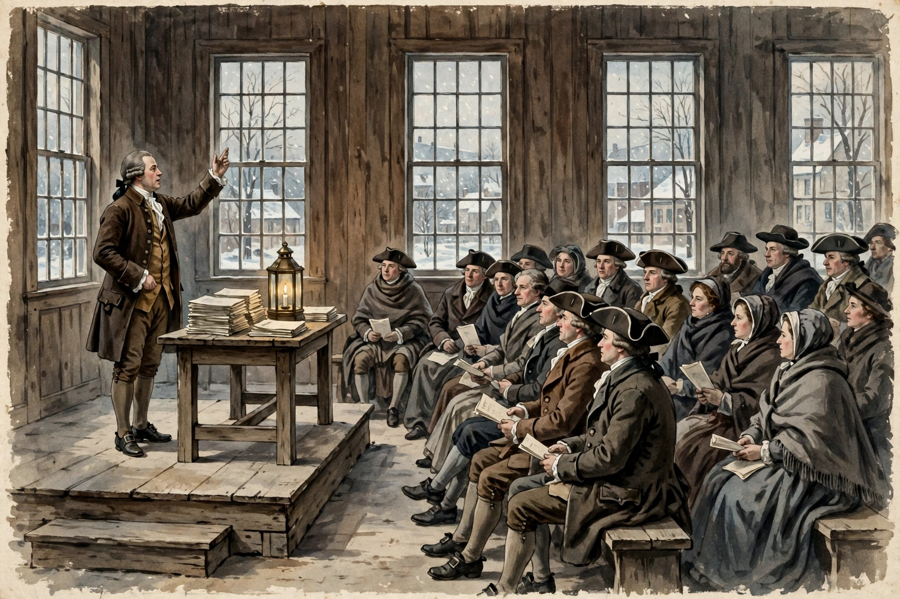

# Lesson 3 — Federalists vs. Anti-Federalists: The Ratification Fight

**Goal:** By the end of this lesson, you can paraphrase one Federalist and one
Anti-Federalist argument, explain how the Massachusetts "ratify and recommend"
model broke the deadlock, and read an illustration for what it can and cannot prove.
**Time:** ~45 minutes. **Materials:** this lesson, the image below (or its text-only
alternative), a notebook.

## Readiness check (3 minutes)

The Constitution was signed, but Article VII said it would take effect only when
**nine of thirteen** states ratified it — and each state would decide in a special
convention, not in its legislature. Predict: would the fight be quick or slow? What
would the losing side at Philadelphia do next?

## Explicit teaching

The fight moved to the newspapers. Supporters of the Constitution called themselves
**Federalists**; opponents, **Anti-Federalists**. Both sides wrote essays under
pen names for ordinary readers — the ratification debate was the first great
American argument conducted in print.

**The Federalist case.** Alexander Hamilton, James Madison, and John Jay wrote 85
essays as "Publius," collected as *The Federalist*. Two matter most here:

- *Federalist No. 10* (Madison, November 22, 1787): a **faction** — a group united by
  an interest hostile to others' rights or the common good — cannot be eliminated
  without destroying liberty itself ("Liberty is to faction what air is to fire").
  The cure is to *control its effects*: in a large republic, so many different
  interests compete that no single faction can easily seize control, and elected
  representatives filter public views.
- *Federalist No. 51* (Madison, February 1788): the Constitution's structure is the
  safeguard. Separate the powers, then give each branch the means to resist the
  others: "Ambition must be made to counteract ambition." A government that controls
  the governed must also be obliged to control itself.

**The Anti-Federalist case.** Writers like "Brutus" (essays attributed to Robert
Yates of New York) answered that size was the problem, not the solution:

- *Brutus No. 1* (October 18, 1787): a republic as large as the United States cannot
  represent its people well; representatives will be too distant, and the
  **necessary-and-proper clause** plus the **supremacy clause** will let the national
  government swallow the states. A free government needs a bill of rights spelling
  out what government may *not* do — the Constitution had none.

Notice what both sides agreed on: factions and abuses of power are real dangers.
They disagreed on the remedy — dispersed size and structure, or closeness, local
control, and written limits.

The deadlock broke in Massachusetts. Its convention was closely divided, and on
February 6, 1788, it ratified **187–168** — but attached a list of recommended
amendments, with the understanding that a bill of rights would follow. This
"ratify and recommend" model let wavering states say yes *and* demand protections,
and it became the template for the remaining conventions. New Hampshire became the
ninth state on June 21, 1788 (57–47); Virginia followed June 25 (89–79) and New York
July 26 (30–27), both narrowly and both with recommended amendments. North Carolina
waited until November 21, 1789, and Rhode Island until May 29, 1790 — after the new
government had already begun (March 4, 1789) and Congress had proposed a bill of
rights. The Anti-Federalists lost the Constitution but won the amendments.

## The image activity

Study the reconstruction below. It is **not** a primary source: it is a modern
AI-generated illustration imagining a public ratification debate. Your job is to
separate what it shows from what it cannot prove.

*Caption: AI-generated reconstruction of a public ratification debate in a town
hall, winter 1787–1788 — a modern illustration imagining how printed arguments
circulated. Not a primary source; not evidence of any specific meeting, speaker,
or vote.*

**Text-only alternative** (use this if you cannot see the image): A wood-paneled
town hall in winter. A speaker in 18th-century dress gestures from a raised platform
beside a table stacked with pamphlets and a lit lantern. A seated audience in coats,
tricorn hats, and shawls listens, many holding blank pamphlets. Tall windows show
bare trees and snow outside. That is everything the image shows — and everything it
does not: no words, no pamphlet contents, no vote, no decision.

## Worked example 1 — Modeling a Federalist argument

*Federalist No. 10* reasoning, modeled step by step:

1. Premise: people in a free society will form factions (shared interests).
2. Premise: removing factions requires destroying liberty (bad) or forcing everyone
   to agree (impossible).
3. Therefore: do not try to remove the *causes* of faction; control the *effects*.
4. Mechanism: in a large republic, many factions compete, so no one faction can
   easily become a majority that oppresses others; representatives refine views.

Test it: does this argument answer Brutus's fear of distant government? Only partly —
Madison says distance *helps* (more factions, less capture), while Brutus says
distance *hurts* (representatives lose touch). Same fact, opposite conclusion. That
is what a real debate looks like.

## Worked example 2 — Modeling an Anti-Federalist argument

*Brutus No. 1* reasoning, modeled step by step:

1. Premise: a republic must be small enough for representatives to know their
   constituents' interests.
2. Premise: the necessary-and-proper clause lets Congress make any law "necessary
   and proper" for its powers, and the supremacy clause makes national law supreme.
3. Therefore: the national government will expand until the states are hollow
   shells, and without a bill of rights nothing stops it.
4. Demand: add explicit protections *before* ratifying.

Test it: does the Constitution's structure answer Brutus? Federalists said yes —
separation of powers and federalism *are* the limits. Brutus said no — limits must be
written down, because a government will use every power it is given. The Bill of
Rights (Lesson 5) is the historical answer to this argument; judge for yourself
whether it was a complete answer.

## Guided practice

1. In one sentence each, paraphrase Madison's faction argument and Brutus's
   size argument.
2. The image shows an audience holding pamphlets. What does that detail suggest
   about how the ratification debate reached ordinary people? What can the image
   *not* tell you about what those pamphlets said?
3. Why would a "ratify and recommend" vote appeal to a delegate who feared the
   Constitution but also feared disunion? Name both fears.
4. Compare the two deliberative processes: the closed-door Philadelphia convention
   (Lesson 2) and the open, printed ratification debate. Which produced the better
   decision? Give one reason for each side — this is practice for project §2's
   deliberation record.

## Independent practice

1. Sequence these ratification events and give each its vote where known:
   Delaware first; Massachusetts and its compromise; New Hampshire ninth; Virginia;
   New York; Rhode Island last. (Dates and votes are in the lesson and the unit
   overview.)
2. A classmate says, "The Federalists won, so the Anti-Federalists were wrong."
   Explain why that sentence is too simple, using the Bill of Rights as evidence.
3. Error analysis: A caption online calls the image above "a photograph of the 1788
   New York ratifying convention." List three things wrong with that caption.
4. Write two sentences: one Federalist argument you find convincing, and one
   Anti-Federalist worry you think was reasonable — even if you side with the
   Federalists overall.

## Application

Hold a two-minute deliberation (with an adult or partner playing the other side):
one side argues the Constitution should be ratified as written; the other argues it
should be ratified only with a bill of rights attached. Each side must cite one
essay argument (Madison or Brutus) and one fact about a state's vote. Then switch
sides and repeat. Record which argument was hardest to answer — that is your
project §2 deliberation note.

## Exit check

Without looking back: (1) Name the two *Federalist* essays and their authors.
(2) What was Brutus's central fear? (3) What did Massachusetts do on February 6,
1788, and why did it matter? (4) Name one thing the image shows and one thing it
cannot prove.

## Supports and extensions

- **Reading access:** essay arguments are paraphrased in the lesson; the adult may
  read one short original passage aloud (e.g., "Ambition must be made to counteract
  ambition") and unpack it word by word.
- **Alternate response mode:** the deliberation may be done in writing as two short
  speeches instead of spoken debate.
- **Extension:** read the opening of *Brutus No. 1* and of *Federalist No. 10* in a
  public-domain collection (see the resource pack) and compare one sentence from
  each in your own words.

## Teacher note

- **Likely misconception:** "Federalists wanted a strong king-like government."
  Correct: Federalists wanted a stronger *national* government within a republic —
  elected, limited, and divided — not a monarchy; Anti-Federalists feared it would
  *become* too strong, which is a different claim. See [teacher-guide.md](../teacher-guide.md).
- **Image note:** stress the reconstruction label every time the image is shown;
  learners must never cite it as evidence. The audience includes women listeners —
  plausible for a public meeting, but not evidence about who could vote (Lesson 6).
