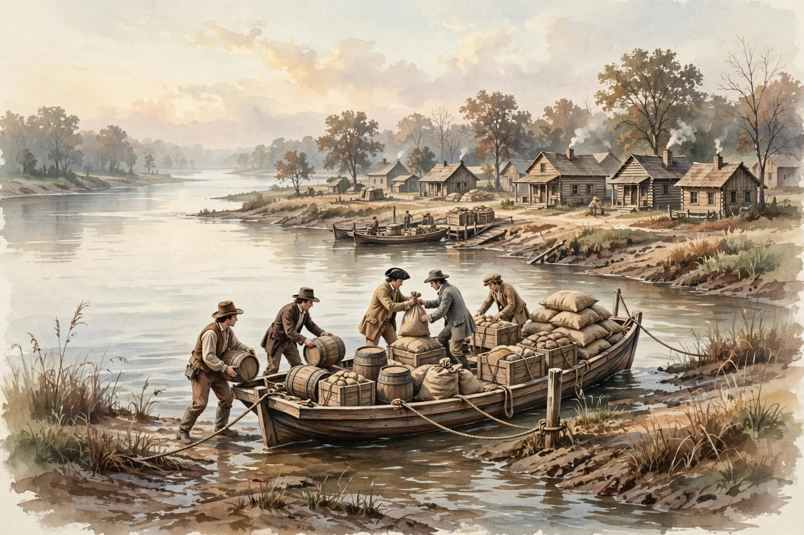

# Lesson 3 — The Louisiana Purchase: A Bargain, a Dilemma, and a Map

**Goal:** By the end of this lesson, you can state the Louisiana Purchase's
price, size, and dates, work its per-acre arithmetic, explain Jefferson's
constitutional dilemma, and sequence the new states it helped produce.
**Time:** ~45 minutes. **Materials:** this lesson, a notebook, a calculator,
`resources/us_states.csv` (statehood-year column), the illustration in
`assets/mississippi-flatboat-illustration.png`.

## Readiness check (3 minutes)

Answer in one sentence each: (1) Why did American farmers west of the
Appalachians care about New Orleans? (2) What did Jefferson argue about
listed powers in the bank debate? Keep your answers; Jefferson is about to
argue against himself.

## Explicit teaching

By 1800 the Mississippi River was America's economic spine. Farmers in Ohio,
Kentucky, and Tennessee floated grain, pork, and whiskey downriver to New
Orleans, where goods were loaded onto ocean ships. Whoever controlled New
Orleans controlled the West's wallet. Spain had held it, then retroceded
Louisiana to France in 1800. When Napoleon Bonaparte offered to sell not just
New Orleans but the whole Louisiana Territory, Jefferson's envoys, Robert
Livingston and James Monroe, were authorized to pay up to $10 million for the
port and the Floridas. Offered the entire territory, they agreed to $15
million and signed the treaty in Paris on April 30, 1803. The Senate ratified
it 24–7 on October 20, 1803. The price was $11.25 million in bonds plus $3.75
million in American claims against France that the United States assumed.
The territory — 828,000 square miles from the Mississippi to the Rockies —
roughly doubled the nation's size, and its land would eventually form all or
part of fifteen states.

Then came Jefferson's dilemma. The strict-construction president who had
argued that Congress may do only what the Constitution lists could find no
listed power to buy foreign territory. He considered seeking a constitutional
amendment, then set the scruple aside: the bargain was too good, Napoleon
might withdraw it, and the West's future was at stake. Jefferson bought first
and justified later — the loose-construction move he had condemned in
Hamilton. The lesson is not that Jefferson was a hypocrite and nothing more;
it is that principles bend under opportunity, and that recognizing the bend
is part of honest history. Jefferson sent Meriwether Lewis and William Clark
(1804–1806) to explore the new territory, map its rivers, and establish
American claims — exploration as both science and sovereignty.

What the purchase meant on the ground depended on where you stood. For
eastern farmers it meant cheap land and a river highway. For enslaved people
it could mean forced migration to new cotton lands. For Native nations living
in the territory — and for the nations east of the Mississippi whose land
hunger now intensified — it meant a growing American claim over lands they
had never ceded. The purchase did not settle slavery's future; it enlarged
the stage on which slavery's future would be fought. When Missouri applied
for statehood as a slave state in 1819, Congress compromised in 1820: Maine
entered free, Missouri entered slave, and slavery was barred north of the
36°30′ line in the remaining Louisiana Territory. The Missouri Compromise
postponed the conflict; it did not resolve it. That postponement is the thread
that runs from this lesson to U06.

## The illustration activity

*Figure 1 — A Mississippi river port in the early 1800s (AI illustration; see
[assets/README.md](../assets/README.md) for the generation record). This image is
a modern reconstruction. It is not evidence of any particular boat, town, or
day.*

**Text-only alternative:** A flat wooden riverboat sits at a muddy bank,
loaded with barrels, crates, and sacks. Four workers load more goods. Behind
them stands a small town of log and frame houses with smoke rising from
chimneys, and the wide river stretches away behind the boat.

Answer these about the image:

1. List three kinds of cargo you can see. What kind of economy moves goods in
   barrels, crates, and sacks down a river?
2. The boat has no engine and no sails set. How do you think it travels
   downstream, and what does that imply about how hard the return trip is?
3. What does this image **not** show that this lesson says mattered: who
   owned the land the town stands on, and who was forced to move so the town
   could grow? Why can an illustration of a busy port hide those facts?

## Worked example 1 — The per-acre arithmetic

The treaty price is $15,000,000 for 828,000 square miles.

- Step 1: Convert square miles to acres. One square mile = 640 acres.
  828,000 × 640 = 529,920,000 acres.
- Step 2: Divide price by acres. $15,000,000 ÷ 529,920,000 ≈ $0.0283 per acre,
  or about 2.8 cents per acre.
- Step 3: Compare with the source. The National Archives describes the deal
  as "roughly 4 cents an acre." The difference comes from rounding and from
  which acreage figure is used; the honest statement is "a few cents an
  acre," not a false precision of 2.83 cents.
- Conclusion: a per-acre figure is only as good as its inputs. Show your
  arithmetic, name your inputs, and treat rounded historical claims as
  rounded — that is how you avoid inventing precision.

## Worked example 2 — Sequencing statehood from the dataset

Using the `statehood_year` column of `resources/us_states.csv`:

- Step 1: Pull the admissions in this era: Vermont 1791, Kentucky 1792,
  Tennessee 1796, Ohio 1803, Louisiana 1812, Indiana 1816, Mississippi 1817,
  Illinois 1818, Alabama 1819, Maine 1820, Missouri 1821.
- Step 2: Sort them. Note the quickening after 1803: six admissions between
  1812 and 1821, against three between 1791 and 1803 (counting Vermont,
  Kentucky, Tennessee, plus Ohio in 1803 itself).
- Step 3: Ask the geographic question: which of these states came from the
  Louisiana Purchase itself? Louisiana (1812) and Missouri (1821) directly;
  the rest came from older claims and cessions.
- Conclusion: a dataset answers "when" precisely; "why so fast after 1803"
  needs the lesson's explanation — land hunger, river trade, and the
  purchase itself. Data plus narrative, not data instead of narrative.

## Guided practice

With an adult or partner, work through these. Hints are in parentheses.

1. State the purchase's price, size, signing date, and Senate vote. (Four
   facts; check each against the lesson.)
2. Jefferson's dilemma in one sentence: what did he believe about listed
   powers, and what did he do? (Strict construction vs. buying anyway.)
3. Why was New Orleans worth more than its acreage? (It controlled the
   river mouth.)
4. What did the Missouri Compromise decide, and what did it postpone?
   (Maine/Missouri pair; 36°30′ line; slavery's expansion left open.)

## Independent practice

1. Redo the per-acre arithmetic with the $11.25 million bond payment alone
   (ignore the $3.75 million in claims). What price per acre do you get, and
   why is the full $15 million the right figure for "the price"?
2. Using the statehood list in Worked Example 2, write the admissions as a
   timeline from 1791 to 1821 and mark which two came from the purchase
   itself. Then write one sentence explaining why the pace quickened after
   1812.
3. Error analysis: a classmate writes, "Jefferson bought Louisiana because
   the Constitution clearly allowed it." Correct the sentence with two facts
   from this lesson.

## Application

A farmer in Kentucky in 1804 writes to a cousin in Virginia: "The river is
ours now." Write a six-sentence reply from the cousin that (a) agrees about
the river's value, (b) names one group for whom the purchase was bad news,
and (c) asks one question about slavery's future in the new territory. Label
your letter as a modern reconstruction.

## Exit check

Without looking back, write: (1) the purchase price and size, (2) one
sentence on Jefferson's dilemma, (3) the Missouri Compromise's line and what
it postponed.

## Supports and extensions

- **Reading support:** the adult reads the per-acre worked example aloud
  while the learner follows each step on a calculator.
- **Alternate response mode:** learners may build the statehood timeline
  with dated cards on a table.
- **Extension:** research Lewis and Clark's expedition (1804–1806) and write
  three sentences on how exploration served both science and American claims
  to the territory, with a citation.

## Teacher note

Misconception alert: learners often say the purchase "doubled the country"
as if the land were empty. Correct it explicitly: tens of thousands of Native
people lived in the territory, and the purchase transferred a European claim,
not an empty continent. Also correct the "4 cents" figure if learners quote it
as exact: show the division. Answer-key reference:
[answer-key.md](../answer-key.md), Lesson 3 items.
