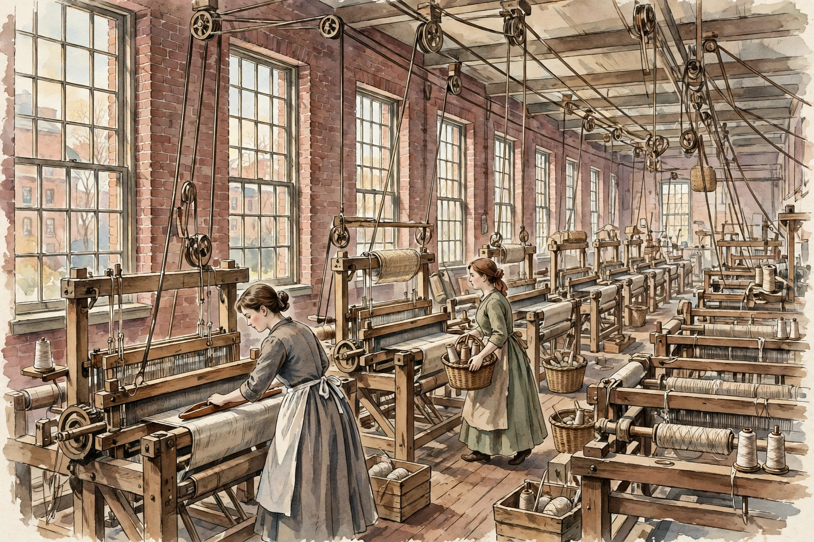

# Lesson 2 — Lowell and the New Wage Labor

**Goal:** By the end of this lesson, you can describe who worked in the
Lowell mills, their hours, wages, board, and rules; compute a mill
worker's take-home pay; and explain two ways workers pushed back.
**Time:** ~45 minutes. **Materials:** this lesson, a notebook, the Lowell
mill illustration below.

## Readiness check (3 minutes)

Answer in one sentence each: (1) In 1820, what did a farm daughter earn
for her work — cash wages, or food and lodging? (2) Would you rather be
paid $3 a week and pay $1.50 for room and board, or be paid nothing and
live free at home? There is no single right answer — keep your reasoning;
the mill girls faced exactly this choice.

## Explicit teaching

Lowell, Massachusetts, was a planned mill city. In 1820 it was a farming
hamlet of about 200 people called East Chelmsford; by 1850 it held 32
textile mills and about 33,000 people. The mills ran on water power from
the Merrimack River, and they needed workers — thousands of them. The
corporations that owned the mills recruited young women from New England
farms, generally 15 to 30 years old (most between 15 and 25). They were
called "mill girls," and for a few years they were the best-paid women in
America.

The bargain worked like this. A mill girl signed a contract, usually for
a year. She lived in a company boarding house — a large brick building
holding 20 to 40 women, run by a keeper who enforced the rules: a 10 p.m.
curfew, church attendance, and good behavior, on pain of losing her job.
She worked 12 to 14 hours a day, plus a half day on Saturday — about 73
hours a week — in a loud, dusty room full of power looms. She earned
$1.85 to $3.00 a week, the highest wages paid to women anywhere in the
country, and she sent much of it home to her family. But room and board
cost $1.25 to $1.50 a week, deducted from her pay before she saw it. The
corporation also owned the boarding house, set the rules, and could fire
her — and a fired worker needed an honorable discharge from the company
to get hired at another mill.

Study the illustration below. It is a **modern AI reconstruction** of a
mill room in the 1840s — an artist's imagining, not a photograph and not
evidence about any particular mill, day, or person. Use it to practice
observation, then check every claim you make from it against the verified
facts in this lesson and in the National Park Service reference in the
resource pack.

*Caption: A modern AI illustration of a Lowell mill room in the 1840s.
It is a reconstruction, not a historical photograph or a primary source.
It shows the looms, belts, windows, and workers' dress in general terms;
it proves nothing about any particular mill, worker, or day.*

**Text-only alternative (the information you need for the activity):**
The image shows a long brick mill room with tall multi-pane windows along
one wall; rows of wooden power looms with belts and pulleys running
overhead; baskets of bobbins and spools of thread; and two young women in
plain long dresses with aprons — one adjusting a loom, one carrying a
basket of bobbins. The room looks bright from the windows, busy, and
ordered. What the image does **not** show: the noise, the cotton dust in
the air, the 12–14-hour day, the boarding-house curfew, or the wage cut
that could arrive without warning. Those facts come from the written
record, not from the picture.

The mill girls did not accept every condition silently. In 1834, about
800 Lowell women walked out over a wage cut; in 1836, about 1,500 walked
out over a rise in the price of board. The 1836 turnout was led in part
by Harriet Hanson, a doffer who had started in the mills at about ten
years old. In the 1840s, Sarah Bagley and the Lowell Female Labor Reform
Association campaigned for a ten-hour day and published a labor
newspaper, *The Voice of Industry*. They did not win the ten-hour day —
but the corporations did cut the workday to 11 hours. Mill girls also
wrote: between 1840 and 1845, *The Lowell Offering* published their poems,
essays, and stories, proof that the workers were thinking, reading, and
arguing in the very hours the mills did not own.

The law was also changing. Before 1842, courts often treated a union as
a criminal conspiracy — workers combining to raise wages could be
prosecuted, as the Boston bootmakers had been. In *Commonwealth v. Hunt*
(1842), Chief Justice Lemuel Shaw of the Massachusetts Supreme Judicial
Court ruled that a labor society was not automatically a crime: workers
could agree on wages and refuse to work with non-members, so long as
their means stayed lawful. The decision did not make unions powerful —
judges stayed hostile for years — but it removed the stigma of criminality
from organizing, and labor historians call it a landmark.

**Key vocabulary in context:** *Wage labor* means the worker sells her
time for cash; a mill girl's wage was hers to send home, which is why
families let their daughters go. A *turnout* is a strike — the Lowell
women's word for walking out together. *External costs* here are the
mill's noise, dust, and long hours: the worker's health paid for cloth
that buyers got cheaply.

## Worked example 1 — What did a mill girl take home?

A mill girl earns $2.50 a week. Board costs $1.25 a week, deducted from
her pay.

- Step 1: $2.50 − $1.25 = $1.25 left after board.
- Step 2: She sends half of what is left home to her family:
  $1.25 ÷ 2 = $0.625, about 63 cents.
- Step 3: She keeps about 63 cents a week for herself — for clothes,
  books, savings, or the *Lowell Offering* subscription.
- Conclusion: the "highest wages for women in America" were real, and
  they were also small. Now try the low end: at $1.85 a week with $1.50
  board, she keeps 35 cents before sending anything home. Wages are only
  half the story; deductions are the other half.

## Worked example 2 — Why did the 1836 turnout happen?

- Step 1 (the trigger): the corporations raised the price of board. A
  mill girl's wage did not rise — so her take-home pay fell.
- Step 2 (the choice): she could accept less money, or she could walk
  out with the other women and demand the old board price back.
- Step 3 (the risk): walking out meant losing wages for those days, and
  the corporation could fire her — and without an honorable discharge she
  could not be hired at another Lowell mill.
- Conclusion: a strike is a gamble. About 1,500 women decided the gamble
  was worth it in 1836, which tells you how much the board increase hurt.
  When you judge a strike, always ask what the strikers risked, not just
  what they demanded.

## Guided practice

With an adult or partner, work through these. Hints are in parentheses.

1. From the illustration and the lesson, name three things the picture
   shows and three things it hides. (Shows: looms, windows, workers'
   dress. Hides: noise, dust, hours, rules.)
2. A mill girl earns $3.00 a week and pays $1.50 for board. How much is
   left? If she sends half home, how much does she keep? ($1.50 left;
   75 cents kept.)
3. Why did the corporations prefer to hire young farm women rather than
   men? (They were cheaper, seen as easier to control, and left after a
   few years — most averaged about three years before leaving.)
4. What did *Commonwealth v. Hunt* change, and what did it not change?
   (It made organizing lawful in principle; it did not make unions strong
   or judges friendly.)

## Independent practice

1. Complete the table with one phrase per cell:

   | Lowell fact | Figure | What it meant for a worker |
   |---|---|---|
   | Hours per week | ? | ? |
   | Wages per week | ? | ? |
   | Board per week | ? | ? |
   | 1834 turnout | ? | ? |
   | 1836 turnout | ? | ? |

2. Write three sentences: (a) one reason a farm family would send a
   daughter to Lowell; (b) one reason a mill girl would join the 1836
   turnout; (c) one sentence explaining why the corporations could set
   both the wages and the boarding-house rules.
3. Error analysis: a classmate writes, "The mill girls were happy
   because they had the best wages in America." Explain two things wrong
   with that sentence, using this lesson. (Hint: think about hours and
   about who spoke — the *Lowell Offering* and the turnouts are evidence
   of what the workers themselves thought.)

## Application

Imagine you are a mill girl writing to your sister on the farm in 1836,
after the turnout. Write a six-sentence letter: one sentence saying what
you earn and what board costs, one sentence describing the mill room, one
sentence saying why you walked out, one sentence saying what you risked,
one sentence saying what the turnout won or did not win, and one sentence
saying whether you would stay or go home. Label the letter as a modern
reconstruction. Do not invent a real mill girl's name; sign it "your
sister."

## Exit check

Without looking back, write: (1) the mill girls' age range and where
they came from; (2) the hours per week and the wage range; (3) one
sentence explaining what a turnout is.

## Supports and extensions

- **Reading support:** the adult reads the wage-and-board figures aloud
  while the learner writes the subtraction on paper. Money arithmetic is
  the lesson's core skill; do it slowly.
- **Alternate response mode:** learners may answer the table orally or
  by placing figure cards next to meaning cards.
- **Extension:** read the National Park Service "Mill Girls of Lowell"
  page (resource pack, reference 1) and find one fact this lesson does
  not state. Write two sentences about it with a citation.

## Teacher note

Misconception alert: learners often romanticize the mill girls as either
victims or heroines. Correct it explicitly: they were workers making
hard choices with real wages and real costs, and they organized — that
is the lesson. Sensitive note: the lesson mentions child labor (Harriet
Hanson began at about ten); keep the discussion factual and brief, and do
not ask learners to role-play a child worker. Answer-key reference:
[answer-key.md](../answer-key.md), Lesson 2 items.
