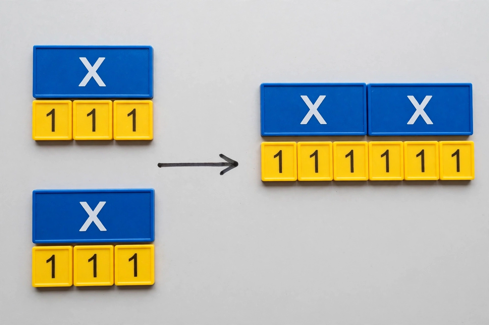

# Lesson 02 — Equivalent Expressions: Rewriting Without Changing Value

**Goal:** I can rewrite an expression into an equivalent form using the
distributive property and combining like terms, and prove two forms are
equivalent by substitution.
**Time:** 50 minutes · **Materials:** notebook; the tile image below (with
text alternative)

## Readiness check (5 min)

Compute `2(10 + 3)` two ways: as `2(13)` and as `2(10) + 2(3)`. Both give 26 —
that agreement is the distributive property in action.

## Teaching: same value, different shape (15 min)

Two expressions are **equivalent** if they give the same value for every
choice of the variable. Rewriting is not guessing — each rewrite must keep the
value identical.

**The distributive property:** `a(b + c) = ab + ac`. Multiplication spreads
over addition. It also runs backward (factoring): `ab + ac = a(b + c)`.

**Like terms** have exactly the same variable part: `3x` and `−7x` are like
terms; `3x` and `3x²` are not. Combine them by adding coefficients:
`3x − 7x = −4x`.

### Worked example 1 — distribute, then combine

> Rewrite `5(2n − 4) + 3n` in simplest form.

1. Distribute the 5 over `(2n − 4)`: `5(2n) + 5(−4) = 10n − 20`.
2. Now the expression is `10n − 20 + 3n`. Combine the like terms `10n` and
   `3n`: `13n − 20`.
3. **Verify by substitution.** Pick `n = 2`.
   Original: `5(2(2) − 4) + 3(2) = 5(4 − 4) + 6 = 5(0) + 6 = 6`.
   Rewrite: `13(2) − 20 = 26 − 20 = 6`. They agree — strong evidence the
   rewrite is valid. (One test does not prove equivalence for all `n`, but a
   rewrite built only from legal properties is valid, and the test catches
   arithmetic slips.)

### Worked example 2 — factor out common structure

> Rewrite `12a + 18` by factoring, and explain what the factored form shows.

1. The greatest common factor of 12 and 18 is 6, and both terms share it:
   `12a + 18 = 6(2a + 3)`.
2. Check with `a = 1`: original `12 + 18 = 30`; factored `6(2 + 3) = 6(5) = 30`.
3. The factored form shows the expression is always a multiple of 6 — hidden in
   the original form. Factoring reveals structure; distributing hides it.
   Choose the form that answers your question.

## Activity: the tile image (10 min)

Study the image: on the left, two groups, each with one blue `x` tile and
three yellow `1` tiles; on the right, all tiles rearranged — two `x` tiles and
six `1` tiles.

*Algebra tiles modeling the distributive property: 2 groups of (x + 3) contain
the same tiles as 2x + 6.*

**Text alternative (same information, no image needed):** Imagine two bags.
Each bag holds one card marked `x` and three cards marked `1`. Empty both bags
onto a table and sort: you have two `x` cards and six `1` cards. The bags
represent `2(x + 3)`; the sorted table represents `2x + 6`.

**Your task:** Write the expression each side of the image represents, then
answer: (a) Why does the arrow not change the total value? (b) Substitute
`x = 4` into both forms and show they agree. (c) A learner claims the image
proves `2(x + 3) = 2x + 3`. Use the tile counts to refute them.

## Guided practice (8 min, with hints)

1. Rewrite `3(y + 7) − 2y` in simplest form. *Hint: distribute first, then
   combine the y-terms.*
2. Verify your rewrite with `y = 1`.
3. Factor `20m − 25` completely. *Hint: what is the greatest common factor of
   20 and 25?*

## Independent practice (9 min)

4. Simplify: (a) `6(2t − 3) + 4t`, (b) `−2(5 − x) + 3x`, (c) `4a + 2(a − 5) − a`.
5. Factor: (a) `9x + 27`, (b) `14b − 7`.
6. **Error analysis:** "Mara wrote `4(x + 5) = 4x + 5`." Explain exactly what
   went wrong, using the tile picture if it helps, and write the correct
   equivalence.
7. In `(2t + 1)³`, which chunk is the repeated single entity? Write what the
   expression means in words without expanding it.

## Application (3 min)

A store sells notebooks in packs: `3` packs of `(n + 2)` notebooks plus `n`
loose notebooks. Write two equivalent expressions for the total notebooks and
explain which form a stock clerk would prefer.

## Exit check

Rewrite `7(x − 2) + x` in simplest form and verify with `x = 3`.

## Supports and extensions

- **Reading access:** verbalize each rewrite step ("five times two n minus
  four becomes ten n minus twenty").
- **Alternate response:** build the tile activity with real paper tiles or
  drawn rectangles.
- **Extension:** Rewrite `(x + 4)(x + 4)` by treating one `(x + 4)` as a
  single entity and distributing: what do you get? (Foreshadows U05.)

## Teacher note

Watch for `4(x + 5) = 4x + 5` (distributing to only the first term) and for
combining unlike terms (`3x + 4 = 7x`). The substitution check is the
self-correcting habit — insist on it until it is automatic. Answer-key
reference: [answer-key.md](../answer-key.md#lesson-02).
