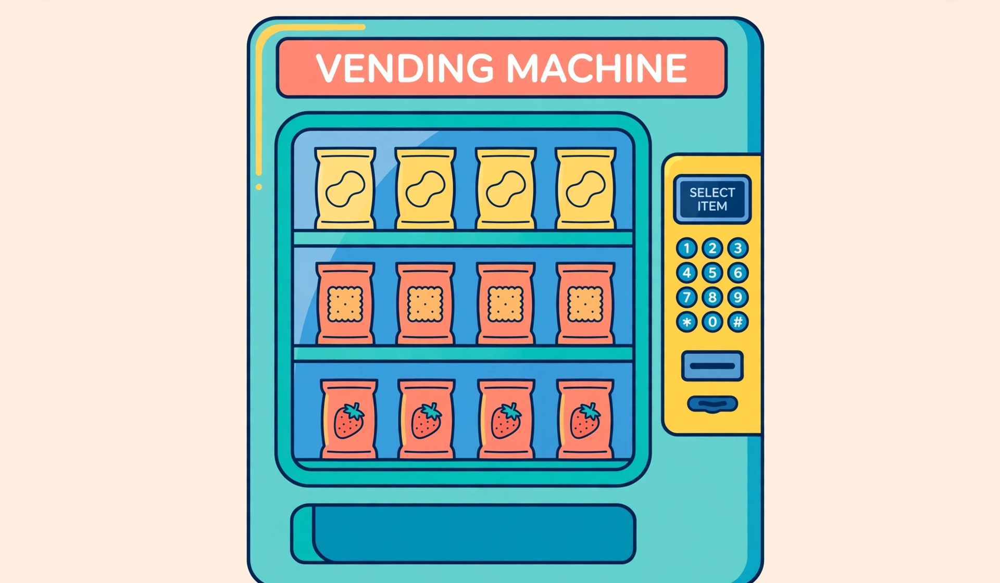

# Lesson 01 — The Function Concept: One Input, Exactly One Output

**Goal:** I can explain what makes a relation a function — exactly one output
for every input — and use a vending machine to test whether a rule is a
function.
**Time:** 50 minutes · **Materials:** notebook, the vending-machine image

## Readiness check (5 min)

A tutoring center charges $12 plus $2.50 per hour: `C = 12 + 2.5h`.
For `h = 4`, what is `C`? If two different tutors both use this rule for
`h = 4`, can they get different answers? (You are ready: `C = 12 + 10 = 22`;
no — the rule gives the same output for the same input. That sameness is
today's whole idea.)

## Teaching: the one-output rule (15 min)

A **relation** is any pairing of inputs with outputs. A **function** is a
special kind of relation: **each input gets exactly one output.** Not zero,
not two — exactly one.

Three fine print points that save you all year:

1. **Two different inputs may share one output.** A function can give the
   same answer twice. What it cannot do is give *two different* answers to
   the *same* input.
2. **The output must be predictable.** If the same input could mean two
   different things, you cannot trust the rule — and it is not a function.
3. **The "graph of f is the graph of y = f(x)"** (F-IF.1): when you plot
   input `x` against output `f(x)`, the points you get are exactly the
   function's graph. More on that in Lesson 03.

### The vending-machine activity

*A vending machine is like a function: each button press selects exactly one item.*

> **Text-only alternative:** The illustration shows a vending machine with
> three glass shelves. The top shelf holds four yellow chip bags; the middle
> shelf holds four red cracker packs; the bottom shelf holds four red
> strawberry-snack packs. On the right side is a yellow panel with a
> "SELECT ITEM" screen, twelve round buttons in four rows (1, 2, 3 / 4, 5,
> 6 / 7, 8, 9 / *, 0, #), a bill slot, and a coin return.
>
> The machine's rule for this activity: buttons 1, 2, 3, 4 vend chips;
> buttons 5, 6, 7, 8 vend crackers; buttons 9, *, 0, # vend strawberry
> snacks. Every button press drops exactly one snack.

1. Complete the table: button `2` → ___; button `6` → ___; button `0` → ___;
   button `#` → ___.
2. Is the "button → item type" rule a function? Explain with the
   one-output rule.
3. **The broken machine.** One morning the machine malfunctions: pressing
   `4` sometimes drops chips and sometimes drops crackers. Is the button →
   item rule still a function? What exactly broke?

### Worked example 1 — ordered pairs

> Is `R = {(1, "chips"), (2, "chips"), (5, "crackers")}` a function? What
> about `S = {(1, "chips"), (1, "crackers"), (5, "crackers")}`?

1. In `R`, scan the inputs (first numbers): 1, 2, 5 — no repeats. Every
   input appears once with exactly one output. **R is a function.** Notice
   inputs 1 and 2 both give "chips": sharing an output is allowed.
2. In `S`, input `1` appears twice — with "chips" once and "crackers" once.
   One input, two possible outputs. **S is not a function.** It fails for
   the same reason the broken vending machine fails.
3. Check: the domain of `R` is the set of inputs `{1, 2, 5}`; the range is
   the set of outputs `{"chips", "crackers"}`.

### Worked example 2 — a table test

> A coach records athletes and the events they entered:
>
> | Athlete | Maya | Luis | Maya | Ana |
> |---|---|---|---|---|
> | Event | 100m | 200m | 400m | 100m |
>
> Is "athlete → event" a function?

1. List each input with its outputs: Maya → 100m **and** 400m; Luis → 200m;
   Ana → 100m.
2. Maya has two outputs, so the rule is **not a function** — exactly the
   vending-machine malfunction. (Maya and Ana sharing "100m" is fine; shared
   outputs are allowed.)
3. Flip it: "event → athlete" also fails (100m → Maya and Ana). Neither
   direction is a function here — and that is a useful discovery, not a
   mistake.

## Guided practice (10 min, with hints)

1. Is `T = {(−3, 4), (0, 4), (3, 1)}` a function? *Hint: check inputs for
   repeats with different outputs.*
2. Is `U = {(−3, 4), (−3, 9), (3, 1)}` a function? Explain in one sentence.
   *Hint: look at the input −3.*
3. A rule says "input: day of the week; output: the number of letters in the
   day's name." Is it a function? What are the outputs for Monday and
   Wednesday? *Hint: Monday has 6 letters.*
4. **Error analysis:** "Dez says `f(2) = 5` and `f(2) = 7` is fine because
   a function can have lots of outputs." Name the rule Dez broke, fix the
   statement, and explain what *would* be allowed (hint: `f(2)` and `f(3)`).

## Independent practice (12 min)

5. Classify each relation as function or not; give the domain and range of
   each:
   (a) `{(1, 2), (2, 4), (3, 6)}`  (b) `{(1, 2), (1, 3), (2, 4)}`
   (c) `{(5, 0), (5, 1), (5, 2)}`
6. A library rule: "input: book title; output: the number of pages." Is it a
   function? Could two different titles share an output? Could one title
   have two outputs?
7. Make your own vending machine: draw or describe a 6-button machine where
   the button → snack rule IS a function, and write its mapping as a set of
   ordered pairs. Then "break" it — change one mapping so it is no longer a
   function — and explain what changed.
8. For the input set `{2, 4, 6, 8}`, invent one relation that is a function
   and one that is not, using outputs of your choice. Explain each in a
   sentence.

## Application (5 min)

A school's attendance system records, for each student ID, the number of days
absent. The principal asks two questions: (a) "Given a student ID, how many
days were they absent?" (b) "Given a day-count like 3, which students have
exactly 3 absences?" Which question's rule is a function? Explain why the
other one is not.

## Exit check (3 min)

In one or two sentences, explain the vending-machine test: what would you
check to decide whether a button-to-item rule is a function?

## Supports and extensions

- **Reading access:** read each ordered pair aloud as "input 1 gives output
  chips."
- **Alternate response:** sort printed input/output cards into "one-output"
  and "two-output" piles instead of writing classifications.
- **Extension:** A "one-to-one" function is one where no two inputs share an
  output. Which of today's functions were one-to-one? Give a real example of
  a function that is one-to-one (hint: student ID → locker number) and one
  that is not (hint: student → birth month).

## Teacher note

Likely misconception: learners hear "one output per input" and then reject
functions where two inputs share an output (e.g., `{(1, 2), (2, 2)}`).
Re-anchor with the vending machine: buttons 1 and 2 both vending chips is
perfectly fine — the rule breaks only when one button gives two different
snacks. Answer-key reference: [answer-key.md](../answer-key.md#lesson-01).
