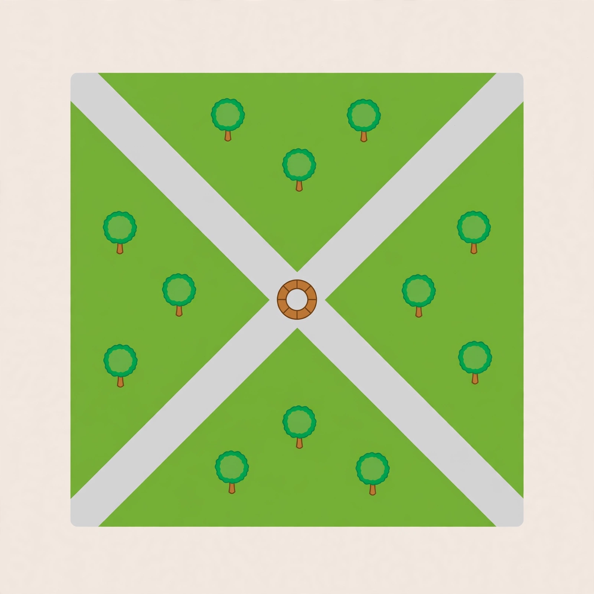

# Lesson 01 — Two Equations, One Pair

**Goal:** I can test whether an ordered pair is a solution of a system,
and find a system's solution by solving the two equations together.
**Time:** 50 minutes · **Materials:** notebook, ruler, the crossing-paths
image below.

## Readiness check (5 min)

Solve `y = 2x + 1` for `x = 3`, and solve `y = −x + 4` for `x = 3`.
If you got `y = 7` and `y = 1`, you are ready: the same `x` gave
different `y` values, so `(3, 7)` and `(3, 1)` are points on two
different lines. Today's question is: is there an `x` that gives the
*same* `y` on both lines?

## Teaching: a system asks for a pair that does two jobs at once (15 min)

A **system of equations** is two (or more) equations considered at the
same time, in the same variables. A **solution of the system** is an
ordered pair that makes *every* equation in the system true. One
equation alone has infinitely many solutions — every point on its line.
The system keeps only the pairs that lie on *both* lines. That is why
the graph of a system usually shows two lines crossing: the crossing
point is the one point on both lines.

*Caption: Two straight paths cross at exactly one point — the bench.
That one shared point is the picture of a system's solution.*

**Text-only alternative:** Picture a park from above. One straight path
runs from the lower-left corner to the upper-right corner. A second
straight path runs from the upper-left corner to the lower-right corner.
They cross exactly once, in the middle of the park, where a round bench
stands. A walker standing on the first path is somewhere on that path;
a walker standing on the second path is somewhere on that path; only a
walker at the bench is on *both* paths at once.

**Activity (with the image):** Point to the bench. It is the only spot
in the park that belongs to both paths. Now forget the park: a solution
of a system is the bench of the two equations — the one pair that
belongs to both. Every other point on either line fails at least one
equation, the way every other spot in the park is on at most one path.

That picture also warns you about two special cases you will meet in
Lesson 03. If the two paths were the *same* path, every spot would be
shared — infinitely many solutions. If the paths were parallel and
never met, no spot would be shared — no solution.

### Worked example 1 — find the crossing by solving

> Solve the system `y = 2x + 1` and `y = −x + 4`.

1. At the crossing, both formulas give the same `y`. Set them equal:
   `2x + 1 = −x + 4`.
2. Add `x` to both sides: `3x + 1 = 4`. Subtract 1: `3x = 3`, so `x = 1`.
3. Find `y` from either equation: `y = 2(1) + 1 = 3`.
4. **Check in both original equations** — never skip this step:
   `2(1) + 1 = 3` ✓ and `−1 + 4 = 3` ✓. The solution is `(1, 3)`.

### Worked example 2 — test a claimed pair in both equations

> Is `(2, 5)` a solution of the system `x + y = 7` and `2x − y = −1`?
> Is `(3, 4)`?

1. Test `(2, 5)`: first equation, `2 + 5 = 7` ✓; second equation,
   `2(2) − 5 = −1` ✓. Both true, so `(2, 5)` **is** a solution.
2. Test `(3, 4)`: first equation, `3 + 4 = 7` ✓ — but that is not
   enough. Second equation: `2(3) − 4 = 2`, not `−1`. One failure is
   enough: `(3, 4)` is **not** a solution.
3. The lesson: a pair must pass *every* equation. Checking only one
   equation is the most common error in this unit.

## Guided practice (10 min, with hints)

1. Test `(1, 4)` in the system `y = 3x + 1` and `x + y = 5`.
   *Hint: substitute into the first equation first, then the second.*
2. Test `(2, 3)` in the system `y = x + 1` and `2x + y = 8`.
   *Hint: one false statement decides the answer.*
3. Find the crossing of `y = x + 2` and `y = −2x + 5` by setting the
   expressions equal. *Hint: `x + 2 = −2x + 5`.*

## Independent practice (10 min)

1. Is `(4, 1)` a solution of `x − y = 3` and `2x + y = 9`?
2. Is `(0, 5)` a solution of `y = 2x + 5` and `x + 2y = 11`?
3. Solve the system `y = 4x − 3` and `y = −x + 7`.
4. Solve the system `y = 3x` and `y = −x + 8`.
5. In two or three sentences, explain why the crossing point of two
   lines must satisfy both equations. Use the bench picture if it helps.

## Application (5 min)

Two friends walk the park paths from the image. One walks only on the
first path, the other only on the second. They agree to meet. Explain,
in one sentence each: (a) why they can only meet at the bench, and
(b) what "the bench" means when the two paths are two equations.

## Exit check (5 min)

Is `(5, 2)` a solution of `x + 2y = 9` and `3x − y = 13`? Show both
checks.

## Supports, extension, teacher note

- **Reading/language access:** read "a solution of the system" aloud as
  "a pair that works in both equations"; keep the bench analogy on the
  board all lesson.
- **Alternate response mode:** a learner may answer the test items by
  pointing to the passing/failing equation and saying "both pass" or
  "this one fails," then writing the check.
- **Extension:** find the crossing of `y = (1/2)x + 3` and
  `y = −(3/2)x − 1` (answer: `x = −2`, `y = 2`), and explain why
  graphing alone could have missed it if the crossing had not been a
  whole-number pair.
- **Teacher note — misconception:** learners often stop after one
  equation checks out (see Worked example 2). Insist on both checks
  every time until it is automatic. **Answer key:** `answer-key.md`,
  Lesson 01.
