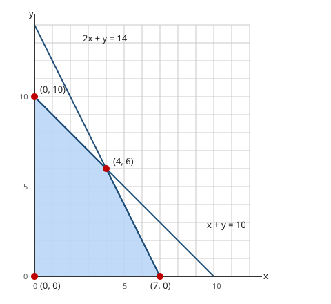

# Lesson 06 — Systems of Inequalities and Feasible Regions

**Goal:** I can graph a system of linear inequalities, name its
feasible region and corner points, and judge which points are viable
in context.
**Time:** 50 minutes · **Materials:** notebook, ruler, the
feasible-region diagram below.

## Readiness check (5 min)

Test the point `(2, 3)` in each of these inequalities: `x + y ≤ 10`
and `2x + y ≤ 14`. If you got "true" for both, you are ready: a point
is in a system's solution set only when it passes *every*
inequality in the system — the same "both jobs at once" rule as
Lesson 01, now for regions instead of lines.

## Teaching: intersect the half-planes (15 min)

A **system of linear inequalities** is solved by graphing each
inequality's half-plane on the same axes and keeping only the overlap
— the **intersection** of the half-planes. That overlap is called the
**feasible region**: every point in it satisfies every constraint at
once. Its **corner points** (vertices) are where two boundary lines
meet; they matter because, in the project, the best or cheapest
feasible combination is often found by comparing the corners.

Steps: graph each boundary with the correct solid/dashed style, shade
each half-plane (lightly, so overlaps stay readable), and darken the
region where all shadings overlap. Then test points: one inside the
region, one outside it, and — when the context counts whole items —
ask whether a point is *viable*: a pair like `(2.5, 3)` may satisfy
every inequality yet still be impossible if the quantities must be
whole numbers.

*Caption: The feasible region for `x ≥ 0`, `y ≥ 0`, `x + y ≤ 10`, and
`2x + y ≤ 14` — the quadrilateral with corners `(0, 0)`, `(7, 0)`,
`(4, 6)`, and `(0, 10)`.*

**Text-only alternative:** A coordinate grid with `x` from 0 to 12 and
`y` from 0 to 14. The shaded region is a four-sided figure with corners
at `(0, 0)` (the origin), `(7, 0)` (on the x-axis), `(4, 6)` (where the
lines `x + y = 10` and `2x + y = 14` cross), and `(0, 10)` (on the
y-axis). Its bottom edge is the x-axis from `(0, 0)` to `(7, 0)`; its
right edge is the line `2x + y = 14` from `(7, 0)` to `(4, 6)`; its
upper edge is the line `x + y = 10` from `(4, 6)` to `(0, 10)`; its
left edge is the y-axis from `(0, 10)` back to `(0, 0)`.

### Worked example 1 — read the diagram, then test points

> Use the diagram's system: `x ≥ 0`, `y ≥ 0`, `x + y ≤ 10`,
> `2x + y ≤ 14`. Which of `(2, 3)`, `(6, 6)`, `(0, 10)` are feasible?

1. `(2, 3)`: `2 + 3 = 5 ≤ 10` ✓; `2(2) + 3 = 7 ≤ 14` ✓; both
   nonnegative ✓. **Feasible** — inside the region.
2. `(6, 6)`: `6 + 6 = 12 ≤ 10` ✗. One failure is enough:
   **not feasible** — outside the region.
3. `(0, 10)`: `0 + 10 = 10 ≤ 10` ✓; `0 + 10 = 10 ≤ 14` ✓.
   **Feasible** — on the boundary, and the boundary is included
   because both inequalities use `≤`.
4. Where do the corners come from? `(4, 6)` is the intersection of
   the two slanted boundaries: solving `x + y = 10` and `2x + y = 14`
   (subtract: `x = 4`, then `y = 6`). `(7, 0)` is where `2x + y = 14`
   meets `y = 0`; `(0, 10)` is where `x + y = 10` meets `x = 0`.

### Worked example 2 — a smaller system, found by hand

> Graph and describe the system `y ≥ x`, `x + y ≤ 6`, `x ≥ 0`.

1. Boundaries: `y = x` (solid, since `≥`), `x + y = 6` (solid),
   `x = 0` (the y-axis, solid).
2. Test `(0, 2)`: `2 ≥ 0` ✓; `0 + 2 = 2 ≤ 6` ✓; `0 ≥ 0` ✓ — feasible.
3. Corners: `(0, 0)` (where `y = x` meets `x = 0`); `(3, 3)` (where
   `y = x` meets `x + y = 6`, since `x + x = 6`); `(0, 6)` (where
   `x + y = 6` meets `x = 0`). The feasible region is that triangle.
4. Non-example: `(4, 1)` fails `y ≥ x` (`1 ≥ 4` is false), so it is
   outside the region even though `4 + 1 ≤ 6`.

## Guided practice (10 min, with hints)

1. Test `(3, 2)` in the system `x + y ≤ 8`, `y ≥ 2x − 4`, `x ≥ 0`,
   `y ≥ 0`. *Hint: check the inequalities one at a time.*
2. Test `(5, 5)` in the same system. *Hint: one failure decides it.*
3. Find the corner points of the system `x ≥ 0`, `y ≥ 0`,
   `x + y ≤ 6`, `y ≤ 2x`. *Hint: the boundaries meet at three
   points; one is the origin.*

## Independent practice (10 min)

1. Test `(0, 2)` and `(4, 0)` in the system `y > x − 1`,
   `y ≤ −x + 5`. Which are feasible, and why?
2. For the system `x ≥ 0`, `y ≥ 0`, `2x + y ≤ 10`, `x + 2y ≤ 8`:
   (a) find its four corner points; (b) test `(3, 1)` and `(4, 4)`.
3. A profit rule is `P = 4x + 3y` dollars for the system in item 2.
   Compute `P` at each corner point and name the corner with the
   greatest profit.
4. Explain, in two or three sentences, why a point can satisfy every
   inequality in a system yet still be nonviable in a real context.
   Give one example (for instance, a fractional number of items).

## Application (5 min)

A baker has 12 cups of flour. Muffins use 2 cups each and cakes use 3
cups each. Let `m` = muffins and `c` = cakes. Write the system
(including `m ≥ 0`, `c ≥ 0`), list four feasible combinations, and
name the combinations that use all 12 cups. (Fictional practice data.)

## Exit check (5 min)

Test `(2, 5)` and `(6, 3)` in the diagram's system (`x ≥ 0`, `y ≥ 0`,
`x + y ≤ 10`, `2x + y ≤ 14`). State for each whether it is feasible,
showing the checks.

## Supports, extension, teacher note

- **Reading/language access:** keep the words "feasible" (passes every
  constraint) and "viable" (feasible *and* possible in the situation)
  side by side on the board; learners often merge them.
- **Alternate response mode:** a learner may answer test-point items
  with a true/false table (one row per inequality) instead of a
  paragraph.
- **Extension:** add the constraint `y ≤ 2x` to the diagram's system
  and describe how the feasible region changes: which corner
  disappears, and what is the new region's corner list? (Answer:
  `(0, 10)` disappears, because it fails `y ≤ 2x`; the new region has
  corners `(0, 0)`, `(7, 0)`, `(4, 6)`, and `(10/3, 20/3)` — the last
  is where `y = 2x` meets `x + y = 10`.)
- **Teacher note — misconception:** learners often shade each
  inequality on a *separate* graph and never intersect them. Require
  one axes, all shadings, and a darkened overlap before any point is
  tested. **Answer key:** `answer-key.md`, Lesson 06.
