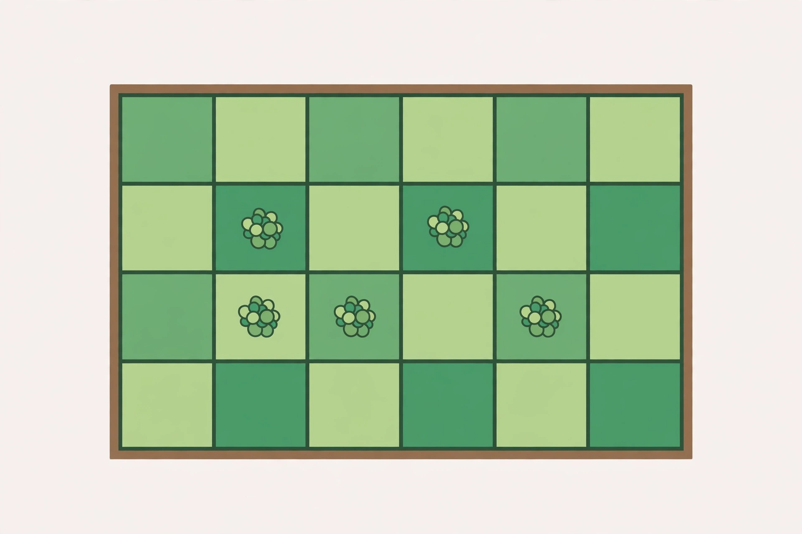
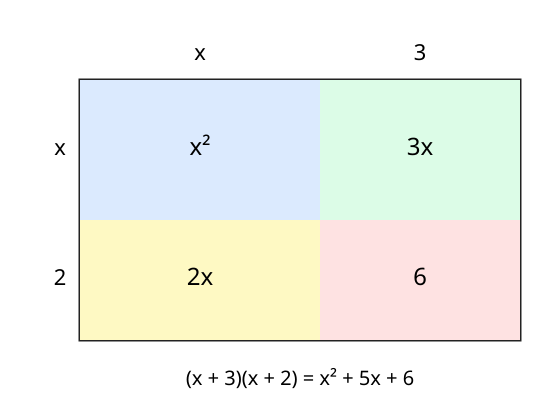

# Lesson 04 — Multiplying Polynomials with Area Models

**Goal:** I can multiply polynomials by distributing every term of
one factor to every term of the other, read an area model, and state
the degree of a product from the degrees of its factors.
**Time:** 50 minutes · **Materials:** notebook, ruler, the garden
image and area-model diagram below.

## Readiness check (5 min)

Expand `3(x + 4)` and `x(x − 2)`. If you got `3x + 12` and
`x² − 2x`, you are ready: the distributive property already
multiplies one term by a sum. Today each factor has more than one
term, so every term of the first factor must meet every term of the
second.

## Teaching: every term meets every term (15 min)

Multiplying polynomials is the distributive property used completely.
For `(x + 3)(x + 2)`:

- `x` times the second factor: `x · x + x · 2 = x² + 2x`.
- `3` times the second factor: `3 · x + 3 · 2 = 3x + 6`.
- Add: `x² + 2x + 3x + 6 = x² + 5x + 6`.

An **area model** draws the same computation as a rectangle. The
sides are split into the terms of each factor, and each small
rectangle's area is one partial product. The total area is the sum
of the partial products — which is why the middle terms `2x` and
`3x` both appear and combine to `5x`. "FOIL" (First, Outer, Inner,
Last) is just a nickname for these four partial products when both
factors are binomials; it is not a separate rule, and it does not
work when a factor has three terms. Distribute every term, and
FOIL takes care of itself.

**Degree of a product:** when you multiply the leading terms, their
exponents add. So the degree of a product is the sum of the degrees
of the factors (for nonzero polynomials): a degree-1 times a
degree-2 polynomial gives a degree-3 product; a degree-2 times a
degree-2 polynomial gives degree 4. The leading coefficient of the
product is the product of the leading coefficients. Predict the
degree *before* multiplying; if your product's degree disagrees,
you dropped a term.

*Caption: A rectangular garden bed divided into square tiles. Its
total area is the sum of the areas of its parts — the same idea as
an area model for polynomial multiplication.*

**Text-only alternative:** Picture a rectangular garden bed seen
from above, framed in brown, divided by thin lines into a grid of
square tiles in two shades of green, with small round plants in
some of the tiles. The bed is one rectangle made of many small
squares. Its total area is the sum of the small squares' areas —
just as a polynomial product is the sum of its partial products.

**Activity (with the image):** The bed is a rectangle, so its area
is length times width. If its length were `(x + 3)` feet and its
width `(x + 2)` feet, its area would be `(x + 3)(x + 2)` square
feet — the product in the diagram below. The picture does not give
you `x`; it gives you the idea: a product of sums is a sum of
partial areas. The exact diagram below, not the photograph-style
illustration, carries the numbers for this lesson.

*Caption: Area model for `(x + 3)(x + 2)`. The four partial
products are `x²`, `2x`, `3x`, and `6`; their sum is `x² + 5x + 6`.*

**Text-only alternative for the diagram:** A rectangle is split
into four regions. The top side is split into lengths `x` and `3`;
the left side into widths `x` and `2`. The four regions, reading
across the top row then the bottom row, have areas `x²`, `3x`,
`2x`, and `6`. Their sum is `x² + 5x + 6`.

### Worked example 1 — binomial times binomial, with a sign to watch

> Multiply `(2x − 1)(3x + 4)`.

1. Distribute `2x`: `2x · 3x = 6x²`; `2x · 4 = 8x`.
2. Distribute `−1`: `−1 · 3x = −3x`; `−1 · 4 = −4`.
3. Add and combine: `6x² + 8x − 3x − 4 = 6x² + 5x − 4`.
4. Degree check: degree 1 times degree 1 gives degree 2 ✓, and the
   leading coefficient `6 = 2 · 3` ✓. Check at `x = 1`:
   `(1)(7) = 7` and `6 + 5 − 4 = 7` ✓.

### Worked example 2 — binomial times trinomial (FOIL cannot do this)

> Multiply `(x + 2)(x² + 3x − 1)`.

1. Distribute `x`: `x³ + 3x² − x`.
2. Distribute `2`: `2x² + 6x − 2`.
3. Add and combine: `x³ + (3x² + 2x²) + (−x + 6x) − 2 =
   x³ + 5x² + 5x − 2`.
4. Degree check: degree 1 times degree 2 gives degree 3 ✓.
   Check at `x = 1`: `(3)(3) = 9` and `1 + 5 + 5 − 2 = 9` ✓.
   A learner who tried FOIL here would have only four partial
   products; this product correctly has six (two terms times three
   terms).

## Guided practice (10 min, with hints)

1. Multiply `(x + 5)(x + 3)`. *Hint: four partial products; the middle terms combine.*
2. Multiply `(3x − 2)(x + 4)`. *Hint: watch the sign on −2 · x.*
3. Multiply `(x − 1)(x² + 2x + 3)`. *Hint: six partial products before combining.*
4. Predict the degree of `(2x² + x)(x³ − 4)` before multiplying.
   *Hint: add the degrees.*

## Independent practice (10 min)

1. Multiply `(x + 7)(x − 2)` and `(2x + 3)(2x − 5)`.
2. Multiply `(x + 4)(x² − x + 1)`.
3. Multiply `(3x − 1)²` — that is, `(3x − 1)(3x − 1)` — by
   distributing fully. (Lesson 05 will give you a shortcut; do not
   use it yet.)
4. A rectangle has length `(2x + 1)` feet and width `(x + 3)` feet.
   Write its area as a polynomial, and find the area when `x = 4`.
5. Explain, in two or three sentences, why an area model shows all
   the partial products while FOIL only names four — and why that
   matters for a trinomial factor.

## Application (5 min)

A square patio has side length `(x + 2)` feet, and a rectangular
bed next to it has length `(x + 2)` feet and width `(x − 1)` feet.
Write both areas as polynomials. Which area is larger, and by how
much (as a polynomial)? Check your answer at `x = 5`.

## Exit check (5 min)

Multiply `(x + 6)(x² + x − 2)`. Give the product in standard form
and state its degree, predicted before you multiplied.

## Supports, extension, teacher note

- **Reading/language access:** say "every term meets every term"
  as the lesson's rule; draw the area model with the side splits
  labeled before any numbers are multiplied.
- **Alternate response mode:** a learner may build the product
  with algebra tiles (or a drawn grid) and read the partial
  products off the grid instead of writing FOIL letters.
- **Extension:** multiply `(x² + 2x − 3)(2x² − x + 1)` (answer:
  `2x⁴ + 3x³ − 7x² + 5x − 3`) and verify the degree and leading
  coefficient predictions before checking at `x = 1`.
- **Teacher note — misconception:** dropped partial products and
  sign errors on a negative term are the errors to hunt. Require
  the "how many partial products?" count (terms × terms) before
  combining. **Answer key:** `answer-key.md`, Lesson 04.
