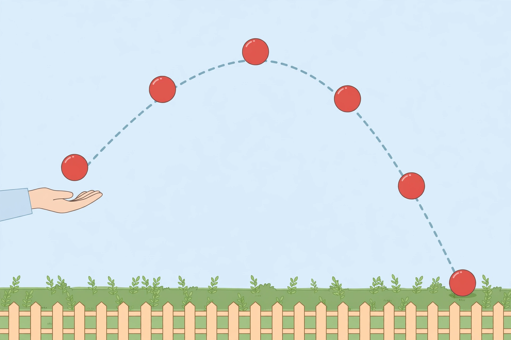
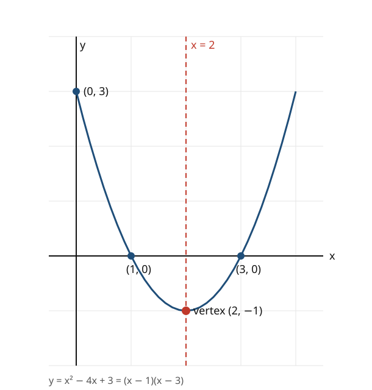

# Lesson 05 — Graphing Quadratics and Transformations

**Goal:** I can graph a quadratic from its forms and describe how
`f(x) + k`, `k·f(x)`, `f(kx)`, and `f(x + k)` transform the graph of
`f(x) = x²`.
**Time:** 50 minutes · **Materials:** notebook, graph paper, the
ball-toss image and parabola diagram below.

## Readiness check (5 min)

Make a table for `f(x) = x²` at `x = −2, −1, 0, 1, 2`. If you got
4, 1, 0, 1, 4, you are ready: today's graphs are all moves of this one
symmetric U-shape.

## Teaching: one parent graph, four moves (15 min)

Every quadratic graph is a **parabola**, a U-shape (or an upside-down
U) with a lowest or highest point called the **vertex** and a vertical
line of symmetry through it. Start from the parent function
`f(x) = x²`, whose vertex is `(0, 0)`. Four moves change it:

- `f(x) + k` — a **vertical shift**: the whole graph moves up `k`
  units if `k` is positive, down if `k` is negative. The vertex moves
  with it.
- `f(x + k)` — a **horizontal shift**: the graph moves *left* `k`
  units if `k` is positive, *right* if `k` is negative. The sign feels
  backwards — `(x + 2)²` shifts left, because the input must be 2
  smaller to give the same output.
- `k·f(x)` — a **vertical stretch or compression**: `|k| > 1` makes
  the parabola narrower (outputs grow faster); `0 < |k| < 1` makes it
  wider. A negative `k` also reflects the graph over the x-axis, so it
  opens down.
- `f(kx)` — a **horizontal stretch or compression**: `|k| > 1`
  squeezes the graph toward the y-axis; `0 < |k| < 1` stretches it
  away. For `f(x) = x²`, `f(2x) = 4x²`, which is also a vertical
  stretch — the two descriptions agree.

To find `k` from a graph, look at the vertex first: its movement from
`(0, 0)` tells you the shifts, and the steepness tells you the stretch.

*Caption: A tossed ball follows a parabola. The highest ball is the
vertex; the balls on the way up and the way down sit at the same
heights on opposite sides of it.*

**Text-only alternative:** A hand on the left tosses a red ball. The
ball appears five times along a dashed arc: low on the left, higher,
highest in the middle, lower on the right, and resting on the ground at
the far right. The arc is symmetric — the left half mirrors the right
half — and its highest point is in the middle, above a garden bed with
a picket fence.

**Activity (with the image):** Point to the highest ball. That is the
vertex of the ball's path — the maximum height. Now find two balls at
the same height, one rising and one falling. They are the same distance
from the middle: that is symmetry. The ball's path is a parabola, and
everything you learn about parabolas today describes this throw.

*Caption: The parabola `y = x² − 4x + 3 = (x − 1)(x − 3)`. The factored
form gives the x-intercepts 1 and 3; the dashed line `x = 2` is the
axis of symmetry; the red dot is the vertex `(2, −1)`.*

**Text-only alternative:** A coordinate grid shows a U-shaped curve.
It crosses the y-axis at `(0, 3)`, crosses the x-axis at `(1, 0)` and
`(3, 0)`, and reaches its lowest point, the vertex, at `(2, −1)`. A
dashed vertical line through `x = 2` divides the curve into mirror
halves. The curve passes through `(4, 3)`.

### Worked example 1 — name the transformation

> Describe how each graph is made from `f(x) = x²`: `g(x) = x² + 3`,
> `h(x) = (x − 2)²`, `k(x) = 2x²`, `m(x) = −x²`.

1. `g(x) = x² + 3 = f(x) + 3`: a vertical shift up 3 units. The vertex
   moves from `(0, 0)` to `(0, 3)`.
2. `h(x) = (x − 2)² = f(x − 2)`: a horizontal shift right 2 units.
   The vertex moves to `(2, 0)`.
3. `k(x) = 2x² = 2·f(x)`: a vertical stretch by a factor of 2. The
   parabola is narrower; the vertex stays at `(0, 0)`.
4. `m(x) = −x² = −1·f(x)`: a reflection over the x-axis. The parabola
   opens downward; the vertex `(0, 0)` is now a maximum.

### Worked example 2 — graph from the forms

> Graph `f(x) = x² − 4x + 3` (the diagram above) using its factored
> and vertex forms.

1. Factored form: `f(x) = (x − 1)(x − 3)`, so the zeros are 1 and 3 —
   the graph crosses the x-axis at `(1, 0)` and `(3, 0)`.
2. Vertex form: complete the square, `f(x) = (x − 2)² − 1`, so the
   vertex is `(2, −1)` and the axis of symmetry is `x = 2`.
3. The y-intercept is `f(0) = 3`, the point `(0, 3)`; symmetry gives
   the matching point `(4, 3)`.
4. Plot `(0, 3)`, `(1, 0)`, `(2, −1)`, `(3, 0)`, `(4, 3)` and draw the
   smooth symmetric curve through them — the diagram above.

## Guided practice (10 min, with hints)

1. Describe the graph of `g(x) = (x + 1)² − 2` as a transformation of
   `f(x) = x²`, and name its vertex. *Hint: `(x + 1)` shifts left.*
2. Make a table for `f(x) = x²` and for `f(2x)` at `x = 0, 1, 2`.
   Is `f(2x)` narrower or wider than `f(x)`? *Hint: compare the
   outputs at `x = 1`.*
3. A parabola has vertex `(3, 1)`, opens downward, and is a
   transformation of `f(x) = x²`. Write its function in vertex form.
   *Hint: the vertex gives `h` and `k`; downward means a minus sign.*

## Independent practice (10 min)

1. Describe the graph of `g(x) = x² − 4` as a transformation of
   `f(x) = x²`; name its vertex.
2. Describe the graph of `g(x) = (x + 3)²` as a transformation of
   `f(x) = x²`; name its vertex.
3. Describe the graph of `g(x) = (1/2)x²` as a transformation of
   `f(x) = x²`; is it narrower or wider?
4. Describe the graph of `g(x) = f(x − 1) + 2` where `f(x) = x²`;
   name its vertex.
5. A parabola has vertex `(2, −3)` and passes through `(0, 1)`. Find
   its function in the form `f(x) = a(x − 2)² − 3`, showing how you
   found `a`.

## Application (5 min)

In the ball-toss image, the ball's height over time follows a
parabola like the ones in this lesson. Which feature of the graph is
the ball's highest point, and which feature is the moment it lands?
Answer in one or two sentences, using the words *vertex* and *zero*.

## Exit check (5 min)

For `h(x) = −2(x + 1)² + 4`: name the vertex, state whether it opens
up or down, and give the maximum or minimum value.

## Supports, extension, teacher note

- **Reading/language access:** keep the four-move list on the board;
  say "inside the parentheses moves it sideways, outside moves it up
  and down" as the memory hook.
- **Alternate response mode:** a learner may sketch each
  transformation on graph paper and point to the vertex's movement
  instead of writing symbols first.
- **Extension:** show that `f(2x)` for `f(x) = x²` equals `4x²`, and
  explain in one sentence why a horizontal compression by a factor of
  2 and a vertical stretch by a factor of 4 give the same graph for
  this parent function.
- **Teacher note — misconception:** learners almost always read
  `(x − 2)²` as a shift *left*. Anchor on the vertex: the output is 0
  when `x − 2 = 0`, that is, at `x = 2` — to the right.
  **Answer key:** `answer-key.md`, Lesson 05.
