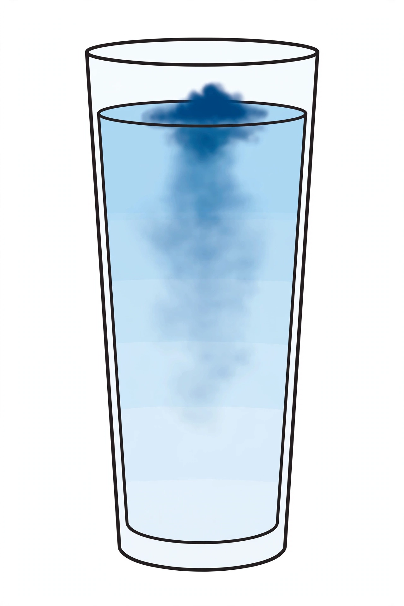

# Lesson 04 — Diffusion and Concentration

**Student goal:** I can use the concentration-gradient model to predict
which way a substance will diffuse, and explain facilitated diffusion.
**Time:** 50 minutes · **Unit:** [U02](../README.md) · **Session 7 of 20**

## Materials

- Notebook and pencil
- Printed copy of
  [`assets/dye-diffusion-prediction.png`](../assets/dye-diffusion-prediction.png)
- Two clear tall glasses, water, blue food coloring, dropper or spoon
  (adult handles the coloring)

## Readiness check (5 minutes)

"Yesterday's membrane lets small molecules slip through. But *which way*
do they go — into the cell or out of it? What decides?" Accept guesses;
today's lesson gives the decider: the concentration gradient.

## Teaching

**Diffusion** is the movement of a substance from where it is *more*
concentrated to where it is *less* concentrated — down its **concentration
gradient** — until it spreads out evenly. No energy is spent; the motion
comes from the particles' own random jiggling. A drop of dye in still water
spreads on its own. A smell crosses a room on its own. The universe
evens things out.

The gradient is the whole prediction machine. Picture two rooms joined by
an open door: 100 people crammed in the left room, 10 in the right. People
wander randomly — but *net* movement goes left → right, simply because more
wanderers start on the crowded side. Nobody is pushing them; the
*imbalance* does the work. That is diffusion: **net movement down the
gradient, from high concentration to low, until equilibrium.**

Three refinements that matter for cells:

1. **Equilibrium is not "stopped."** At equilibrium particles still jiggle
   across the membrane — equally both ways, so there is no *net* change.
   "Evened out" does not mean "frozen."
2. **The membrane decides *what* diffuses, the gradient decides *which
   way*.** Oxygen diffuses *into* a working muscle cell because the cell
   keeps burning O₂ — inside stays low, outside stays high, so the
   gradient points inward. The same membrane, the same molecule, the
   opposite gradient → the opposite direction.
3. **Facilitated diffusion** is diffusion *with a door*: glucose rides down
   its gradient through a channel protein (the green arrow in Lesson 3's
   diagram). Still no energy — still down the gradient — the protein just
   provides a path the bilayer would block.

The one-sentence machine: *find the high side and the low side; net
movement goes high → low; it stops netting out at equilibrium.*

**Key vocabulary:** *concentration* (amount of a substance in a given
volume), *concentration gradient* (the difference in concentration between
two regions — the "slope" substances roll down), *diffusion* (net movement
of a substance from high to low concentration; no energy required),
*facilitated diffusion* (diffusion through a membrane protein; still down
the gradient, still no energy), *equilibrium* (concentrations evened out;
no net movement, though particles still move).

## The generated illustration — diffusion prediction

*Caption (also in [assets/README.md](../assets/README.md)): An
AI-generated picture of a dye drop just entering still water. Which way
will the dye molecules move — and how will you know when they are done?*

**Activity:** Before touching the real glasses, the learner writes a
prediction: (1) which way the dye molecules will move, (2) what the glass
will look like at equilibrium, (3) *why* — using the words *concentration*,
*gradient*, and *equilibrium*. Then the adult puts one drop of coloring in
a real glass of still water (no stirring) and the learner observes for
several minutes, comparing observation against prediction.

**Text-only alternative** (carries every detail the activity needs): "The
picture shows a clear tall drinking glass of still, colorless water on a
white background, seen from the side. A drop of dark blue food coloring
has just entered at the top center, forming a small concentrated dark-blue
cloud near the surface; the blue fades downward through pale blue to
nearly clear water at the bottom."

**Honest framing to state aloud:** this picture freezes *one moment* —
the instant after the drop entered. It is a prompt for your prediction,
not the answer. Your real observation in the next minutes is the evidence;
if the dye does something your prediction missed (a tendril sinks faster,
a swirl appears), the evidence wins and the model gets revised.

## Worked example 1 — predicting with the gradient

**Question:** A cell sits in fluid with lots of CO₂ outside and little CO₂
inside. The membrane lets CO₂ through. Which way does CO₂ move, net? What
if the situation reverses?

**Reasoning:** Step 1 — find the high side: outside. Step 2 — net movement
goes high → low: CO₂ diffuses *into* the cell. Step 3 — equilibrium check:
as inside CO₂ rises, the gradient shrinks and net movement slows. Reversed
(lots inside, little outside): the gradient points outward, so CO₂
diffuses *out*. Reasoning to name aloud: the *same molecule* moves opposite
ways under opposite gradients — direction is a property of the *situation*,
not the substance.

## Worked example 2 — facilitated diffusion is still diffusion

**Question:** Glucose is more concentrated outside a cell than inside, and
the membrane has glucose channel proteins. Does glucose need energy to
enter? Explain.

**Reasoning:** No energy needed. Check the two questions: (a) *Can it
cross?* — not through the bilayer (large, polar), but yes through the
channel protein — that is facilitated diffusion. (b) *Which way?* — down
its gradient, high (outside) → low (inside). Energy is only required when
moving *against* the gradient (Lesson 6). The adult names the test the
learner will reuse all unit: **"Can it cross?" then "Which way does the
gradient point?"** — two questions, in that order.

## Guided practice (adult stays close, hints allowed)

1. Look at the illustration: write your three-part prediction (direction,
   equilibrium appearance, why — with the three vocabulary words).
   *(Hint: start "The high side is…")*
2. A muscle cell is burning oxygen fast. Inside O₂ is low, outside O₂ is
   high. Which way does O₂ move, net? What keeps the gradient from
   disappearing? *(Hint: what does "burning" do to the inside
   concentration?)*
3. Error analysis: "Diffusion stops at equilibrium because the particles
   run out of energy." Explain the error — what is still happening at
   equilibrium?
4. Facilitated or simple? For each — O₂ through the bilayer, glucose
   through a channel, CO₂ through the bilayer — name the type and say
   whether energy is required.

## Independent practice (6–8 meaningful tasks)

1. Draw two boxes joined by a gap (a membrane). Put 12 dots in the left
   box, 3 in the right. Draw an arrow for net movement, label high/low,
   and write one sentence explaining the arrow. Then draw the boxes at
   equilibrium.
2. A cell produces CO₂ as waste. Inside CO₂ is high, outside is low. Which
   way does CO₂ move? How does this help the cell? (Connect to Lesson 1:
   which organelle's work creates the CO₂?)
3. Two glasses: glass A gets one drop of dye, glass B gets five drops in
   the same volume of water. Which glass reaches a darker equilibrium
   color? Explain with concentration.
4. Write a 3-sentence paragraph: "Why a smell spreads across a room but a
   book does not" — using *random motion*, *gradient*, and *equilibrium*.
5. Error analysis: "Facilitated diffusion needs energy because it uses a
   protein." Correct the statement and explain the real energy rule.
6. A channel protein is blocked. Glucose is high outside, low inside.
   Predict what happens to glucose entry — and what happens to the
   gradient over time if the cell keeps using glucose inside. Explain both.
7. Compare: how is the dye-in-water observation like diffusion across a
   membrane, and how is it different? (Name one similarity and one real
   difference.)

## Application

Write the two-question test ("Can it cross? Which way does the gradient
point?") on an index card. You will use it on every transport scenario for
the rest of the unit — Sessions 11, 13, 16, and 20 all run through it.

## Exit check

From memory: define diffusion, concentration gradient, and equilibrium in
one sentence each; then predict the net direction for "high outside, low
inside" and for "high inside, low outside."

## Supports and extensions

- **Language access:** the gradient chant — "high to low, let it flow;
  evened out, net movement's out" — with the two-rooms door picture as the
  anchor.
- **Alternate response mode:** the learner may act out the two rooms with
  counters on a table (many on one side, few on the other, move one counter
  per "jiggle") and narrate the net direction aloud.
- **Extension:** time the real dye glass: note the clock when the drop
  enters and when the color looks uniform. Compute nothing fancy — just
  record the minutes, and write one sentence on what "slow diffusion"
  implies for why cells are small. (Surface area and size return in later
  grades; today it is an observation, not a law.)

## Teacher note — likely misconceptions

"Particles want to spread out / seek balance" — teleology; replace *want*
with *random motion + imbalance = net flow*. "Equilibrium means stopped" —
stress jiggling continues, net is zero. Third: learners apply "high → low"
without checking *can it cross* first — enforce the two-question order on
every scenario. Answer-key references:
[answer key](../answer-key.md#lesson-04).
