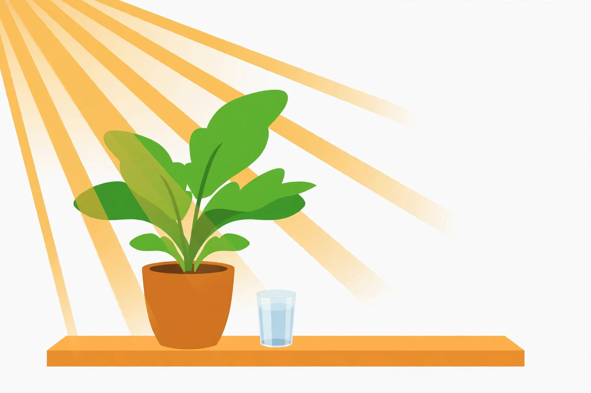

# Lesson 01 — Photosynthesis as Energy Transformation

**Student goal:** I can explain photosynthesis as light energy becoming
stored chemical energy, name its inputs and outputs, and balance its
equation by counting atoms.
**Time:** 50 minutes · **Unit:** [U03](../README.md) · **Session 1 of 20**

## Materials

- Notebook and pencil
- Printed copy of [`../assets/sunlit-plant-inputs.png`](../assets/sunlit-plant-inputs.png)
  (the generated observation image) or its text alternative below
- Index cards: carbon dioxide, water, light energy, sugar (glucose),
  oxygen

## Readiness check (5 minutes)

Ask: "A plant sits in sunlight all day. At the end of the day, is the
plant heavier, lighter, or the same — and where did any change come
from?" Accept guesses. Most learners say "from the soil" or "from the
water." Keep those guesses on the board: this lesson tests them, and one
of them is mostly wrong.

## Teaching

A plant makes its own food, and food here means something precise: a
molecule that stores energy in its chemical bonds. The plant's trick is
called **photosynthesis** — "photo" for light, "synthesis" for putting
together. Light energy goes in; chemical energy stored in sugar comes out.
Energy is not created — it changes form, from light to chemical, the way a
battery charger changes wall-outlet energy into stored chemical energy.
That is the whole story of this lesson, and the equation is just the
bookkeeping for it.

What goes in and what comes out? In words:

**carbon dioxide + water + light energy → sugar (glucose) + oxygen**

The carbon dioxide comes from the air. The water comes from the roots.
The light comes from the sun (or a lamp). The sugar is the plant's food
and building material. The oxygen is released into the air — a byproduct
the plant does not need for this process, and the gas animals (including
us) need to breathe.

Now the bookkeeping. A chemical equation must balance: atoms are neither
created nor destroyed in a chemical reaction, so every atom on the left
must appear on the right. The symbol equation for photosynthesis is:

**6CO₂ + 6H₂O + light energy → C₆H₁₂O₆ + 6O₂**

Read it aloud: "Six carbon dioxides plus six waters, using light energy,
make one glucose plus six oxygens." The small numbers (subscripts) belong
to the molecule and never change — CO₂ always has one carbon and two
oxygens. The big numbers in front (coefficients) say how many molecules
take part, and those are what we adjust to balance.

Count with me. Left side: 6CO₂ gives 6 carbons and 12 oxygens; 6H₂O gives
12 hydrogens and 6 oxygens. Totals: carbon 6, hydrogen 12, oxygen 18.
Right side: C₆H₁₂O₆ gives carbon 6, hydrogen 12, oxygen 6; 6O₂ gives oxygen
12. Totals: carbon 6, hydrogen 12, oxygen 18. Balanced. If any total
mismatches, the equation is wrong — no matter how nice it looks.

**Key vocabulary:** *photosynthesis* (light energy transformed into stored
chemical energy by building sugar from carbon dioxide and water),
*glucose* (a sugar, C₆H₁₂O₆, that stores chemical energy),
*coefficient* (the big number before a formula, saying how many molecules),
*subscript* (the small number inside a formula, part of the molecule
itself — never changed when balancing).

## Worked example 1 — Balancing from scratch

**Question:** Balance this unbalanced equation: CO₂ + H₂O → C₆H₁₂O₆ + O₂.

**Reasoning:** Start with the molecule that has the most atoms: glucose,
C₆H₁₂O₆, needs 6 carbons, so put 6 before CO₂. It needs 12 hydrogens, so
put 6 before H₂O (6 × 2 = 12 hydrogens). Now count oxygens on the left:
6CO₂ gives 12, 6H₂O gives 6, total 18. The right side has 6 oxygens inside
glucose, so the O₂ must supply 18 − 6 = 12 oxygens, which is 6O₂.
Balanced equation: 6CO₂ + 6H₂O → C₆H₁₂O₆ + 6O₂. Check: carbon 6 = 6,
hydrogen 12 = 12, oxygen 18 = 18. Done.

## Worked example 2 — Scaling the equation

**Question:** A plant builds 2 glucose molecules. Write the full equation
and check the oxygen count.

**Reasoning:** Double everything: 12CO₂ + 12H₂O → 2C₆H₁₂O₆ + 12O₂.
Oxygen check — left: 12CO₂ gives 24, 12H₂O gives 12, total 36. Right:
2C₆H₁₂O₆ gives 12, 12O₂ gives 24, total 36. Balanced. Scaling never breaks
a balanced equation, because every count scales together. This is the
same trick you will use whenever a problem asks "how much" instead of
"what."

## Guided practice

Work these with the adult, talking through each count aloud.

1. **Find the error.** A learner writes: 6CO₂ + 6H₂O → C₆H₁₂O₆ + 5O₂.
   Count oxygens on each side and say exactly what is wrong.
2. **Word to symbols.** A plant takes in carbon dioxide and water and
   releases oxygen while storing sugar. Write the word equation, then the
   balanced symbol equation.
3. **Input or output?** Sort these into inputs and outputs of
   photosynthesis: light energy, glucose, oxygen, water, carbon dioxide.
   For each one, say where it comes from or where it goes.

## Independent practice

1. Balance check: is 3CO₂ + 3H₂O → C₆H₁₂O₆ + 3O₂ balanced? Count all
   three elements and give the verdict with numbers.
2. A plant builds 3 glucose molecules. Write the full balanced equation.
3. Explain in two sentences why oxygen is called a byproduct of
   photosynthesis rather than its purpose.
4. **Error analysis.** A learner says: "Plants breathe in carbon dioxide
   and breathe out oxygen, just like we breathe in oxygen and breathe out
   carbon dioxide — so photosynthesis is plant breathing." What is right
   about this comparison, and what is wrong? (Hint: breathing moves gases
   in and out; photosynthesis is a chemical process that builds sugar.
   Lesson 3 returns to this.)

## Application — observe the sunlit plant

Look at the generated image below (or read its text alternative).

*Caption: An AI-generated picture of a potted plant in sunlight with a
glass of water beside it. What can you see the plant taking in — and what
is it taking in that you cannot see?*

**Text-only alternative:** "The picture shows a healthy green potted
plant with broad leaves sitting on a shelf. Warm sunlight streams in from
the upper left onto the leaves. Beside the pot sits a small clear glass
of water. The background is plain and light."

Answer in your notebook: (a) two inputs you can see in the picture; (b)
one input that is invisible in the picture, and why you still know it is
there; (c) two outputs of photosynthesis, and which one you could see
only as a bubble or a measurement, not with your eyes.

## Exit check

Write the balanced photosynthesis equation from memory, then write one
sentence saying what form of energy goes in and what form of energy is
stored.

## Supports

- Atom-counting table: make three columns (C, H, O) and fill left and
  right totals before deciding anything is balanced.
- Say the equation as a sentence ("six carbon dioxides plus six waters…")
  before writing symbols.
- The image activity accepts spoken answers; the adult scribes if writing
  stamina lags.

## Extension

A grower doubles the carbon dioxide in a greenhouse but keeps light and
water the same. Using the equation, explain why photosynthesis might rise
at first but cannot rise forever — what else would run out? (Light energy
or water becomes the limiting input; the equation needs all three.)

## Teacher note

Likely misconceptions: plants "eat" soil (mass comes mostly from air and
water — Lesson 5 proves it); oxygen is the plant's goal (it is a
byproduct of splitting water — Lesson 2); energy is created (it is
transformed). Solutions: [answer key](../answer-key.md), Lesson 01.
