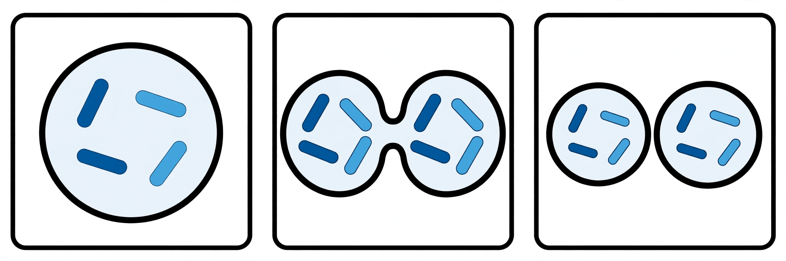

# Lesson 02 — Mitosis: One Division, Two Identical Cells

**Student goal:** I can model the stages of mitosis in order, count
chromosomes and chromatids at each stage, and explain why mitosis
produces genetically identical cells.
**Time:** 50 minutes · **Unit:** [U04](../README.md) · **Session 3 of 20**

## Materials

- Notebook and pencil
- Printed copy of [`assets/one-cell-becomes-two.png`](../assets/one-cell-becomes-two.png)
- Printed copy of [`assets/cell-division-stages.svg`](../assets/cell-division-stages.svg)
- Two colors of pipe cleaners (optional, for the table model)

## Readiness check (5 minutes)

Point to the generated image. "Count the rods in the parent cell on the
left. Count the rods in each daughter cell on the right. What stayed the
same?" (Answer: 4 rods — two dark blue, two light blue — in the parent
and in each daughter.) Today you will learn the sorting machine that
makes that equality happen.

## Teaching

**Mitosis** is nuclear division: one nucleus becomes two nuclei with
identical genetic material. It is followed by **cytokinesis**, the split
of the cytoplasm. Together they are the mitotic phase from Lesson 1.

After S phase, each chromosome consists of two sister chromatids joined
at the centromere. Mitosis moves those copies apart in five stages
(taught here as a model, not a list to recite under pressure):

1. **Prophase:** chromosomes condense and become visible; the nuclear
   envelope starts to break down; the spindle — a structure of fibers
   that will move chromosomes — begins to form.
2. **Prometaphase:** the nuclear envelope is gone; spindle fibers attach
   to the centromere of each chromosome.
3. **Metaphase:** chromosomes line up along the cell's middle, the
   **metaphase plate**, each sister-chromatid pair straddling the line,
   fibers attached from both sides.
4. **Anaphase:** sister chromatids separate and are pulled to opposite
   poles. The moment they separate, each chromatid counts as its own
   chromosome.
5. **Telophase:** chromosomes arrive at the poles and unwind; a nuclear
   envelope re-forms around each set. Then cytokinesis splits the
   cytoplasm — a cleavage furrow pinching an animal cell in two, or a
   cell plate building across a plant cell.

The result, for a parent cell with 4 chromosomes (2n = 4): **two daughter
cells, each with 4 chromosomes, genetically identical to the parent**
(and to each other, barring rare copying errors, which are Lesson 5's
topic).

Why "identical"? Because S phase made an exact copy of every chromosome
first, and mitosis hands one copy of each to each daughter. Nothing is
shuffled, nothing is halved. Mitosis is the copy machine: growth, repair,
and replacement all run on it.

*Figure 1 (AI-generated illustration). Left: a parent cell with four
rod-shaped chromosomes — two dark blue, two light blue. Middle: the cell
pinching apart, each side receiving the same four rods. Right: two
daughter cells, each with the same four rods as the parent. The colors
mark chromosome pairs; they carry no other meaning.*

**Text-only alternative to Figure 1:** Parent cell: 4 rods (2 dark blue,
2 light blue). Dividing cell: two lobes, each with 4 rods (2 dark blue,
2 light blue). Daughter cells: two cells, each with 4 rods (2 dark blue,
2 light blue). Question answered from this alternative alone: "How many
chromosomes does each daughter cell have, and how does that compare with
the parent?" Answer: 4 each — the same as the parent.

**Key vocabulary:** *mitosis* (nuclear division producing identical
nuclei), *cytokinesis* (cytoplasm division), *spindle* (fiber structure
that moves chromosomes), *metaphase plate* (the cell's middle line where
chromosomes align), *cleavage furrow* (animal-cell pinch), *cell plate*
(plant-cell dividing wall).

## Worked example 1 — stage by stage for 2n = 4

**Question:** A cell with 4 chromosomes finishes S phase and enters
mitosis. At metaphase, how many chromosomes are lined up, and how many
chromatids is that? At the end of cytokinesis, how many chromosomes does
each daughter cell have?

**Reasoning:** At metaphase the cell still has **4 chromosomes** (one
centromere each), each holding 2 sister chromatids → **8 chromatids**
lined up on the plate. In anaphase the 8 chromatids separate, 4 to each
pole; each separated chromatid is now a chromosome. After telophase and
cytokinesis, each daughter cell has **4 chromosomes** (one chromatid
each). The count returns to the starting number because the copies were
made before division, then shared out evenly.

## Worked example 2 — human numbers

**Question:** A human skin cell (2n = 46) divides by mitosis to heal a
cut. How many chromosomes does each new skin cell have? A student says
the answer is 92 because "the DNA doubled." What went wrong?

**Reasoning:** Each daughter cell has **46 chromosomes**. After S phase
the cell holds 46 chromosomes and 92 chromatids — the DNA *amount*
doubled, but the chromosome *count* did not, because sister chromatids
share centromeres. Mitosis then deals one chromatid of each pair to each
daughter, restoring 46 chromosomes per cell. The student's error is
counting chromatids as chromosomes after S phase.

## Guided practice

1. Order these stage cards and say what moves where: prophase,
   metaphase, anaphase, telophase, prometaphase. (Correct order:
   prophase, prometaphase, metaphase, anaphase, telophase.)
2. A cell with 2n = 6 finishes S phase. How many chromatids line up at
   metaphase? How many chromosomes does each daughter cell receive?
3. Why does anaphase have to wait for every chromosome to attach to the
   spindle? Connect your answer to the metaphase checkpoint.

## Independent practice

1. Sketch the five stages for a 2n = 4 cell, labeling chromosome and
   chromatid counts at metaphase and in each daughter cell.
2. A plant root cell (2n = 8) divides. State, with counts: chromosomes
   and chromatids after S phase; chromosomes per daughter cell.
3. Explain why a cut heals with cells identical to the ones that were
   lost, rather than with varied cells.
4. True or false, with a correction if false: "After mitosis, each
   daughter cell has half the parent's chromosomes."

## Application

Use the stage SVG to build a pipe-cleaner model: one color per
chromosome pair (dark = pair 1, light = pair 2, matching Figure 1).
Arrange the model at metaphase, then move it through anaphase to two
daughter sets. Photograph or sketch the final arrangement only — the
model itself is not submitted; the sketch with counts is.

## Exit check

1. In one sentence, what does mitosis accomplish?
2. A parent cell has 2n = 10. Each daughter cell after mitosis has how
   many chromosomes?

## Supports

- If stage names blur: remember "PMAT" (prophase, metaphase, anaphase,
  telophase) with prometaphase tucked between prophase and metaphase —
  but the *events* matter more than the initials, and no quiz in this
  unit asks for stage names without an event to match.
- If counting slips: count centromeres, not rods, after S phase.
- Oral, drawn, or modeled answers are accepted for every item.

## Extension

A single fertilized egg becomes about 30 trillion cells by adulthood,
all by mitosis. Estimate how many rounds of division that takes if every
division doubles the cell count (2, 4, 8, …). Show your powers of 2 and
explain why the real number of rounds is larger than your estimate.
(Hint: cells also die and stop dividing.)

## Teacher note

Two traps recur: (1) counting 8 "chromosomes" after S phase — reteach the
centromere rule; (2) thinking cytokinesis is part of mitosis — it is the
second half of the mitotic phase, after nuclear division. Answers: see
[answer key](../answer-key.md#lesson-02).
