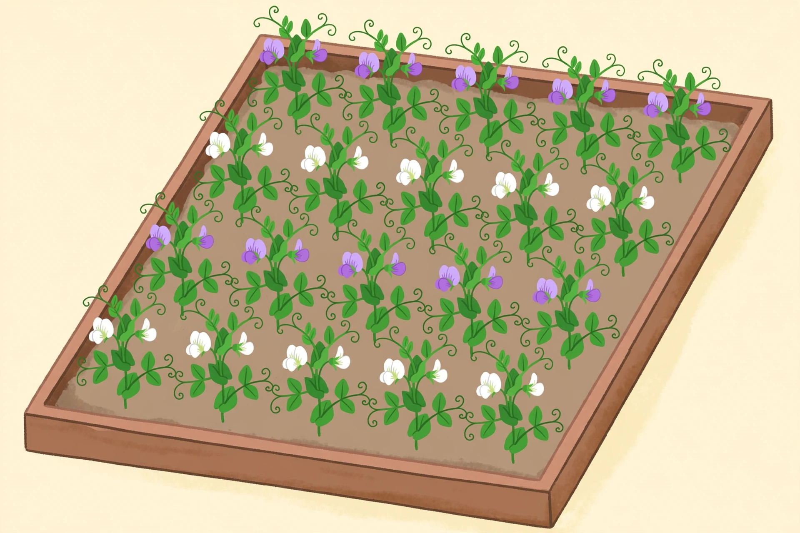

# Lesson 03 — Chromosomes, Alleles, and Punnett Squares

**Student goal:** I can explain how meiosis puts one allele in each gamete,
and I can use a Punnett square to predict the offspring of a monohybrid
cross.
**Time:** 50 minutes · **Unit:** [U05](../README.md) · **Session 5 of 20**

## Materials

- Notebook and pencil
- The pipe-cleaner chromosomes from Unit 04 (two homologous pairs, one
  pair marked with a B/b allele bead)
- Printed copy of
  [`assets/pea-flower-counting.png`](../assets/pea-flower-counting.png)
- Printed copy of
  [`assets/punnett-square-bb.svg`](../assets/punnett-square-bb.svg)

## Readiness check (5 minutes)

Hold up the Unit 04 pipe cleaners: one homologous pair, one chromosome
carrying a purple-flower allele (B), its partner carrying a white-flower
allele (b). Ask: "This cell is Bb for flower color. After meiosis, what
does each gamete carry — B, b, or both?" Confirm the learner answers "one
or the other, never both" — that is the law of segregation in one sentence.
If the learner says "both," re-run the Unit 04 meiosis model before
continuing.

## Teaching

A **gene** is a DNA segment that codes for a trait. An **allele** is one
version of a gene — a different spelling of the same instruction. The pea
flower-color gene has (at least) two alleles: **B** for purple flowers and
**b** for white flowers. Every diploid cell carries two copies of each
gene, one on each **homologous chromosome**: one copy came from the mother,
one from the father.

The cell's two alleles together are its **genotype** — written as two
letters, such as BB, Bb, or bb. The trait you can see is the
**phenotype** — purple flowers or white flowers. **Homozygous** means the
two alleles are the same (BB or bb); **heterozygous** means they differ
(Bb). When the alleles differ, one may hide the other: the **dominant**
allele (B, purple) is expressed, and the **recessive** allele (b, white)
stays hidden — but it is still there, and it can still be passed on. A
white-flowered plant must be bb: if it carried even one B, it would be
purple.

Meiosis (Unit 04) is the machine that turns genotype into prediction. The
homologous chromosomes separate in meiosis I, so each gamete gets **one**
allele per gene. A Bb plant makes two kinds of gametes in equal numbers:
half carry B, half carry b. Fertilization puts two gametes together at
random — and a **Punnett square** is the bookkeeping grid that lists every
possible combination. Write one parent's gametes across the top, the other
parent's down the side, and fill in each box by combining the row and
column letters. Each box is one equally likely offspring.

Mendel's own data is the test case. He crossed true-breeding purple (BB)
with true-breeding white (bb). Every F1 plant was Bb — and every one had
purple flowers. Then he let the F1 plants self-fertilize (Bb × Bb) and
counted the F2 generation: **705 purple, 224 white** — a ratio of about
3.15 purple to 1 white, close to the 3:1 the Punnett square predicts.
The white trait had vanished in the F1 and reappeared in the F2: the
alleles were never blended or lost, only hidden.

**Key vocabulary:** *gene* (a DNA segment coding for a trait), *allele*
(one version of a gene), *genotype* (the two alleles an organism carries,
e.g. Bb), *phenotype* (the observable trait, e.g. purple flowers),
*homozygous* (two identical alleles), *heterozygous* (two different
alleles), *dominant* (the allele expressed when present), *recessive* (the
allele hidden unless homozygous), *Punnett square* (a grid listing all
possible offspring genotypes).

## Worked example 1 — "Bb × Bb, step by step"

Cross two heterozygous purple plants (Bb × Bb). Use the deterministic
diagram alongside this example:
[`assets/punnett-square-bb.svg`](../assets/punnett-square-bb.svg).

1. **Gametes:** each parent makes B gametes and b gametes, half and half.
2. **Grid:** B and b across the top (Parent 1), B and b down the side
   (Parent 2).
3. **Fill:** top-left BB, top-right Bb, bottom-left Bb, bottom-right bb.
4. **Genotypes:** 1 BB : 2 Bb : 1 bb.
5. **Phenotypes:** BB is purple, Bb is purple, Bb is purple, bb is white
   — **3 purple : 1 white**.

**Reasoning to name aloud:** the 3:1 ratio is not a fact to memorize; it
falls out of the grid. Three of the four boxes carry at least one B, and
one B is enough for purple. The recessive trait reappears only in the
one box that got b from both parents — a 1-in-4 chance.

## Worked example 2 — "The test cross: Bb × bb"

A purple-flowered plant could be BB or Bb — you cannot tell by looking.
Cross it with a white-flowered plant (bb), whose gametes are all b:

| | b | b |
|---|---|---|
| **B** | Bb (purple) | Bb (purple) |
| **b** | bb (white) | bb (white) |

Result: **1 purple : 1 white** (genotypes 2 Bb : 2 bb). **Reasoning to
name aloud:** the white parent contributes only b, so the offspring's
color reveals the purple parent's hidden allele: every white offspring
proves the purple parent gave a b. If the purple parent had been BB, all
offspring would be Bb and purple. Breeders use this **test cross** to
unmask a hidden genotype — and it works because the recessive parent can
only give the recessive allele.

## The garden-bed activity (uses the generated image)

Look at the illustration together:

**Figure:** A raised bed of pea plants in bloom. *AI-generated illustration
for counting practice — not a photograph of a real cross, and not evidence
about real plants.*

Count the open flowers in the picture, row by row, and record purple and
white separately. Then answer:

1. How many purple flowers and how many white flowers are there? What is
   the ratio?
2. A Bb × Bb cross predicts about 3 purple to 1 white. Does this bed
   match that prediction?
3. Look at the *arrangement*: purple rows and white rows, planted in
   blocks. If someone planted this bed on purpose, does the count test
   Mendel's prediction at all? What would a fair test look like instead?

**Text-only alternative:** The bed holds 20 pea plants in four rows of
five. Each plant shows two open flowers. Counting every open flower:
20 purple and 20 white — a 1:1 ratio. The rows are planted in color
blocks: the back and third rows are all purple, the second and front rows
are all white. (If you count 19–21 of either color — a bloom partly
hidden behind a leaf — the conclusion is the same: about 1:1, not 3:1.)

## Guided practice (adult stays close, hints allowed)

Work through these together, 4–6 minutes each.

1. A plant is heterozygous for seed shape: Rr (round dominant, wrinkled
   recessive). What gametes does it make, and in what proportions?
2. Cross Rr × Rr. Draw the Punnett square. What are the genotype and
   phenotype ratios?
3. Cross Rr × rr. What fraction of the offspring will be wrinkled? Show
   the grid.
4. Error analysis: "A Bb plant crossed with a bb plant gives 3 purple :
   1 white, because that's the ratio Mendel found." What is wrong, and
   what is the correct ratio?
5. In the garden-bed activity: the count was 20 purple : 20 white. A
   learner says, "That proves Mendel was wrong." Write a 2–3 sentence
   reply explaining why it proves no such thing.

## Independent practice (6–8 meaningful tasks)

1. Tall pea plants (T) are dominant to dwarf (t). Cross Tt × Tt. Give the
   genotype ratio and the phenotype ratio.
2. A tall plant is crossed with a dwarf plant (tt), and half the offspring
   are dwarf. What was the tall parent's genotype? Explain using the
   offspring ratio.
3. Yellow seeds (Y) are dominant to green (y). Cross Yy × yy. What is the
   probability that any one offspring has green seeds? What is the
   probability it has yellow seeds?
4. A white-flowered plant (bb) is crossed with a purple-flowered plant,
   and all 20 offspring are purple. What is the purple parent's genotype?
   Explain why the 20 offspring are enough to be confident.
5. In a Bb × Bb cross, what is the probability that a given offspring is
   heterozygous? What is the probability it is homozygous? Show the
   Punnett square or the counting that gives your answers.
6. Draw a Punnett square for a cross between two pea plants that are both
   heterozygous for pod color (Gg × Gg, green dominant). Label the
   genotype and phenotype ratios.
7. Explain in 2–3 sentences why the F1 generation of Mendel's cross
   (BB × bb) was *all* purple, even though half of each F1 plant's
   alleles were b.

## Application

Design your own test cross on paper: you have a purple-flowered plant of
unknown genotype and a white-flowered plant. Write the two possible
predictions (if the purple parent is BB, and if it is Bb), including the
expected offspring ratios for each case. Then state the rule: how many
offspring, and what result, would let you conclude the purple parent is
Bb? (Hint: one white offspring is enough to prove Bb — but how many
purple-only offspring would you want before trusting BB?)

## Exit check

Without looking back: define *allele*, *genotype*, and *phenotype*; draw
the Bb × Bb Punnett square from memory and give both ratios; and explain
in one sentence why a recessive trait can skip a generation.

## Supports and extensions

- **Language access:** keep the allele cards (B, b) on the table; move
  them into the grid as you fill it. Say "letter pair" for genotype and
  "what you see" for phenotype until the terms stick.
- **Alternate response mode:** the learner may fill the grid with letter
  tiles or beads instead of writing, or dictate the ratios while the adult
  scribes.
- **Extension:** two genes at once — a dihybrid cross YyRr × YyRr gives a
  9:3:3:1 phenotype ratio (yellow round : yellow wrinkled : green round :
  green wrinkled). Work out why the two 3:1 ratios combine that way, using
  the product rule from OpenStax §12.3.

## Teacher note — likely misconceptions

The big one: "dominant means more common." Dominance is about expression
in a heterozygote, not frequency in a population — white flowers are
recessive and common in many gardens. Second: thinking the Punnett square
*predicts* the exact next four offspring — it gives probabilities per
offspring; real small families deviate (Lesson 4 makes this precise).
Third: treating the generated bed image as data from a real cross — the
activity's whole point is that a planted bed is not a random cross.
Answer-key references: [answer key](../answer-key.md#lesson-03).
