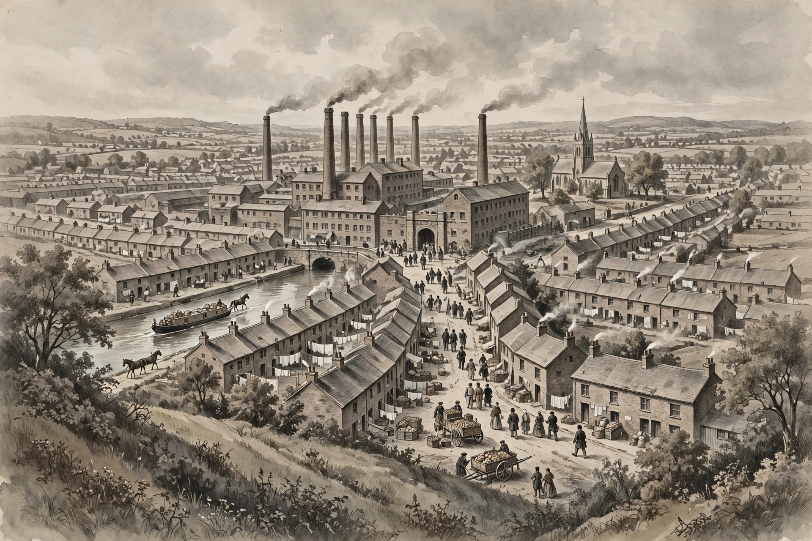

# Lesson 02 — Factory Labor, Cities, and Daily Life

**Unit 04 · Week 16, Session 1 · ~50 minutes**

**Goal (learner-facing):** I can explain how industrial capitalism
changed daily life — factory discipline, city growth, child labor — from
at least two different perspectives, and explain how reformers answered.

**Materials:** this lesson, notebook/inquiry journal, the unit's
mill-town reconstruction image (`../assets/industrial-mill-town-1840-reconstruction.png`)
or its text alternative below.

**Readiness check (5 min):** Lesson 01 ended with a bargain: higher
output, less freedom. Write one sentence answering: *if you owned a
mill, why would you want every worker to start at the same bell?*
(Answer: machines are expensive when idle; synchronized labor keeps
every loom and furnace earning. The bell is not about cruelty first —
it is about profit. Cruelty enters when the bell's logic overrides
human limits.)

---

## Part 1 — The factory day and the new city (explicit teaching, 15 min)

**Discipline replaced the seasons.** A farm worker's year followed sun
and harvest; a factory worker's day followed the clock. Shifts of 12–14
hours were common in early textile mills; fines docked pay for lateness,
talking, or broken thread. Children worked alongside adults because
small hands could reach under machines and because families needed the
wages. The machine set the pace: a power loom does not tire, and the
weaver who tends it must not either — until the law, the union, or
exhaustion intervened.

**Cities grew faster than they could cope.** Workers followed wages to
towns built around mills. Manchester, the cotton capital, grew from a
modest market town into a city of hundreds of thousands within two
generations. Houses went up fast and cheap: back-to-back rows with one
privy for many families, water from shared pumps, streets without
sewers. Cholera and typhus followed crowding. Yet people kept coming,
because the countryside offered less: enclosed farms needed fewer
hands, and a mill wage, however low, was steadier than a harvest.

**Look at the mill-town image.** The reconstruction below is an
artist's impression of an English mill town around 1840 — not a
photograph and not evidence of one real place. Use it as a historian
uses any picture: ask what it shows, and what it cannot prove.

*Caption: AI reconstruction of an English industrial mill town, c. 1840.
Labeled as an illustration, not a primary source. Chimneys, canal,
cottages, and the mill gate are the features to read; the image shows
no wages, hours, or working conditions, and proves nothing about them.*

**Text alternative (use this instead of the image if you prefer):**
From a hill above the town you see, in the center, a large brick mill
with six tall chimneys trailing smoke. A canal runs past the mill with
a horse-drawn barge loaded with goods. On both sides of the canal stand
long, identical rows of small brick cottages with washing lines strung
between them. A church spire rises behind the cottages. Workers in
1840s dress walk along a cobbled street toward the mill's arched gate;
carts carry crates and coal. Fields and low hills lie beyond the town.

**Five things to read from the image (and their limits):**

1. The mill dominates the town physically — industry is the town's
   center, not its edge. (It does not prove the mill owned the
   cottages — many did, but the picture alone cannot show ownership.)
2. The canal and barge show cheap bulk transport: coal in, cloth out.
3. Identical cottage rows suggest housing built quickly, in bulk, for
   workers — not houses built one family at a time.
4. The church spire shows older institutions still present — the town
   was not only a factory.
5. Smoke from many chimneys shows coal burned at scale — and, by
   implication, air the residents breathed all day.

**Worked example 1 — image vs. evidence:** A learner writes, "The
picture proves workers were miserable." Correct it: the picture shows
buildings, smoke, and people walking — it shows no faces clearly, no
wages, no hours, no illness. Misery is a claim that needs wage books,
inspector reports, and death registers. Pictures suggest questions;
documents answer them. This distinction runs through the whole unit.

**Worked example 2 — two perspectives on the same bell:** An owner
says the bell brings order and full employment of expensive machines.
A weaver says the bell fines her for arriving two minutes late after
walking two miles in rain. Both can be true at once. "Whose interest
does this rule serve?" is a better question than "was the bell good or
bad?"

## Part 2 — Reform: laws, unions, and their limits (explicit teaching, 15 min)

**The Factory Acts.** Parliament began regulating child labor in
stages. The 1833 Factory Act — the first with real enforcement —
banned factory work under age 9 in textiles, limited ages 9–13 to 48
hours a week with 2 hours of schooling a day, limited ages 13–18 to 12
hours a day, and banned night work under 18. Its inspectorate was just
four men for roughly 4,000 mills, so evasion was routine. The 1847 Ten
Hours Act limited women and young persons in textile mills to a
10-hour day. These were beginnings, not solutions: they covered
textiles first, left adult men's hours alone, and depended on
inspectors who could be outwitted by a mill that hid its youngest
workers when the inspector's carriage was spotted.

**Unions and protest.** Workers also organized themselves. Luddites
(1811–16) broke machines — not because they hated technology in the
abstract, but because machines cut the wages of skilled croppers whose
livelihoods depended on hand finishing. Chartists (1838–48) petitioned
for the vote and political rights, connecting workplace grievances to
democratic demands. Trade unions, legalized in stages after 1824 and
1871, bargained over wages and hours. Each movement taught the same
lesson from a different angle: people treated as costs in someone
else's accounts eventually demanded a voice in the accounts.

**Two original model passages.** The passages below were written for
this unit to model the *kinds* of arguments made at the time. They are
not real documents and must not be quoted as such.

> **Model passage A — in the manner of a factory inspector's report
> (original, written for this unit):** "At the mill visited Tuesday
> last, I found twelve children under the age of thirteen at the
> frames, two of whom could not state their ages. The overlooker kept
> a book of fines: sixpence for a broken thread, a shilling for
> lateness. The air in the carding room was thick with dust, and the
> privies behind the mill served near two hundred souls. The law
> requires schooling; the schoolroom was locked and used for storage."

> **Model passage B — in the manner of a mill owner's defense
> (original, written for this unit):** "My mill feeds four hundred
> families who would otherwise starve on the parish. The fines keep
> order among hundreds; without them the looms stand idle and all
> suffer. The children earn wages their parents begged me to give
> them. Restrict our hours and the French and American mills will take
> our trade, and then where are my four hundred families?"

**Worked example 3 — reading the two passages against each other:**
Both writers claim to speak for the workers' good. Test each claim:
the inspector offers checkable details (ages, fines, a locked
schoolroom); the owner offers a threat about foreign competition and
an appeal to jobs. Neither is automatically lying — but the inspector's
specifics can be verified by visiting, while the owner's prediction
about trade cannot be tested until the law passes. When two accounts
conflict, ask: *which claims can be checked, and how?*

**Worked example 4 — did lives improve?** Answer with a timeline, not
a yes/no. In 1820: long hours, child labor, crowded housing, no vote
for workers. By 1870: shorter hours for women and children, some
schooling, unions legal, cities with (slowly improving) sewers — and
real wages finally rising as productivity gains spread. An honest
answer is: *worse in some ways first (discipline, crowding, child
labor), better later, and better partly because workers organized and
reformers legislated — improvement was fought for, not handed down.*

---

## Guided practice (10 min)

With the adult or a partner, answer aloud or in notes:

1. From the image or its text alternative, name three features that
   show this town was built around industry, and one feature that
   shows life beyond the mill.
2. Match each 1833 provision to the abuse it targeted: under-9 ban;
   48-hour week for ages 9–13; 2 hours of schooling; four inspectors.
3. Why did the 1833 Act still leave most child labor in place? (Name
   two reasons: tiny inspectorate; textiles only; adult hours untouched.)
4. A classmate says Luddites "hated machines." Correct the claim using
   the croppers' wage motive.

## Independent practice (see Practice Set B)

Practice Set B (in `practice.md`): image-analysis questions, a
Factory-Act matching task, and a two-perspective paragraph.

## Applied task

Write two short paragraphs: one as an inspector reporting a mill visit,
one as the mill's owner answering the report. Base both on facts from
this lesson, and label both as your own modeled writing, not real
documents. (Scoring guidance is in `answer-key.md`.)

## Exit check (3 min)

Without looking: name the 1833 Act's three main rules and one reason
enforcement failed. (Rules: no work under 9; 48-hour week + schooling
for 9–13; 12-hour day and no night work for 13–18. Enforcement: four
inspectors for ~4,000 mills.)

## Supports and extensions

- **Reading/language access:** the adult pre-teaches *privy, overlooker,
  carding, parish, Chartist* before the lesson; the text alternative
  replaces the image for any learner who prefers it.
- **Alternate response mode:** the applied task may be dictated to the
  adult, or drawn as a two-panel comic with captions.
- **Extension:** compare the 1833 and 1847 Acts: who gained in each
  round, who was still left out, and what does that pattern suggest
  about how reform usually happens?

## Teacher note — likely misconceptions

- "Factory owners were simply cruel." The unit's line: the system
  rewarded output and punished idleness; cruelty happened inside a
  logic of profit, which is why laws and unions — not better bosses —
  changed it.
- "Child labor ended in 1833." It did not; the Act limited and
  regulated it, and enforcement lagged for decades.
- "Cities were only bad." Cities also offered wages, schools,
  chapels, unions, and political organization — the same crowding that
  spread disease also spread ideas.
- Answer-key reference: `answer-key.md` §Lesson 02.
