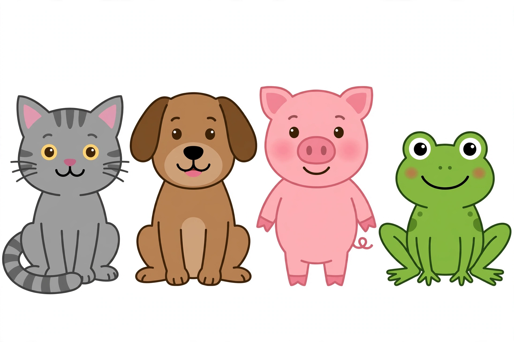

# Practice, Game, and Review Sessions — Unit 03

Each session is 15–20 minutes. All responses may be oral, pointing, or
drawing, adult-scribed, except the writing tasks, which the learner
attempts independently with a crayon or pencil. The adult records which
letters and sounds are secure and which need re-teaching; see the
[teacher guide](teacher-guide.md#re-teach-triggers).

## Session A — Alphabet arc practice (Session 2)

**Purpose:** name uppercase letters A–Z in order, then mixed up
(objective 1; Lesson 01).

1. Walk or point the arc, naming A–Z together with the adult.
2. Walk or point the arc alone, naming A–Z. (Adult supplies a
   stalled letter after a few seconds.)
3. The adult removes five cards from the arc (D, J, Q, T, W) and
   mixes them; the learner names each and puts it back in its place.
4. Speed round: the adult points to letters at random — B, R, Z, E,
   M, X — and the learner names each as fast as they can, without
   worrying about mistakes.
5. The learner names the letter that comes before and after a
   letter the adult points to: before/after M (L, N); before/after
   S (R, T); before/after Z (Y, and "nothing — Z is last").

## Session B — Letter hunt game (Session 3)

**Purpose:** find a named uppercase letter in a mixed pile (objective
1; Lesson 01).

1. The adult scatters all 26 uppercase cards face up. "Find F!"
   The learner finds it and says, "F!" Repeat for A, Z, K, P, U.
2. Timed hunt (gentle, not competitive): "How fast can you find
   M, S, and G?" The adult counts slowly to ten; any finds count.
3. The learner calls the letters and the adult hunts — the learner
   checks the adult's finds ("Yes, that is T!" or "No, that is J!").
4. Missing-letter game: the adult lays out A–Z minus one card
   (first round: minus Q; second round: minus H). The learner names
   the missing letter.
5. The learner picks three favorite letters, names them, and says a
   word that starts with each (any sensible word counts).

## Session C — Uppercase review (Session 4)

**Purpose:** re-check Lesson 01's exit items and re-teach the weakest
letters (objective 1).

1. Mixed-up naming: P, A, X, L, U, R, Z, C (Lesson 01 exit check,
   extended).
2. "How many letters are in the alphabet?" (26.) "What is the first
   letter?" (A.) "What is the last letter?" (Z.)
3. The adult names the letters the learner missed in Sessions 2–3
   and drills just those, in groups of three, three times each.
4. Alphabet arc walk, alone, A–Z, with the adult noting any letter
   still missed.
5. Celebration round: the learner names their five hardest letters
   from the week correctly, one at a time, with applause after each.

## Session D — Pair-match practice (Session 6)

**Purpose:** match each lowercase card to its uppercase partner
(objective 2; Lesson 02).

1. Match A–M lowercase to uppercase partners on the arc, left to
   right.
2. Match N–Z lowercase to uppercase partners on the arc, left to
   right.
3. Mixed pile: the adult hands the learner lowercase cards one at a
   time — g, r, y, e, t — and the learner places each on its partner.
4. The adult points to an uppercase letter and the learner holds up
   its lowercase partner: B, K, W, D, H.
5. The learner checks the adult's deliberate mistakes: the adult
   pairs b with D and k with T; the learner fixes both ("b goes
   with B, not D!").

## Session E — Tricky-pair game (Session 7)

**Purpose:** tell b from d and p from q by belly and stick
(objective 2; Lesson 02).

1. Belly-and-stick drill: the adult shows b and d in random order,
   six times each; the learner names each, saying the rule first
   ("stick first — b" or "belly first — d").
2. Same drill for p and q, four times each: the learner names each
   and says one way it differs from its partner.
3. Sorting race (gentle): the adult deals twelve cards (three each
   of b, d, p, q) face up; the learner sorts them into four piles,
   saying each name as it lands.
4. The adult writes b, d, p, q on paper in a random order; the
   learner circles the b's (three of them, mixed among the others).
5. Story round: the learner tells a one-sentence story using a b
   word and a d word ("The big dog bit the ball") — any sensible
   sentence counts; the adult scribes it.

## Session F — Case review (Session 8)

**Purpose:** re-check Lessons 01–02 and re-teach the weakest
letters and pairs (objectives 1–2).

1. Mixed-up lowercase naming: a, m, g, s, q, z, r, w.
2. Mixed-up uppercase naming: C, U, Y, F, N, J.
3. Partner round: the adult shows uppercase R, L, E, V and the
   learner holds up r, l, e, v.
4. Tricky-pair check: d, b, q, p, b, d (Lesson 02 independent
   practice task 4, repeated).
5. The adult re-drills only the letters missed in tasks 1–4, then
   the learner re-takes those items once.

## Session G — Sound-sort practice (Session 10)

**Purpose:** sort pictures by first sound, using the generated
illustration (objectives 3 and 5; Lessons 03–04).

Show the generated illustration
[`assets/sound-sort-animals.png`](assets/sound-sort-animals.png):

*Caption: The four sound-sort animals, left to right: cat, dog, pig,
frog. Used in the sort below; the text-only alternative follows.*

**Text-only alternative:** the picture shows four animals in a row,
left to right: a gray cat, a brown dog, a pink pig, a green frog.
Every question in this session can be answered from this sentence
alone, without seeing the picture.

1. Name the four animals left to right: cat, dog, pig, frog.
2. Say the first sound of each: *cat* — /k/; *dog* — /d/; *pig* —
   /p/; *frog* — /f/.
3. Match each animal to its letter: cat — C (also K says /k/; C is
   the answer here because *cat* is spelled with C); dog — D;
   pig — P; frog — F.
4. Lip-sound find: "Which animal starts with a sound made with
   the lips?" (Pig — /p/ is a lip pop; cat /k/, dog /d/, and frog
   /f/ are not made with the lips. Only pig qualifies, and the
   adult says so plainly rather than forcing a pair.)
5. The learner picks an animal, says its first sound and letter, and
   thinks of one more word with the same first sound (cat — cake;
   dog — door; pig — pie; frog — fish — any sensible word counts).

## Session H — Re-teach session (Session 12)

**Purpose:** re-teach the highest-need objective from Sessions 1–11
(see the [teacher guide](teacher-guide.md#re-teach-triggers)).

The adult picks one of these, based on the week's notes, and runs it
for the full session:

- **If uppercase naming is weakest:** repeat Session A tasks 2–3
  with only the missed letters, then the arc walk.
- **If lowercase naming or pairs are weakest:** repeat Session D
  tasks 1–3 with only the missed pairs, then Session E task 1.
- **If consonant sounds A–M are weakest:** repeat Lesson 03 guided
  practice tasks 1–3 with the mirror, then Session G tasks 2–3.
- **If nothing is weak:** run Lesson 05 early (short vowels) as
  enrichment, and use the extra time for the project.

## Session I — Review week (Session 14, second half)

**Purpose:** after Lesson 06 and the project, re-check the whole
unit before the quiz (objectives 1–5).

1. Alphabet sprint: name A–Z uppercase mixed up (ten cards: A, C,
   F, J, M, P, R, U, W, Z) and a–z lowercase mixed up (ten cards:
   b, e, g, k, n, q, s, t, x, y).
2. Sound sprint: say the sound for B, S, Q, Z, V, R, N, X.
3. Vowel sprint: say the short sound and the long sound for A, E,
   I, O, U (adult names "short" or "long" before each).
4. Writing sprint: the adult dictates /m/, /a/ (short), /t/, /o/
   (short), /s/; the learner writes the letter for each.
5. The learner names the one letter or sound they still find
   hardest, and the adult drills just that one, three times, with
   praise for each correct try.
