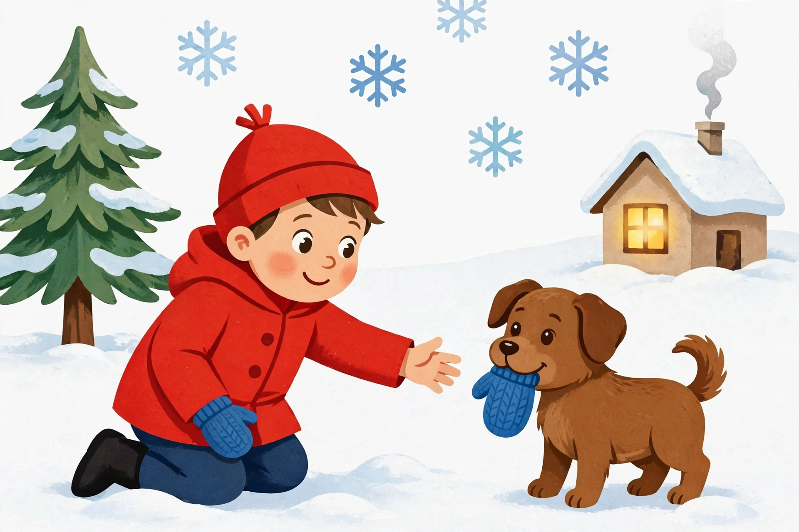

# Lesson 04 — Retell with Key Details

**Goal (learner hears):** "I can tell a story back in order, with
the important parts."
**Time:** 15–20 minutes · **Materials:** the story *Milo and the
Lost Mitten* (Lesson 01 text), the generated illustration
[`../assets/milo-lost-mitten.png`](../assets/milo-lost-mitten.png)
shown on a screen or printed large, a blue mitten or paper mitten,
a stuffed animal or toy dog, the three Milo sequence cards from
Lesson 03.
**Standards:** RL.K.2; RL.K.3; SL.K.4 (describe with detail, with
prompting and support — used here for the retelling's detail).

## Readiness check (1–2 min)

Show the three sequence cards in order. Ask the learner to say one
sentence for each card. Then: "Today you tell the whole story
yourself. I will not read it first. You can use the cards, the
picture, and the props to help you remember."

## Explicit teaching

A good retelling has four parts. Show four fingers as you name them:

1. **Who and where** — who the story is about, and where it happens.
2. **First** — what happened at the beginning.
3. **Next** — what happened in the middle.
4. **Last** — how it ended.

And a good retelling keeps the **key details** and leaves out the
rest. Key details for Milo's story are: Milo, Biscuit, the snowy
path to Grandma's house, the blue mitten falling off, Biscuit
bringing it back, Milo saying thank you. The red hat is not key —
you can tell the whole story without it, and a good reteller does
not need it.

You do not have to use the story's exact words. Retelling in your
own words is *better* — it proves you understood, not just
memorized. If you forget a part, look at the cards or the picture.
Pictures are memory helpers, not cheating.

### Modeled example 1 — the adult retells, thinking aloud about choices

*Adult retells Milo's story in their own words, pausing to think aloud:*

"First, Milo and his dog Biscuit were walking in the snow to
Grandma's house. *(I started with who and where.)* Next, Milo's
blue mitten fell off in the snow, and Biscuit picked it up in her
mouth. *(That is the middle — the problem and the help.)* Last,
Biscuit brought the mitten back, Milo said thank you, and they
walked on. *(That is the ending.)* I did not say the hat was red.
The story works fine without it — so I left it out."

### Modeled example 2 — retelling from the picture

*Adult shows the generated illustration and thinks aloud:*

"Look at this picture. What moment is this? Milo is kneeling in the
snow, reaching out. Biscuit is holding a blue mitten in her mouth.
Milo already has one blue mitten on his hand. So this picture shows
the **last** part — Biscuit bringing the mitten back. If I only had
this picture, I could still guess the middle: a mitten must have
fallen off, or Biscuit would not be carrying one. Pictures tell
parts of the story even when no one reads the words."

*Caption: Biscuit brings Milo's lost blue mitten back on the snowy
path. This is the story's last event.*

*Text-only alternative: A child in a red coat and red hat kneels in
the snow, reaching toward a small brown dog. The dog holds a blue
mitten in its mouth. The child wears one blue mitten on the other
hand. A pine tree stands on the left, a small house with a warm
window stands on the right, and snowflakes fall. Every question in
this lesson about the picture can be answered from this paragraph
alone.*

## Guided practice (adult does it with the learner; 5 tasks)

1. With the three sequence cards in order in front of them, the
   learner retells Milo's story, one sentence per card. The adult
   prompts only with "And then?" or "What happened next?"
2. The learner retells Milo's story again, this time holding the
   blue mitten prop and giving it to the toy dog at the right
   moment, then taking it back. (Acting the key events.)
3. The learner looks at the generated illustration and answers:
   "What moment does this picture show? How do you know?" (The
   last event — Biscuit returning the mitten; the dog holds it, and
   Milo reaches for it.)
4. The adult asks: "What is one key detail you must not leave out?"
   (Any of: Milo, Biscuit, the mitten falling, Biscuit bringing it
   back.) "What is one detail you can leave out?" (Hat color, coat
   color, the snowflakes.)
5. The learner retells Milo's story a third time with the cards
   face down — from memory — while the adult listens and notes
   which key details appear.

## Independent practice (learner tries; adult observes, 5 tasks)

1. Retell Milo's story from memory, beginning to end, in order.
   (Adult notes: who, where, first, next, last present?)
2. "Who was in the story, and where did it happen?" (Milo and
   Biscuit; the snowy path to Grandma's house.)
3. "Tell me the middle of the story in one sentence." (The mitten
   fell off and Biscuit picked it up.)
4. Look at the illustration: "What is Biscuit doing? What will
   Milo do next?" (Holding the mitten in her mouth / bringing it
   back; Milo will take it and say thank you.)
5. "Tell the story to your stuffed animal" — the learner retells
   Milo to a toy listener, with no adult prompts. (This is the
   closest rehearsal to the assessment's unaided retell.)

## Application

"Retell switch." The learner retells Milo's story, but the adult
starts it wrong on purpose: "First, Biscuit lost her mitten..."
The learner stops the adult, corrects the error ("No! Milo lost
the mitten!"), and retells correctly. Catching someone else's
retelling error proves the learner owns the story, not just the
script.

## Exit check

1. Retell Milo's story in order, with at least 2 of the 3 major
   events and the characters named. (Secure = all 3 events, in
   order, characters and setting named; nearly there = 2 events in
   order.)
2. "What does the picture show?" (Biscuit bringing the lost mitten
   back to Milo.)
3. "Name one key detail and one detail you can leave out." (Key:
   the mitten falling / Biscuit bringing it back. Leave out: hat
   color, coat color.)

## Supports and extension

- **Language access:** the four-finger retell frame (who/where,
  first, next, last) stays visible; the learner may retell in their
  home language first, then in English with the adult's help.
- **Alternate response mode:** act the whole story with props
  without speaking, then add one spoken sentence per event; or
  draw the three events and point through them while the adult
  narrates.
- **Seated-table variant:** cards and props on the table; the
  learner moves the mitten prop along the card row as they tell.
- **Floor-play variant:** the learner walks the tape "snowy path"
  and acts each event at a marked spot.
- **Extension:** the learner retells Milo's story from Biscuit's
  point of view ("First I saw something blue in the snow...") — a
  first step toward understanding that the same events can be told
  by different characters.

## Teacher note — misconceptions

Watch for three retelling traps. (1) *Listing:* "Milo, Biscuit,
snow, mitten, Grandma" — names without events. Prompt: "What
*happened*?" (2) *Ending-only:* the learner tells only the last
event because it is freshest. Restart with the cards face up. (3)
*Word-perfect recitation:* the learner repeats the adult's exact
sentences. Praise it, then ask for it "in your own words" — the
unit's goal is understanding, and paraphrase is the evidence. Never
penalize a retelling that changes unimportant details (a green hat
instead of red) — that is a sign of ownership, not error.

**Answer-key reference:** [answer-key.md](../answer-key.md#lesson-04).
