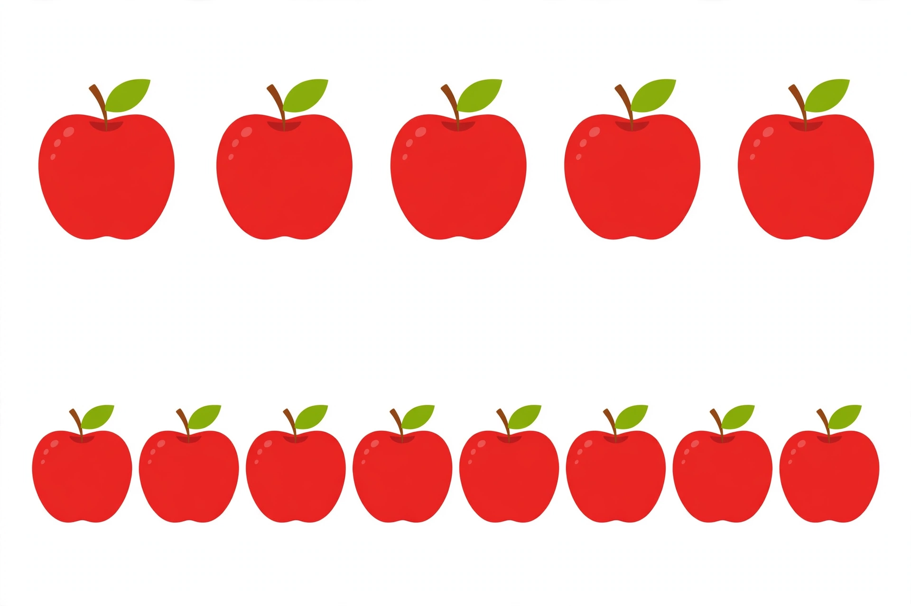

# Lesson 05 — Greater, Less, Equal in a Picture

**Student goal:** I can count the apples in a picture, compare the two
rows, and say which row is greater, which is less — using the picture
as my evidence.
**Time:** 15–20 minutes · **Unit:** [U03](../README.md) · **Session 12 of 16**
**Objectives:** 2, 3, 5 (picture comparison; making equal)

## Materials

- The unit's generated picture:
  [two rows of apples](../assets/two-rows-apples-5-and-8.png) (print it
  large, or show it on a screen the learner can point at)
- Counters for the make-equal step, numeral cards 5 and 8

## Readiness check (1 minute)

"Compare 5 and 8 as numerals: which is greater? Which is less?" If the
learner answers (Lesson 03: 8 greater, 5 less), proceed. If not, point
to 5 and 8 on the number line together first.

## Teaching

Today our groups live in a picture — we cannot touch the apples or
move them. So we count with our eyes and our pointing finger, one apple
at a time, top to bottom, left to right. Counting carefully *is*
touching, with our eyes.

Then we use our comparison words for numbers: **greater than**,
**less than**, **equal to**. "The bottom row is greater than the top
row" is a claim — and our counts are the evidence.

Look at the picture together now (caption read aloud by the adult):

> 
>
> *Caption: "An AI-generated picture of two rows of red apples. Count
> each row, then compare: which row has more apples?"*

**Text-only alternative** (the activity works fully without the
picture): "Top row: 5 red apples. Bottom row: 8 red apples. Count each
row, then compare: which row has more?"

## Worked example 1 — count the top row

> "Point to each top apple with me: 1, 2, 3, 4, 5 — **five** apples on
> top. Now the bottom row: 1, 2, 3, 4, 5, 6, 7, 8 — **eight** apples on
> the bottom. Five and eight. Eight is greater than five. So the bottom
> row has **more** apples. Five is less than eight, so the top row has
> **fewer**."

**Reasoning to name aloud:** we counted both rows before deciding —
count first, compare second, every time, even in a picture.

## Worked example 2 — make them equal

> "The rows are not equal: 5 and 8. How can we make them equal? Add
> apples to the top row until it has 8 too: 5… 6, 7, 8 — add **3** apples
> (real counters placed under the picture, or drawn). Now both rows
> have 8. **8 is equal to 8.** Or take apples away from the bottom row:
> 8… 7, 6, 5 — take **3** away, and both rows have 5. Either way works!
> Equal means the same number, however you get there."

**Reasoning to name aloud:** equal is something you can *make*, not
just something you find. Adding to the smaller side or taking from the
bigger side both work — and the amount (3) is the same both ways here.

## Guided practice (adult stays close, hints allowed)

Do 4–6 short rounds. The first two use the picture; the rest use
counters or drawings.

1. Picture round: "Count the top row again, slowly. Count the bottom
   row. Which row is greater? Say it: '8 is greater than 5.'"
   *Hint: "Point to each apple once — no skipping, no double-counting."*
2. Picture round, reversed question: "Which row is less?" (top row —
   5 is less than 8.)
3. "Cover the bottom row with your hand. If the top row has 5, how many
   apples do I add to make 8?" (3 — count on: 6, 7, 8.)
4. Counters: build 4 and 9. "Compare them. Now make them equal by adding
   to the smaller group." (add 5 to the 4-group → 9 = 9)
5. Counters: build 7 and 7. "Are they equal already? How do you know?"
   (same count, no adding or taking needed)
6. Drawing round: the learner draws two rows of dots (3 and 6), counts
   them back, and announces: "6 is greater than 3. 3 is less than 6."

## Independent practice

Three picture/dot tasks (adult-drawn): rows of (2, 2), (10, 4),
(6, 9). For each, the learner counts both rows, says which is greater
and which is less (or "they are equal"), and — for the unequal pairs —
says how many to add to the smaller row to make them equal (0 for the
equal pair; 6 for 10 vs. 4; 3 for 6 vs. 9). The adult scribes the
answers.

## Application

Lunchbox comparison: two snack groups (real or drawn) — e.g., 5 grapes
and 8 crackers. "Which snack has more? Which has fewer? Make them equal
by eating some of the bigger group — how many must you eat?" (3 — and
yes, eating the evidence is allowed and memorable.)

## Exit check

Picture only, no counters: "Count the top row of apples. Count the
bottom row. Which row is greater? How many apples would you add to the
top row to make the rows equal?" Correct: top 5, bottom 8, bottom
greater, add 3. All four parts must be right (re-count together if the
learner miscounts — a counting slip is not a comparison failure).

## Supports

- **Point-and-mark:** the learner puts a dot sticker (or a finger dot)
  on each counted apple so none is counted twice.
- **Row-by-row:** cover one row while counting the other; uncovered
  rows distract young counters.
- **Color is not a cue:** both rows are red on purpose — the comparison
  is by count, never by color.
- **Text alternative first:** if the picture is hard to see, use the
  text-only alternative ("5 apples, 8 apples") and real counters — the
  learning goal is identical.

## Extension

"Draw your own two rows: one with 7 dots, one with 10 dots. Compare
them in a full sentence, then make them equal two ways — by adding and
by taking away. How many dots move each way?" (add 3; take away 3.)

## Teacher note

Likely misconception: answering from row length ("the top row looks
longer because its apples are bigger") instead of counting. The
picture is designed to trap this: the top apples are drawn larger, but
there are fewer of them. Always re-count when the answer comes from
looks. Image record:
[assets/README.md](../assets/README.md). Answer key:
[answer-key.md](../answer-key.md#lesson-05).
