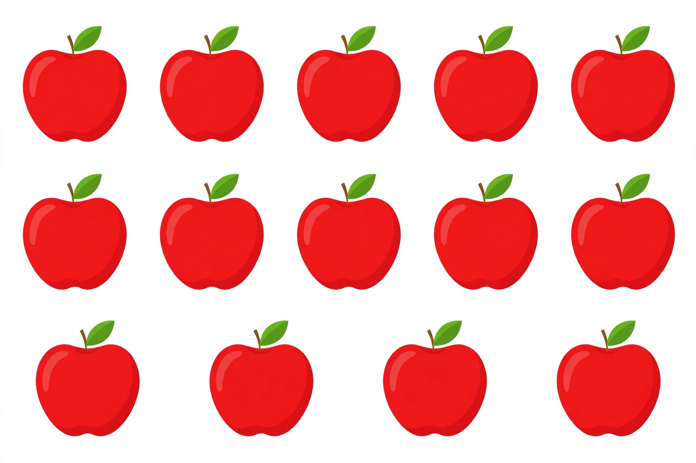

# Lesson 05 — Ten and Four in a Picture

**Student goal:** I can count a picture in ten-and-some-more groups
and find the partner that makes 10.
**Time:** 15–20 minutes · **Unit:** [U04](../README.md) · **Session 12 of 16**
**Objectives:** 1, 3, 5 (ten-frame counting; teen decomposition;
partners that make 10, intro)

## Materials

- The unit's generated picture:
  [ten and four apples](../assets/ten-and-four-apples.png)
- Two ten-frame mats, 20 counters in two colors

## Readiness check (1 minute)

"Build 14." (Frame + 4 extras; "ten and four more make fourteen.")
"Write 14." If both are quick (Lessons 02 and 04), proceed. If the
build or the numeral wobbles, replay one guided round from Lesson 02
before opening the picture.

## Teaching

Today the picture does the teaching. Look at it together — do not
count yet. Ask: "What do you see? How are the apples arranged?" The
learner should notice rows: a top row, a middle row, and a bottom row.

Now count the smart way — in ten-and-some-more groups, not one by one
from the start:

- Top row: 5 apples.
- Middle row: 5 apples.
- Five and five make ten! The top two rows together are one ten.
- Bottom row: 4 apples — the extras.
- **Ten and four more make fourteen.** The picture shows 14 apples.

Say it like a sentence every time: "Ten and four more make fourteen."

Then the second idea of the day: **partners that make 10**. Look at
one ten frame with 7 counters in it. How many empty boxes? Three.
Seven counters and three empty boxes fill the frame: **7 + 3 = 10**.
Seven and three are partners that make 10 — they belong together, like
two puzzle pieces that complete the frame. Every number from 1 to 9
has exactly one partner that makes 10: 1 needs 9, 2 needs 8, 3 needs 7,
4 needs 6, 5 needs 5, 6 needs 4, 7 needs 3, 8 needs 2, 9 needs 1.

## The picture

*Caption: An AI-generated picture of red apples in rows. Count the
rows the smart way: how many make a ten, and how many more are there?*

Text-only alternative (all the information the activities need, so
the lesson works without the image): "Top row: 5 red apples. Middle
row: 5 red apples. Bottom row: 4 red apples. The top two rows together
make 10 apples. The bottom row adds 4 more. Ten and four more make 14
apples in all."

## Worked example 1 — counting the picture the smart way

The adult points row by row while the learner counts:

> "Top row: one, two, three, four, five. Middle row: one, two, three,
> four, five. Five and five make ten — cover the top two rows with
> your hands: that is our ten. Now the bottom row: one, two, three,
> four. Ten and four more make fourteen! There are 14 apples. We did
> not count to 14 one by one — we used the ten."

**Reasoning to name aloud:** grouping into a ten first is faster and
less error-prone than counting fourteen single things. The rows are
the grouping.

## Worked example 2 — partners that make 10

The adult fills a ten frame with 6 counters (top row 5, bottom row 1)
and asks: "How many empty boxes?"

> "Count the empty boxes: one, two, three, four. Six counters, four
> empty boxes — six and four make ten! 6 + 4 = 10. Six and four are
> partners. Now you try: I put in 8 counters. How many empty boxes?
> Two! Eight and two make ten. Partners again."

**Reasoning to name aloud:** empty boxes are not "nothing" — they are
the partner. Partners that make 10 will make addition stories much
easier in Unit 05, because a full frame is a friendly number to work
with.

## Guided practice (adult stays close, hints allowed)

Do 4–6 short rounds, mixing picture questions and frame partners.

1. Picture: "How many apples in the top two rows?" *(10.)* "How many
   in the bottom row?" *(4.)* "How many in all?" *(14.)*
2. Picture: "If we ate the bottom row of 4 apples, how many would be
   left?" *(10 — the top two rows.)*
3. Frame partners: frame with 4 counters — "How many empty boxes?
   What is 4's partner?" *(6 empty; 4 + 6 = 10.)*
4. Frame partners: frame with 9 counters — "How many empty boxes?
   What is 9's partner?" *(1 empty; 9 + 1 = 10.)*
5. Frame partners: frame with 5 counters — "How many empty boxes?
   What is 5's partner?" *(5 empty; 5 + 5 = 10 — its own partner!)*
6. Error-watch round: the adult counts the picture one by one and
   "gets" 13 by skipping a middle-row apple. The learner re-counts by
   rows and corrects: "No — five and five make ten, and four more
   make fourteen." *(Praise the row-count correction.)*

## Independent practice (adult watches, no hints)

The learner answers three picture questions alone (pointing allowed):
"How many apples in the top row? In the middle row? In the bottom
row?" Then: "Ten and how many more make 14?" Finally, the learner
builds a frame with 3 counters and says its partner ("3 and 7 make
10").

## Application

"Apple boxes": "A farmer packs apples in rows of 5. She has filled two
rows (ten apples) and started a third row with 4 apples. How many
apples has she packed? Write the number." (14; the learner may draw
the rows or use the picture.)

## Exit check

Show the picture. "How many apples in all, and how do you know?"
(14 — "five and five make ten, and four more make fourteen.") Then a
frame with 7 counters: "What is 7's partner that makes 10?" (3.)
Both right = ready for the Teen Market project.

## Supports and extensions

- **Support:** cover rows with paper as each is counted, so only one
  row is visible at a time; use the text-only alternative for learners
  who cannot see the picture well.
- **Alternate response mode:** point to each row and hold up fingers
  for its count; adult scribes the sentence "10 + 4 = 14."
- **Extension:** "How many apples would there be with a fourth row of
  5?" (19 — ten and nine more. Or: 14 + 5 = 19, counted as ten + 9.)

## Teacher note

Likely misconceptions: (1) counting the picture one by one and losing
track past 10 — redirect to rows, not to speed; (2) thinking the
partner is "however many counters are in the frame" rather than the
empty boxes — always point at the empty boxes and say "these are the
missing part." The picture's apples are drawn the same size in all
three rows on purpose: unlike Unit 03's picture, size is not a trap
here — grouping is the lesson.
Answer-key reference: [answer-key.md](../answer-key.md#lesson-05).
