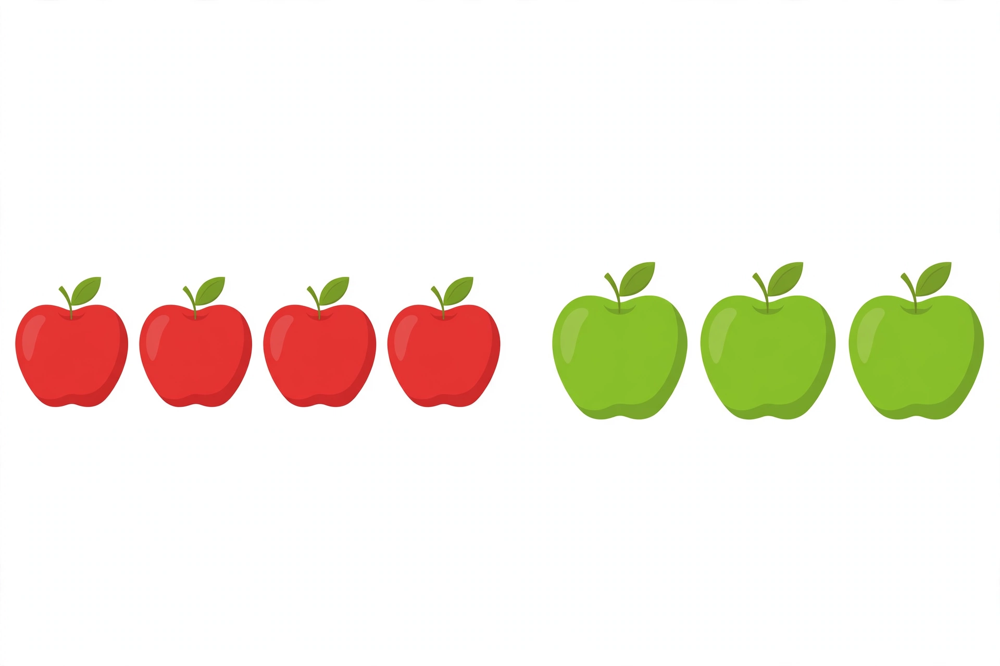

# Formative Quiz — Unit 05, Week 22 (Session 15)

**Format:** adult-led, oral/manipulative/drawing responses, about 15
minutes. The adult reads every item aloud. The learner may use
counters, a ten frame, or drawings for any item. Solutions are in the
[answer key](../answer-key.md), never on this page.

**Scoring note (adult only):** 6 of 8 items correct, with the parts
and the total both shown, signals readiness for Unit 06 (subtraction
stories). Items 6–7 check Objective 5; if either is missed, revisit
Lesson 05 before moving on, even if the total score is 6 or higher.

1. Look at the picture: 4 red apples and 3 green apples.
   
   *Caption: "An AI-generated picture of apples: 4 red apples and
   3 green apples. How many apples altogether?"*
   How many apples altogether? Say the sentence.
   Text-only alternative: "Left group: 4 red apples. Right group:
   3 green apples. How many apples altogether?"
2. 5 ducks swim on a pond. 2 more ducks join them. How many ducks
   are on the pond now?
3. The adult writes `3 + 2 = 5`. Make up a story for this sentence,
   act it out, and check by counting all.
4. 6 spoons are in a drawer. 3 more spoons are put in. How many
   spoons are in the drawer now?
5. 1 red balloon and 7 blue balloons float up together. How many
   balloons are there in all?
6. Show 5 counters split into two parts in one way, and say the
   sentence. Then split the same 5 counters a different way, and say
   that sentence too.
7. Show the doubles split of 6. Say the sentence.
8. Error hunt: the adult acts out "4 pencils and 4 pencils" and
   counts "1, 2, 3, 4, 5, 6, 7" and claims the total is 7. Is that
   right? Count carefully yourself and say the correct sentence.
