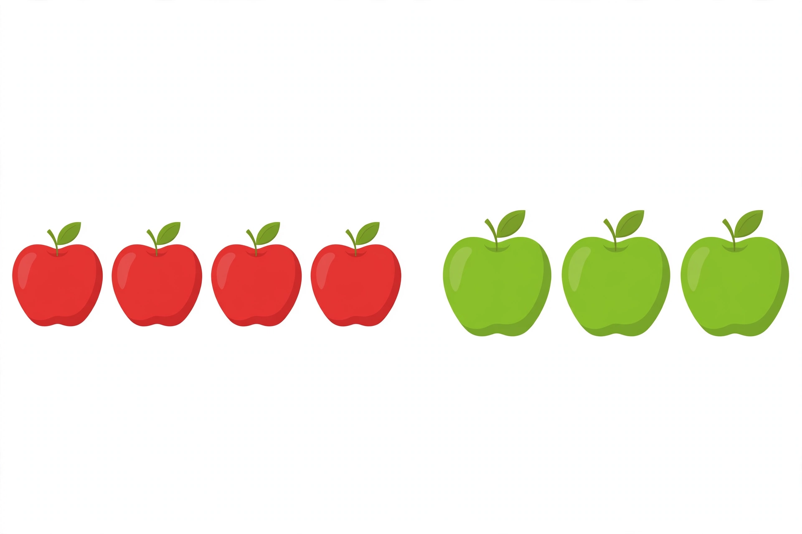

# Lesson 01 — Putting Together: Two Groups Join Into One

**Goal (read aloud):** "I can act out a putting-together story and say
how many there are altogether."
**Time:** 15–20 minutes · **Materials:** 20 counters, a tray with two
areas, paper and crayons

## Readiness check (2 minutes)

Adult: "Show me 4 counters. Now show me 3 more counters, in a second
group. How many counters did you show in all?" (The learner counts
all: 7.) If the learner cannot yet count out 4 and 3, spend this
lesson with totals of 5 or below and revisit Unit 02 counting first.

## Teaching (5 minutes)

Addition starts with a story, not a symbol. A **putting-together**
story has two groups that join into one big group, and the question
is always the same: **how many altogether?**

Say it slowly while you act it: "There are 3 birds on a branch. Then
2 more birds fly over and sit with them. Now they are all together.
How many birds altogether?" The two groups are 3 and 2. Push them
together, touch each bird as you count — 1, 2, 3, 4, 5 — and say:
"3 birds and 2 birds — 5 birds altogether."

Two rules for every story in this unit:

1. **Show both parts first.** Keep the two groups apart until you
   have counted each one.
2. **Count all to check.** Push the groups together and count from 1
   to the total, touching each object. The counted total is the
   answer, not a guess.

The word **altogether** means "all of them, counted together." The
word **join** means "come together into one group."

## Worked example 1 — Birds on a branch

Adult acts it out with counters while telling the story: "3 birds sit
on a branch. 2 more birds fly over and join them. How many birds
altogether?"

- First group: count — 1, 2, 3. (3 birds.)
- Second group: count — 1, 2. (2 birds.)
- Push them together and count all, touching each one — 1, 2, 3, 4,
  5. (5 birds.)
- Say it: "3 birds and 2 birds — 5 birds altogether."

Point out: we counted the first group (3), then the second group (2),
and then we counted *all* of them (5). The last number we say when
counting all is the total.

## Worked example 2 — Apples in a basket

Show the unit picture:

*Caption: "An AI-generated picture of apples: 4 red apples and
3 green apples. How many apples altogether?"*

Adult: "Mia picks 4 red apples. Then she picks 3 green apples. She
puts them all in one basket. How many apples altogether?"

- Red group: count — 1, 2, 3, 4. (4 red apples.)
- Green group: count — 1, 2, 3. (3 green apples.)
- Count all, left to right, touching each apple in the picture — 1,
  2, 3, 4, 5, 6, 7. (7 apples.)
- Say it: "4 red apples and 3 green apples — 7 apples altogether."

Text-only alternative (same counts, no picture needed): "Left group:
4 red apples. Right group: 3 green apples. Count each group, then
count all: 7 apples altogether."

Point out: the apples are different colors, but color does not change
the count. Red or green, each apple counts as one.

## Guided practice (adult leads; learner acts and counts)

Do each story with counters. The adult tells the story; the learner
builds the two groups, pushes them together, counts all, and says the
sentence. (Solutions are in the [answer key](../answer-key.md).)

1. "2 toy cars are on the rug. 2 more cars roll over to join them.
   How many cars altogether?"
2. "4 strawberries are in a bowl. 1 more strawberry is added. How
   many strawberries altogether?"
3. "3 blocks are in a tower. 3 more blocks join the tower. How many
   blocks altogether?"
4. "1 fish swims in the pond. 4 more fish swim in. How many fish
   altogether?"

## Independent practice

Learner works alone with counters while the adult watches and listens
(no correcting mid-count; note what to reteach):

1. Build a story of your own: pick two groups (each 1–4), put them
   together, and tell the adult the story and the total.
2. Draw a putting-together story: draw one group, draw a second
   group, circle them together, and tell the adult how many
   altogether. (Adult scribes the learner's words under the drawing.)

## Application

Snack-time story (real objects): "You have 2 crackers. The adult
gives you 3 more crackers. Act it out with the crackers, count all,
and say how many crackers you have altogether before eating any."
(If food is not available, use counters and pretend.)

## Exit check

Adult tells one new story, no hints: "5 buttons are in a box. 2 more
buttons go into the box. How many buttons altogether?" The learner
must show two groups, count all, and say the total sentence. This
checks Objective 1.

## Supports and extension

- **Support:** keep totals at 5 or below; use one color of counter;
  let the learner clap once per object while counting.
- **Alternate response:** the learner may point at the picture or
  move counters instead of speaking the whole sentence — the adult
  supplies the missing words and the learner repeats the total.
- **Extension:** "What if 2 more birds joined the 5? Show it and
  count all." (7 birds.) Or: tell the same story backwards — start
  with the total group and split it back into 3 and 2.

## Teacher note

Likely misconception: the learner says the second group's count (2)
or the first group's count (3) as the answer, instead of counting
all. Fix: cover the joined pile and ask "how many in this part? And
in this part? Now push them together and count *all* of them."
Another trap: counting the same object twice when groups are pushed
together in a jumble — line the objects up in a row before the final
count. Full guidance is in the [teacher guide](../teacher-guide.md).
