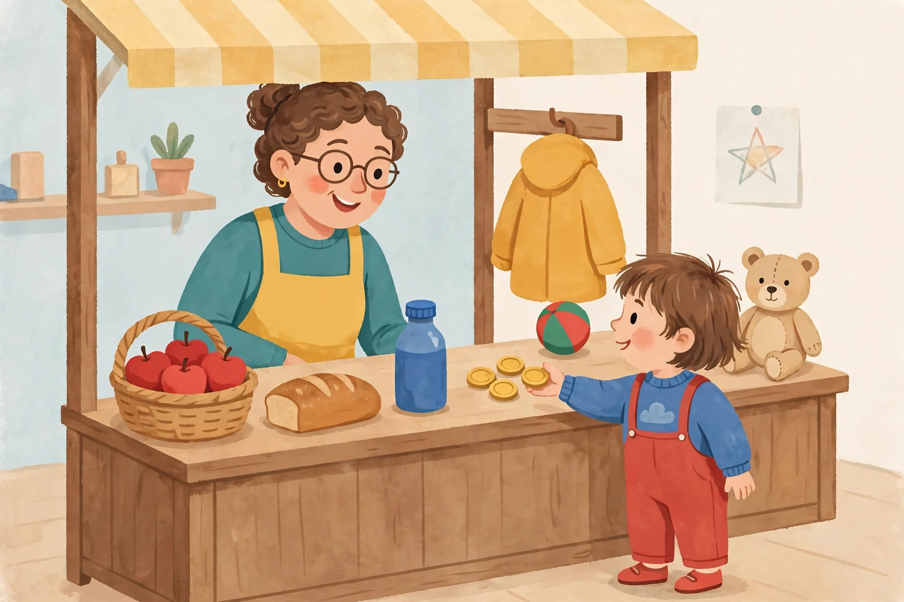

# Lesson 03 — Our Classroom Shop: Work, Money, and Prices

**Student goal:** I can explain that people earn money by working, and I
can buy something in our shop by paying its price in play coins.
**Time:** 15–20 minutes · **Unit:** [U05](../README.md) · **Session 5 of 16**

## Materials

- The generated illustration
  [`assets/classroom-market-stall.png`](../assets/classroom-market-stall.png)
  (printed large or shown on a screen), with its
  [text-only alternative](../assets/README.md)
- The shoebox shop, price cards (picture + coin dots), 5 play coins,
  apple, bread shape, water bottle, ball, teddy bear, toy coat
- The classroom shop price list from the [unit README](../README.md#the-classroom-shop-price-list-used-in-every-lesson-practice-quiz-and-assessment)

**Privacy note for the adult:** this lesson uses play coins only. No real
money is spent, and the learner is never asked about real family shopping
or money. Restate the Unit 01 safety rule at the start: "Names,
addresses, and photos stay private."

## Readiness check (1 minute)

Show the illustration. "Point to the shopkeeper. Point to the child.
What is the child giving the shopkeeper?" (Play coins.) "Today we learn
why the child gives coins, and how the shopkeeper knows how many coins
to take." If the learner is ready to listen and point, begin.

## Teaching

People **earn** money by **working**. Work is a job someone does. The
grocer works in the shop. The baker works making bread. The teacher
works teaching. When people work, they are paid money. Money is the
coins (and paper bills grown-ups use) that we exchange for goods and
services.

A **price** is how many coins something costs. The shopkeeper puts a
price card next to each item: count the coin dots, and you know the
price. Our shop's prices never change in this unit:

- Apple — 1 coin · Bread — 2 coins · Water bottle — 2 coins
- Ball — 3 coins · Teddy bear — 3 coins · Warm coat — 3 coins

An **exchange** is simple: the buyer gives the coins, the shopkeeper
gives the item. Give something, get something. Both sides agree: the
buyer wants the item, the shopkeeper takes the price.

How buying works, step by step: (1) choose an item; (2) count its coin
dots — that is the price; (3) count out that many coins from your purse
of 5; (4) hand them to the shopkeeper; (5) say how many coins are left
in your purse. What a maker needs: the baker needs flour and an oven to
make bread — that is why bread costs 2 coins and not 0. Things cost
coins because someone worked to make them or bring them.

*Caption: An AI-generated picture of our classroom shop. Who is the
shopkeeper? What is the child giving? What needs and wants can you see
on the stall?*

*Text-only alternative: A shopkeeper in a yellow apron stands behind a
wooden market stall with a striped awning. On the stall are a basket of
red apples, a loaf of bread, a blue water bottle, a yellow coat hanging
on a hook, a red-and-green ball, and a teddy bear. A child in red
overalls hands gold play coins to the shopkeeper. Use this description
for every picture question in this lesson — the questions work without
seeing the image.*

## Worked example 1 — buying bread, step by step (modeled)

The adult plays shopkeeper; the learner watches, then repeats the steps.

> "I have 5 coins. I want bread. The bread card has 2 coin dots, so
> bread costs 2 coins. I count out 2 coins — one, two — and hand them
> to the shopkeeper. The shopkeeper gives me the bread. How many coins
> are left in my purse? I had 5, I gave 2, so 5 − 2 = 3 coins are left.
> Bread, 2 coins, 3 left — that is one exchange."

**Reasoning to name aloud:** we counted the dots, not the coins in the
purse. The price tells us how many to give; the purse tells us how many
are left.

## Worked example 2 — buying an apple, and a wrong-price check (modeled)

> "Now I want an apple. The apple card has 1 coin dot, so an apple
> costs 1 coin. I count out 1 coin and hand it over. I had 5 coins, I
> gave 1, so 5 − 1 = 4 coins are left."
>
> "Now — what if I tried to pay 3 coins for the apple? Would the
> shopkeeper take 3?" (Let the learner answer.) "No! The price is 1
> coin. We pay the price — no more, no less. Paying extra does not buy
> a bigger apple."

**Reasoning to name aloud:** a price is an agreement. We pay exactly
the price on the card.

## Guided practice (adult stays close, hints allowed)

Do 4–6 short rounds. Offer choices; never demand a spoken answer.

1. "You have 5 coins. Buy a ball. How many coin dots does the ball
   card have? How many coins do you give? How many are left?" *(3 dots;
   give 3; 5 − 3 = 2 left.)*
2. "You have 5 coins. Buy a water bottle. How many are left?" *(Price
   2; 5 − 2 = 3 left.)*
3. "How does a shopkeeper earn money?" *(By working in the shop —
   selling goods to buyers.)*
4. Error-analysis round: the adult announces, very seriously: "I will
   buy the teddy bear for 1 coin, because 1 is my favorite number!"
   Ask: "Is that right? What does the price card say?" *(Expected: no
   — the teddy bear costs 3 coins. Our favorite number does not change
   the price.)*
5. Picture question (use the illustration or its text alternative):
   "Point to one need on the stall and one want on the stall." *(Needs:
   apples, bread, water bottle, coat. Wants: ball, teddy bear. Any one
   of each counts.)*
6. If the learner is verbal: "Finish the sentence: people earn money
   by ___." *(Working.)*

## Independent practice

The learner plays buyer with 5 coins and buys two items, one at a time,
saying the price and the coins left after each purchase. Suggested pair:
bread (2 → 3 left) then apple (1 → 2 left). The adult plays shopkeeper
and scribes the two exchanges for private storage: "Bought bread for 2,
3 left. Bought apple for 1, 2 left."

*Alternate response mode:* the learner points to the price card's coin
dots and counts coins onto the counter instead of naming numbers, and
shows the coins left by holding up the remaining pile.

## Application

"Tomorrow, notice one person working in our school or neighborhood —
just notice, in your head. Tomorrow, tell me: what work were they
doing?" (In a one-on-one setting, the learner reports back at the next
session. Never ask about a real person's pay.)

## Exit check

The adult sets out 5 coins and the teddy bear card. "Buy the teddy
bear. How many coins do you give? How many are left?" The learner
should give 3 and say 2 are left (words, pointing, or counting the
pile). The adult records: secure / developing / not yet. A second
probe: "How do people earn money?" (By working — any version counts.)

## Supports

- **Language access:** teach each word by action first, word second.
  Mime working, counting coins, handing coins over before saying the
  words. Accept home-language words alongside English.
- **Alternate response mode:** pointing, counting piles, mime, drawing.
- **Floor-play variant:** lay the shop on the floor; the learner
  "walks" to the stall and pays at the counter.
- **Seated-table variant:** do the whole lesson at the table with the
  shoebox shop and coin dots.

## Extension

"What would happen if the shopkeeper gave the bread away for 0 coins
every day?" (The shopkeeper would have no coins to buy flour, and the
baker could not keep making bread. Prices pay for the work and the
things makers need. Accept any version of "the shop would run out."
Preview: Lesson 04 asks what happens when our own coins run out.)

## Teacher note

**Likely misconceptions:** (1) "my favorite number is the price" —
the error-analysis round teaches that the price card, not a preference,
sets the price; (2) "the shopkeeper gets money for free" — re-teach
that the shopkeeper works, and the coins pay for work and materials;
(3) "paying more gets more" — the wrong-price check teaches that the
price is exact.

**Answer-key reference:** [answer-key.md](../answer-key.md#lesson-03) has the
expected responses for the error-analysis round and exit check.
